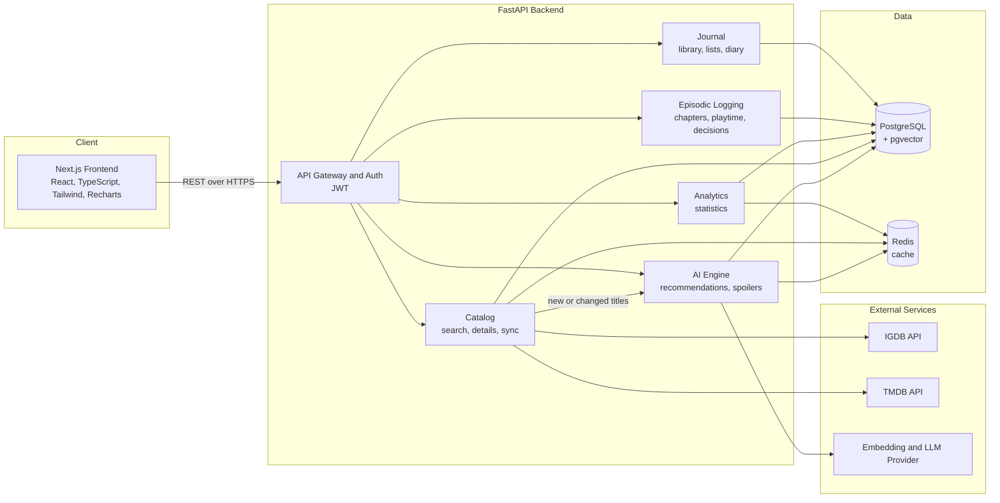

<div align="center">

# OmniLog

One place to track, rate and review your games and TV series, chapter by chapter

CMPE 331 Software Engineering Concepts, Fall 2026-2027

</div>

---

## Features

- Personal library: Add items, set progress status, and rate them.
- Custom lists & history: Organize content your way and view your activity log.
- All in one search: Find games and shows instantly with cached IGDB and TMDB data.
- Episode & chapter tracking: Log playtimes, rate individual chapters, and save choice paths.
- Cross media recommendations: Get show suggestions based on games you play, and vice versa.
- Automatic spoiler shield: Plot-revealing reviews are flagged automatically.
- Insights dashboard: Track genre breakdowns, rating trends, and total playtime stats.

## Architecture



The backend is a single FastAPI application. It is split into modules that match the six epics. The detailed data flow diagrams are in [`docs/analysis/behavior`](docs/analysis/behavior/dfd-level0-1.md).

## Tech stack

| Area | Technologies |
|---|---|
| Backend | Python, FastAPI, SQLAlchemy, Pydantic, Alembic, python-jose, Redis, Docker |
| Database | PostgreSQL (SQLite for quick local development), pgvector |
| Frontend | Next.js, React, TypeScript, Tailwind CSS, Recharts, Lucide React, Axios, React Hook Form |
| AI | LangChain, OpenAI API, Hugging Face models, transformer pipelines |
| External data | IGDB (games), TMDB (movies and series) |
| Testing and CI | pytest, pytest-cov, GitHub Actions |

## Roadmap

Each step builds on the one before. A step is done when its tests pass.

| Step | Goal | Stories |
|---|---|---|
| 0 | Open decisions: database, rating scales, chapter data source, embedding model | - |
| 1 | Infrastructure: Docker Compose, migrations, settings, test database, health check | US-01 |
| 2 | Authentication: register, login, JWT, protected endpoints | US-02, US-03 |
| 3 | Catalog base and library: media tables, add, rate and update titles | US-04, US-05 |
| 4 | Journal: custom lists and activity diary | US-06, US-07 |
| 5 | External catalog: IGDB and TMDB, Redis cache, search, details, sync | US-08, US-09 |
| 6 | Episodic logging: chapter ratings, playtime, decisions | US-10 to US-12 |
| 7 | Analytics: personal statistics | US-15 |
| 8 | AI engine: spoiler detection, embeddings, recommendations | US-13, US-14 |
| 9 | Hardening: non-functional tests, 70% coverage, test report, code freeze | NFR-01 to NFR-05 |

### Milestones

| Deliverable | Deadline |
|---|---|
| Project Charter | 02.10.2026 |
| Requirements Definition Report | 11.10.2026 |
| Requirement Analysis Report | 18.10.2026 |
| Software Design Report | 15.11.2026 |
| Software Testing Report | 22.11.2026 |
| Codebase | 30.11.2026 |

## Project status

The project is in the analysis phase. Requirements, tests and analysis documents are ready. Roadmap step 1 (infrastructure) is in place: Docker Compose services, settings, migrations and a PostgreSQL test database. Only the health endpoint is implemented. The requirement-level tests are written first, so most of them fail on purpose until the features are built.

## Getting started

### Backend

Start PostgreSQL and Redis first (the first start also creates the `omnilog_test` database):

```bash
docker compose up -d
```

Then set up the backend:

```bash
cd backend
cp .env.example .env
# Set SECRET_KEY in .env (at least 32 characters). Generate one with:
python -c "import secrets; print(secrets.token_urlsafe(32))"
python -m venv .venv
source .venv/bin/activate
pip install -r requirements.txt
alembic upgrade head
uvicorn app.main:app --reload
```

The API runs at `http://localhost:8000`. Interactive docs are at `http://localhost:8000/docs`.

`DATABASE_URL` and `SECRET_KEY` are required, and the app stops with a clear error if either is missing. `DATABASE_URL` must point to PostgreSQL and `SECRET_KEY` must be at least 32 characters. The settings are read from `backend/.env` (see `backend/.env.example`).

To create a new migration after changing a model:

```bash
alembic revision --autogenerate -m "describe the change"
```

### Frontend

```bash
cd frontend
npm install
npm run dev
```

The app runs at `http://localhost:3000`.

### Tests

The tests use the separate `omnilog_test` database, so `docker compose up -d` must be running. From the repository root, with the virtual environment active:

```bash
python -m pip install -r tests/requirements-test.txt
python -m pytest tests/requirements -v --tb=short
```

## Documentation

| Document | Location |
|---|---|
| Project Charter | [`docs/CHARTER.md`](docs/CHARTER.md) |
| Requirement Specification | [`docs/requirements/requirements-specification.md`](docs/requirements/requirements-specification.md) |
| User stories | [`docs/requirements/user-stories.md`](docs/requirements/user-stories.md) |
| Project plan (WBS, PERT, Gantt) | [`docs/plan`](docs/plan) |
| Requirement Analysis Report | [`docs/analysis/requirement-analysis-report.md`](docs/analysis/requirement-analysis-report.md) |
| Domain model and E-R diagram | [`docs/analysis/data`](docs/analysis/data) |
| Data flow diagrams | [`docs/analysis/behavior`](docs/analysis/behavior) |
| UI screen list | [`docs/analysis/ui/screen-list.md`](docs/analysis/ui/screen-list.md) |
