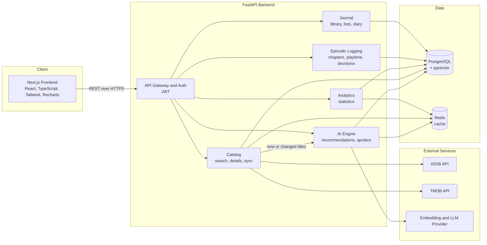

<div align="center">

# OmniLog

One place to track, rate and review your games and TV series, chapter by chapter

CMPE 331 Software Engineering Concepts, Fall 2026-2027

</div>

---

## Features

- Personal library: Add items, set progress status, and rate them.
- Custom lists & history: Organize content your way and view your activity log.
- All in one search: Find games and shows instantly with cached IGDB and TMDB data.
- Episode & chapter tracking: Log playtimes, rate individual chapters, and save choice paths.
- Cross media recommendations: Get show suggestions based on games you play, and vice versa.
- Automatic spoiler shield: Plot-revealing reviews are flagged automatically.
- Insights dashboard: Track genre breakdowns, rating trends, and total playtime stats.

## Architecture



The backend is a single FastAPI application. It is split into modules that match the six epics. The detailed data flow diagrams are in [`docs/analysis/behavior`](docs/analysis/behavior/dfd-level0-1.md).

## Roadmap

Each step builds on the one before. A step is done when its tests pass.

| Step | Goal | Stories |
|---|---|---|
| 0 | Decisions: database (PostgreSQL), rating scales (library 1 to 10, chapters 1 to 5) and chapter data source (seed file) are made. The embedding model is still open | - |
| 1 | Infrastructure: Docker Compose, migrations, settings, test database, health check | US-01 |
| 2 | Authentication: register, login, JWT, protected endpoints | US-02, US-03 |
| 3 | Catalog base and library: media tables, add, rate and update titles | US-04, US-05 |
| 4 | Journal: custom lists and activity diary | US-06, US-07 |
| 5 | External catalog: IGDB and TMDB, Redis cache, search, details, sync | US-08, US-09 |
| 6 | Episodic logging: chapter ratings, playtime, decisions | US-10 to US-12 |
| 7 | Analytics: personal statistics | US-15 |
| 8 | AI engine: spoiler detection, embeddings, recommendations | US-13, US-14 |
| 9 | Hardening: non-functional tests, 70% coverage, test report, code freeze | NFR-01 to NFR-05 |

### Milestones

| Deliverable | Deadline |
|---|---|
| Project Charter | 02.10.2026 |
| Requirements Definition Report | 11.10.2026 |
| Requirement Analysis Report | 18.10.2026 |
| Software Design Report | 15.11.2026 |
| Software Testing Report | 22.11.2026 |
| Codebase | 30.11.2026 |

## Project status

The project is in the analysis phase. Requirements, tests and analysis documents are ready. Roadmap steps 1 to 4 and the stories of step 5 (US-08 and US-09) are in place: Docker Compose services, settings, migrations, a PostgreSQL test database, registration and login with JWT (`POST /auth/register`, `POST /auth/login`), catalog entries (`POST /media`), the library (`GET /library`, `POST /library`, `PATCH /library/{id}`), custom lists and the activity diary (`/lists`, `/diary`) catalog search in IGDB and TMDB (`GET /catalog/search`) title details with seasons, episodes and chapters (`GET /catalog/{id}`) chapter ratings (`PUT /library/{id}/chapters/{chapter_id}/rating`, US-10 of step 6) and playtime per chapter (`POST /library/{id}/chapters/{chapter_id}/playtime`, `GET /library/{id}/chapters/{chapter_id}`, US-11) and personal statistics (`GET /stats`, US-15 of step 7). The manual sync of step 5, decisions (US-12) and recommendations are not implemented yet. The requirement-level tests are written first, so most of them fail on purpose until the features are built.

## Getting started

### Backend

Start PostgreSQL and Redis first (the first start also creates the `omnilog_test` database):

```bash
docker compose up -d
```

Then set up the backend:

```bash
cd backend
cp .env.example .env
# Set SECRET_KEY in .env (at least 32 characters). Generate one with:
python -c "import secrets; print(secrets.token_urlsafe(32))"
python -m venv .venv
source .venv/bin/activate
pip install -r requirements.txt
alembic upgrade head
uvicorn app.main:app --reload
```

The API runs at `http://localhost:8000`. Interactive docs are at `http://localhost:8000/docs`.

`DATABASE_URL` and `SECRET_KEY` are required, and the app stops with a clear error if either is missing. `DATABASE_URL` must point to PostgreSQL and `SECRET_KEY` must be at least 32 characters. `ACCESS_TOKEN_EXPIRE_MINUTES` is optional and defaults to 60. It sets how long a login token stays valid. The settings are read from `backend/.env` (see `backend/.env.example`).

**Catalog search keys.** `GET /catalog/search` needs keys for the outside services: `IGDB_CLIENT_ID` and `IGDB_CLIENT_SECRET` for games (a Twitch application, see the comments in `.env.example`) and `TMDB_API_KEY` for series and movies. A source without keys is turned off and its searches return 503. Search results are cached in Redis (`REDIS_URL`, `CACHE_TTL_SECONDS`). If Redis is down, an in-process cache is used. Never commit real keys.

**Title details.** `GET /catalog/{id}` returns a title with its seasons and episodes (series) or its chapters (games). The seasons of a series are loaded from TMDB the first time the title is opened, then saved in the database and cached in Redis for `DETAILS_CACHE_TTL_SECONDS` (default 24 hours). While TMDB is down, the saved copy is returned, or 503 when the series was never loaded. IGDB has no chapter list, so the chapters of a game are read from the database only. No endpoint creates them. They come from a seed file, described below. The team chose this source (point 3 in [`docs/analysis/data/domain-model.md`](docs/analysis/data/domain-model.md)). Every title has `genres` (names, sorted), and the details answer also has the `description`. Both are loaded from IGDB or TMDB when the details are opened, so a title that was only found in a search has no genres yet. Every chapter and episode in the answer has `decision_points`, each with its `options` (id, label and text), so a client can show the choices of US-12 without another call.

**Chapters and decision points of games.** IGDB has no chapter list and no source has decision points, so they are kept in [`backend/app/seed/game_chapters.json`](backend/app/seed/game_chapters.json) and loaded with:

```bash
cd backend
python -m app.seed                 # the file next to the code
python -m app.seed path/to/other.json
# production: docker compose -f docker-compose.prod.yml exec backend python -m app.seed
```

A game is joined to the catalog by its IGDB id (`external_api_id`). To find it, search the title with `GET /catalog/search?type=GAME` and read `external_api_id` in the result. The file is checked before anything is written, and a file with an error saves nothing. The load is one transaction and can be run again: a row is found by its key (chapter number, position of the decision point, label of the option) and only changed when a value differs. Nothing is ever deleted, because the choices of users point to these rows. Rows that are in the database but not in the file are listed as warnings. A game that a search has already saved keeps its title and poster, and a warning appears when the title in the file is different, which usually means a wrong id. Each decision point needs at least two options with different labels.

The shipped file holds a draft for one game. Its `external_api_id` is `0` on purpose: the command refuses it until the real IGDB id is filled in, and the chapter titles and decisions should be checked against the game first.

**Rating scales.** The team chose two scales (point 2 in [`docs/analysis/data/domain-model.md`](docs/analysis/data/domain-model.md)). A rating of a library entry is a whole number from 1 to 10 (`POST /library`, `PATCH /library/{id}`). A rating of a chapter or episode is a whole number from 1 to 5 (`PUT /library/{id}/chapters/{chapter_id}/rating`). A value outside the range, or a value that is not a JSON number, is refused with 422. Sending `null` for the rating of a library entry in `PATCH` clears it.

**Removal.** This goes beyond the stories of the Charter. `DELETE /library/{id}` removes a title from the library, and the chapter ratings, playtime and decisions that the user logged for it are deleted with it, so a client should ask for confirmation first. `DELETE /lists/{id}/items/{media_item_id}` takes a title out of a list, and `DELETE /lists/{id}` deletes a list with its items. All three answer 204, and 404 when the thing does not exist, is not the user's, or was already removed. Titles are never deleted from the catalog. Each removal adds a diary event (`LIBRARY_REMOVED`, `LIST_ITEM_REMOVED`, `LIST_DELETED`), and the older events stay.

**Statistics.** `GET /stats` needs a token and returns the numbers of the logged-in user's library only: `total_items`, `media_split` (whole percents of `GAME`, `SERIES` and `MOVIE` that add up to 100), `rating_distribution` (the keys `"1"` to `"10"`), `genre_breakdown` (largest first) and `playtime` (`total_minutes` and a `histogram` of the titles in buckets of 5 hours). An empty library gives zeros and an empty list, not an error. The numbers are computed on every request, so a change shows at once. The Redis cache of the design (`omni:stats:{user_id}`) is not built yet.

The tests do not call IGDB or TMDB. They use a fake at the HTTP level (`tests/requirements/fake_external_apis.py`), so no keys are needed. To check the real services once, put real keys in `backend/.env` and run:

```bash
RUN_LIVE_API_TESTS=1 python -m pytest tests/requirements/test_epic3_catalog_live.py -v
```

To create a new migration after changing a model:

```bash
alembic revision --autogenerate -m "describe the change"
```

### Frontend

```bash
cd frontend
npm install
npm run dev
```

The app runs at `http://localhost:3000`.

### Tests

The tests use the separate `omnilog_test` database, so `docker compose up -d` must be running. From the repository root, with the virtual environment active:

```bash
python -m pip install -r tests/requirements-test.txt
python -m pytest tests/requirements -v --tb=short
```

The frontend tests run with Vitest in happy-dom (`cd frontend && npm test`). The settings that keep happy-dom from running code of a page are in `frontend/vitest.config.mts` and are checked by `frontend/tests/security/happy-dom.test.ts`.

### Dependency security

Dependabot opens pull requests for the Python packages, the frontend packages and the GitHub Actions (`.github/dependabot.yml`). Next.js and `eslint-config-next` are pinned to the same exact version and are updated together. The CI job for the frontend runs `npm audit --omit=dev --audit-level=high` and fails on a known high or critical problem in a package that runs in production. Development tools are not part of that check. Vitest 3 and 4 have open advisories that are fixed only in Vitest 5, a major upgrade that is planned as separate work, so `npm audit` (without `--omit=dev`) still lists them.

## Documentation

| Document | Location |
|---|---|
| Project Charter | [`docs/CHARTER.md`](docs/CHARTER.md) |
| Requirement Specification | [`docs/requirements/requirements-specification.md`](docs/requirements/requirements-specification.md) |
| User stories | [`docs/requirements/user-stories.md`](docs/requirements/user-stories.md) |
| Project plan (WBS, PERT, Gantt) | [`docs/plan`](docs/plan) |
| Requirement Analysis Report | [`docs/analysis/requirement-analysis-report.md`](docs/analysis/requirement-analysis-report.md) |
| Domain model and E-R diagram | [`docs/analysis/data`](docs/analysis/data) |
| Data flow diagrams | [`docs/analysis/behavior`](docs/analysis/behavior) |
| UI screen list | [`docs/analysis/ui/screen-list.md`](docs/analysis/ui/screen-list.md) |
