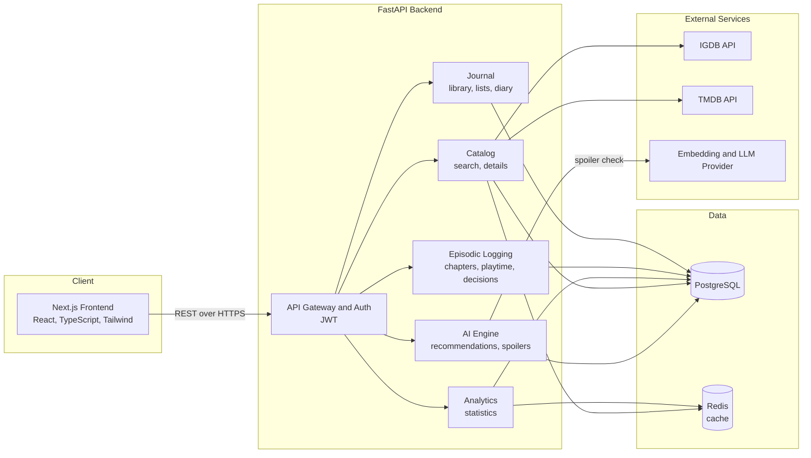

<div align="center">

# OmniLog

One place to track, rate and review your games and TV series, chapter by chapter

CMPE 331 Software Engineering Concepts, Fall 2026-2027

</div>

---

## Features

- Personal library: Add items, set progress status, and rate them.
- Custom lists & history: Organize content your way and view your activity log.
- All in one search: Find games and shows instantly with cached IGDB and TMDB data.
- Episode & chapter tracking: Log playtimes, rate individual chapters, and save choice paths.
- Cross media recommendations: Personalized, embedding-based recommendations for titles you do not own, with a popularity-based fallback.
- Automatic spoiler shield: Plot-revealing reviews are flagged automatically.
- Insights dashboard: Track genre breakdowns, rating trends, and total playtime stats.

## Architecture



The backend is a single FastAPI application. It is split into modules that match the six epics. Title details create or refresh media embeddings using OpenAI when the title has genres or a description. Recommendations use embeddings from positively rated or completed library titles when available, and fall back to popularity-based ranking when needed. The detailed data flow diagrams are in [`docs/analysis/behavior`](docs/analysis/behavior/dfd-level0-1.md).

## Roadmap

Each step builds on the one before. A step is done when its tests pass.

| Step | Goal | Stories | State |
|---|---|---|---|
| 0 | Decisions: database (PostgreSQL), rating scales (library 1 to 10, chapters 1 to 5), chapter data source (seed file) and embedding model (`text-embedding-3-small`, 1536 dimensions, set in `backend/app/core/config.py`) | - | Done |
| 1 | Infrastructure: Docker Compose, migrations, settings, test database, health check | US-01 | Done |
| 2 | Authentication: register, login, JWT, protected endpoints | US-02, US-03 | Done |
| 3 | Catalog base and library: media tables, add, rate and update titles | US-04, US-05 | Done |
| 4 | Journal: custom lists and activity diary | US-06, US-07 | Done |
| 5 | External catalog: IGDB and TMDB, Redis cache, search, details | US-08, US-09 | Done. The manual sync is a command (`python -m app.sync`). There is no sync endpoint and no job log |
| 6 | Episodic logging: chapter ratings, playtime, decisions | US-10 to US-12 | Done |
| 7 | Analytics: personal statistics with a Redis cache | US-15 | Done |
| 8 | AI engine: spoiler detection, embeddings, recommendations | US-13, US-14 | Done. Embeddings are stored in `media_embeddings` and can be backfilled with `python -m app.embeddings`. US-13 uses embedding-based ranking with a popularity fallback |
| 9 | Hardening: non-functional tests, 70% coverage, test report, code freeze | NFR-01 to NFR-05 | Partly done. The NFR tests exist. Coverage is 95.88% for the backend with a CI gate of 90%, and 34.54% of the lines for the frontend with a measured threshold ([coverage](docs/tests/coverage.md)). The [Software Testing Report](docs/tests/software-testing-report.md) is written; the code freeze is not done yet |

### Milestones

| Deliverable | Deadline |
|---|---|
| Project Charter | 02.10.2026 |
| Requirements Definition Report | 11.10.2026 |
| Requirement Analysis Report | 18.10.2026 |
| Software Design Report | 15.11.2026 |
| Software Testing Report | 22.11.2026 |
| Codebase | 30.11.2026 |

## Project status

The backend is built for every story except the parts listed at the end of this paragraph. All six epics have endpoints and tests: registration, login and logout (`POST /auth/register`, `POST /auth/login`, `POST /auth/logout`, `GET /auth/me`), the catalog (`GET /catalog/search`, `GET /catalog/{id}`, and `POST /media`, which is off by default and used only by the tests), the library (`/library`), custom lists and the activity diary (`/lists`, `/diary`), chapter ratings, playtime and decisions (`/library/{id}/chapters/{chapter_id}/...`, US-10 to US-12), personal statistics with a Redis cache (`GET /stats`, US-15), reviews with spoiler detection (`POST` and `GET /library/{id}/review`, US-14) and recommendations (`GET /recommendations`, US-13). The last full local test run (2026-11-26) gave 1145 passed and 4 skipped, with 2 warnings.

"Log out" ends the login token at the backend (`POST /auth/logout`) and then removes the cookie, so a copy of the token stops working at once. Other logins of the same user, for example on another device, keep working until they end after 90 minutes (`ACCESS_TOKEN_EXPIRE_MINUTES`). Tokens from before this change have no `jti` claim and are refused, so everybody logs in once again after the update.

A new password must be at least 8 characters long and must not be a common password, contain the username or the name of the email, be one repeated character or be a simple sequence such as `12345678` (BR-20). Register answers 422 with the reason on the password field. Accounts made before this rule keep their password.

Recommendations use the title embeddings to personalize the ranking. If no usable taste vector exists or the vector search fails, the service falls back to a popularity ranking.

Not built yet:

- The Operator role (`is_admin`), the sync job log, the scheduled sync and the admin endpoints of the design. The manual sync is a command and needs none of them.

The frontend calls the backend from its server code (see [Frontend](#frontend)).

Latest release: [v0.8.0](https://github.com/metezd/OmniLog/releases/tag/v0.8.0) (pre-release, Step 8). The changes of every version are in [`CHANGELOG.md`](CHANGELOG.md), and the next planned releases are `v0.9.0` (Step 9 done) and `v1.0.0` (code freeze, 30.11.2026).

## Getting started

### Backend

Start PostgreSQL and Redis first (the first start also creates the `omnilog_test` database):

```bash
docker compose up -d
```

PostgreSQL listens on `localhost:5432`. If another PostgreSQL on your machine already uses that port, start with `POSTGRES_PORT=5433 docker compose up -d` and use port `5433` in `DATABASE_URL` and `TEST_DATABASE_URL`.

Then set up the backend:

```bash
cd backend
cp .env.example .env
# Set SECRET_KEY in .env (at least 32 characters). Generate one with:
python -c "import secrets; print(secrets.token_urlsafe(32))"
python -m venv .venv
source .venv/bin/activate
pip install --require-hashes -r requirements.txt
alembic upgrade head
uvicorn app.main:app --reload
```

`requirements.txt` is a lock file for Linux and the Python version of the production image (see `backend/requirements.in`). On Windows, or on another Python version, use `pip install -r requirements.in` instead. You then get the newest allowed versions, not the locked ones.

The API runs at `http://localhost:8000`. Interactive docs are at `http://localhost:8000/docs`.

`DATABASE_URL` and `SECRET_KEY` are required, and the app stops with a clear error if either is missing. `DATABASE_URL` must point to PostgreSQL (a URL without a driver, such as the `postgresql://...` that Render gives, is used with psycopg2) and `SECRET_KEY` must be at least 32 characters. `ACCESS_TOKEN_EXPIRE_MINUTES` is optional and defaults to 90. It sets how long a login token stays valid. The settings are read from `backend/.env` (see `backend/.env.example`). Start PostgreSQL before the API. The API uses PostgreSQL only. When `DATABASE_URL` points to this computer and nothing answers there, the API does not start and says `PostgreSQL does not answer at localhost:5432 ... Start it with docker compose up -d`. A remote database (Docker, Render) can start later, so the API starts with a warning, and `/health/ready` answers 503 until the database is there (#371).

**Catalog search keys.** `GET /catalog/search` needs keys for the outside services: `IGDB_CLIENT_ID` and `IGDB_CLIENT_SECRET` for games (a Twitch application, see the comments in `.env.example`) and `TMDB_API_KEY` for series and movies. A source without keys is turned off and its searches return 503. Search results are cached in Redis (`REDIS_URL`, `CACHE_TTL_SECONDS`). If Redis is down, an in-process cache is used. Calls to IGDB and TMDB time out after `EXTERNAL_API_TIMEOUT_SECONDS` and are tried again up to `EXTERNAL_API_MAX_RETRIES` times when they time out or answer 429 or 5xx, with a wait that starts at `EXTERNAL_API_BACKOFF_SECONDS` and doubles (a `Retry-After` header is used when the service sends one). The calls to IGDB are spaced by a limiter (`IGDB_MAX_REQUESTS_PER_SECOND`, default 3, every retry included), so IGDB does not answer 429 for too many requests per second. IGDB queries ask for explicit fields only (never `fields *`), and the manual sync (`python -m app.sync`) loads the details of many games with one query for every 100 games (`where id = (...)`) instead of one request per game. Never commit real keys. **Keyless mode for demos.** Set `IGDB_CLIENT_ID=public` (with any value in `IGDB_CLIENT_SECRET`, because the source counts as set up only when both are filled) to search and load games from the Steam Store instead of IGDB. Set `TMDB_API_KEY=public` to use TVMaze for series and Wikidata for movies instead of TMDB (movies from Wikidata have no poster, because film posters are not free). No keys are needed then, but the ids are the ids of those services (a Steam app id, a TVMaze id, the number of a Wikidata item such as 25188 for `Q25188`), not IGDB or TMDB ids. A database should therefore be filled in one mode only, and the IGDB id of the seed file does not match a game that was saved in the Steam mode.

**Caching in the client.** A successful answer of `GET /catalog/search` and `GET /catalog/{id}` has `Cache-Control: private, max-age=300, stale-while-revalidate=600`: the catalog is the same for everyone, so a client may reuse it for 5 minutes, but a shared cache must not keep it, because the endpoints need a token. Errors and the user's own data (library, lists, diary, statistics) are not cached. Answers of 1000 bytes or more are gzip compressed when the client accepts it (#250).

**Title details.** `GET /catalog/{id}` returns a title with its seasons and episodes (series) or its chapters (games). The seasons of a series are loaded from TMDB the first time the title is opened, then saved in the database and cached in Redis for `DETAILS_CACHE_TTL_SECONDS` (default 24 hours). While TMDB is down, the saved copy is returned, or 503 when the series was never loaded. IGDB has no chapter list, so the chapters of a game are read from the database only. No endpoint creates them. They come from a seed file, described below. The team chose this source (point 3 in [`docs/analysis/data/domain-model.md`](docs/analysis/data/domain-model.md)). Every title has `genres` (names, sorted), and the details answer also has the `description`. Both are loaded from IGDB or TMDB when the details are opened and when the title is added to the library (`ensure_title_details`, a failure there never blocks the addition). A title that was only found in a search has no genres until one of these happens, and the manual sync (`python -m app.sync`) loads them for such titles in bulk. Every chapter and episode in the answer has `decision_points`, each with its `options` (id, label and text), so a client can show the choices of US-12 without another call.

**Chapters and decision points of games.** IGDB has no chapter list and no source has decision points, so they are kept in [`backend/app/seed/game_chapters.json`](backend/app/seed/game_chapters.json) and loaded with:

```bash
cd backend
python -m app.seed                 # the file next to the code
python -m app.seed path/to/other.json
# production: docker compose -f docker-compose.prod.yml exec backend python -m app.seed
```

**Manual sync.** `python -m app.sync` loads the description, genres and (for a series) seasons and episodes of every title that has an outside id and was never synced, for example titles that went from a search into the library without being opened (issue #125). It uses the same load as `GET /catalog/{id}`, so the cache, the retries and the rule that an empty value never replaces a saved one are the same. Titles that are already synced are left alone, and one failing title does not stop the others.

```bash
cd backend
python -m app.sync --dry-run          # only count the titles
python -m app.sync                    # sync all of them
python -m app.sync --type GAME --limit 50
python -m app.sync --id 12 --id 15    # only these catalog ids
# production: docker compose -f docker-compose.prod.yml exec backend python -m app.sync
```

It prints how many titles were selected and synced. A title that the outside service does not know, or that failed while the service was down, stays unsynced and is tried again by the next run. The exit code is 0 when the run finished, 1 when loading raised an error for a title, and 2 for a wrong option.

A game is joined to the catalog by its IGDB id (`external_api_id`). To find it, search the title with `GET /catalog/search?type=GAME` and read `external_api_id` in the result. The file is checked before anything is written, and a file with an error saves nothing. The load is one transaction and can be run again: a row is found by its key (chapter number, position of the decision point, label of the option) and only changed when a value differs. Nothing is ever deleted, because the choices of users point to these rows. Rows that are in the database but not in the file are listed as warnings. A game that a search has already saved keeps its title and poster, and a warning appears when the title in the file is different, which usually means a wrong id. Each decision point needs at least two options with different labels.

The shipped file holds one game: Life is Strange (`external_api_id` 7599), with 5 chapters and 6 decision points. The chapter titles and decisions are written by the team and no data source confirms them, so check them against the game before a demo. The command refuses a game with `external_api_id` 0. To change the content, edit the file and run the command again. To create or refresh embeddings in bulk, run `python -m app.embeddings` from `backend`. The command skips titles without genres and descriptions, and skips embeddings whose source text has not changed.

**Rating scales.** The team chose two scales (point 2 in [`docs/analysis/data/domain-model.md`](docs/analysis/data/domain-model.md)). A rating of a library entry is a whole number from 1 to 10 (`POST /library`, `PATCH /library/{id}`). A rating of a chapter or episode is a whole number from 1 to 5 (`PUT /library/{id}/chapters/{chapter_id}/rating`). A value outside the range, or a value that is not a JSON number, is refused with 422. Sending `null` for the rating of a library entry in `PATCH` clears it.
**Reviews.** `POST /library/{entry_id}/review` creates or updates a review for a library entry owned by the authenticated user. The request body is `{"text": "Your review text"}`. A new review returns 201, and updating an existing review returns 200. Review text must not be blank or longer than 5000 characters (422). Requests without authentication return 401, and entries that do not exist or belong to another user return 404. `GET /library/{entry_id}/review` returns the review, or 404 if no review exists. Posting a review adds a `REVIEW_POSTED` diary event. The spoiler check is described in "Reviews and spoiler detection (US-14)" below.

**Paging of long lists.** `GET /diary`, `GET /library` and `GET /lists` take two optional query parameters: `limit` (1 to 500) and `offset` (0 or more, the number of rows to skip). The default `limit` is 100 for `/diary` and 200 for `/library` and `/lists`, so a client that sends nothing gets a first page and no screen has to change for a user with fewer rows. A `limit` above 500, a `limit` below 1 and a negative `offset` answer 422. The answer stays a plain JSON list, and the order does not change: `/diary` is newest first (ties are ordered by `id`, newest first), `/library` and `/lists` are oldest first. An `offset` after the last row gives an empty list. To read the next page, add the number of rows you got to the `offset`; a page with fewer rows than `limit` is the last one. A client that must show everything reads pages until it gets a short page. The diary has two indexes, `(user_id, created_at DESC)` for this list and `media_item_id` for the delete cascade of a title (migration `0013`).

**Removal.** This goes beyond the stories of the Charter. `DELETE /library/{id}` removes a title from the library, and the chapter ratings, playtime and decisions that the user logged for it are deleted with it, so a client should ask for confirmation first. `DELETE /lists/{id}/items/{media_item_id}` takes a title out of a list, and `DELETE /lists/{id}` deletes a list with its items. All three answer 204, and 404 when the thing does not exist, is not the user's, or was already removed. Titles are never deleted from the catalog. Each removal adds a diary event (`LIBRARY_REMOVED`, `LIST_ITEM_REMOVED`, `LIST_DELETED`), and the older events stay.

**Statistics.** `GET /stats` needs a token and returns the numbers of the logged-in user's library only: `total_items`, `media_split` (whole percents of `GAME`, `SERIES` and `MOVIE` that add up to 100), `rating_distribution` (the keys `"1"` to `"10"`), `genre_breakdown` (largest first) and `playtime` (`total_minutes` and a `histogram` of the titles in buckets of 5 hours). An empty library gives zeros and an empty list, not an error. The answer is cached in Redis under `omni:stats:{user_id}` for 24 hours. The cache is cleared when the user adds, changes or removes a library entry, rates a chapter, logs playtime, makes a decision, or removes a list item or a list. If Redis is down, an in-process cache is used. The genres of a title that is opened for the first time do not clear the cache, so the `genre_breakdown` can be up to 24 hours old in that case.

**Reviews and spoiler detection (US-14).** `POST /library/{id}/review` takes `{"text": "..."}` (1 to 5000 characters, not blank) and answers 201 with the review: `contains_spoiler`, `spoiler_score` (0 to 1) and `spoiler_model_version`. A library entry has one review, so a second `POST` replaces the first one. `GET /library/{id}/review` returns the review or `null`. Both answer 404 for an entry that is not the user's. With `OPENAI_API_KEY` set, the text goes to the model in `SPOILER_MODEL`. The review is flagged when the model says it has a spoiler and its score is `SPOILER_THRESHOLD` or more. Without a key, a list of local patterns checks the review (the model version is then `omnilog-nlp-spoiler-v1`). The review is saved first and checked afterwards, without an open database transaction. When OpenAI is set up but does not answer, the review is still saved and the answer is a normal 201 or 200: `contains_spoiler`, `spoiler_score` and `spoiler_model_version` are then `null` (not checked). Each review adds a `REVIEW_POSTED` diary event.

**Recommendations (US-13).** `GET /recommendations` requires authentication and a `target` (`GAME`, `SERIES` or `MOVIE`). The optional `limit` defaults to 10 and must be between 1 and 50. The service excludes titles already in the current user's library. When embeddings are available for positively rated titles (rating 7 or higher) or completed titles without a rating, it averages those vectors and ranks candidates of the requested type by cosine distance. Candidates without embeddings can fill remaining slots. If no usable taste vector is available, or vector ranking fails, recommendations fall back to popularity-based ranking with a stable ID tie-breaker. The response is not cached.

**OpenAI settings.** `OPENAI_API_KEY` (empty turns OpenAI off), `SPOILER_MODEL` (default `gpt-4o-mini`), `SPOILER_THRESHOLD` (default 0.5), `OPENAI_TIMEOUT_SECONDS` (8) and `OPENAI_MAX_RETRIES` (2) are used by the spoiler check. `EMBEDDING_MODEL` (`text-embedding-3-small`) and `EMBEDDING_DIMENSIONS` (1536) configure title embeddings. Opening title details creates or refreshes an embedding when its source text changes. Embedding failures are logged and do not block the title details response.

The tests do not call IGDB, TMDB or OpenAI. They use fakes at the HTTP level (`tests/requirements/fake_external_apis.py` and `tests/requirements/fake_openai.py`), so no keys are needed. To check the real services once, put real keys in `backend/.env` and run:

```bash
RUN_LIVE_API_TESTS=1 python -m pytest tests/requirements/test_epic3_catalog_live.py -v
```

To create a new migration after changing a model:

```bash
alembic revision --autogenerate -m "describe the change"
```

**Import a movie list from a CSV file.** This goes beyond the stories of the Charter (#336). `scripts/import_lists.py` reads a CSV file with a `title` and a `year` column, or the file that Letterboxd exports (`Name`, `Year`), finds each film with `GET /catalog/search` and adds it to a custom list, which it creates when it is missing. It uses only the API and the Python standard library (Python 3.9 or newer), so it needs no virtual environment and reads no website.

```bash
export OMNILOG_USERNAME=alice
export OMNILOG_PASSWORD='your password'   # or leave it out and type it when asked
python scripts/import_lists.py --list "Favourites" < films.csv                       # http://localhost:8000
python scripts/import_lists.py --list "Favourites" --dry-run < films.csv             # only match, write nothing
python scripts/import_lists.py --list "Favourites" --api-url https://<your-api>.onrender.com < films.csv
```

A film matches when the title is the same (case, accents and punctuation do not count) and the year is the same, or one year off when no film has the same year. A film that is not found, or whose search failed, is listed at the end and does not stop the import. Running the script again is safe: the list is found by its name, and a film that is already in it is not added twice. The searches are 2.5 seconds apart (`--delay`), because the backend allows 30 searches a minute for each user, and a 429 answer waits for its `Retry-After`. The password is never an argument, so it does not end up in the shell history, and a host other than this computer must use https. The CSV comes in on standard input (`< films.csv`), so the script opens no file path of its own and another program that starts it cannot make it read a different file. The backend needs `TMDB_API_KEY` (or `public`) for movie searches; without it every search answers 503 and every film is listed as failed. The exit code is 0 when the import ran, 1 when the login or the list failed, and 2 for a wrong file or option.

### Frontend

```bash
cd frontend
npm install
npm run dev
```

The app runs at `http://localhost:3000`. The server code of Next.js (Server Components and Server Actions) calls the backend, and the JWT is kept in a cookie that the browser cannot read. The login and register pages wake a sleeping backend with one `GET /health` from the server, at most once a minute (#250). The search boxes send nothing while you type, only when the form is sent. The address of the backend is `BACKEND_URL` (default `http://localhost:8000` in development, required in production, see `frontend/.env.example`). No code reads `NEXT_PUBLIC_API_URL` any more, because the Axios client `src/lib/api.ts` was removed in `f7cf8fd`. The production Docker build still requires it (`frontend/Dockerfile`).

### Tests

The tests use the separate `omnilog_test` database, so `docker compose up -d` must be running. From the repository root, with the virtual environment active:

```bash
python -m pip install --require-hashes -r tests/requirements-test.txt
python -m pytest tests -v --tb=short
```

CI runs the same suite with `--cov-fail-under=90`. The requirement NFR-05 asks for 70%, and the gate is set higher so the coverage cannot fall back far. The stories are linked to the test functions in [`docs/analysis/data/traceability.md`](docs/analysis/data/traceability.md). The frontend tests run with Vitest in happy-dom (`cd frontend && npm test`). The settings that keep happy-dom from running code of a page are in `frontend/vitest.config.mts` and are checked by `frontend/tests/security/happy-dom.test.ts`.

### Code quality (SonarQube)

The job "SonarQube" in `.github/workflows/ci.yml` scans the code on SonarCloud after the backend tests, with their coverage (`coverage.xml`), and fails when the quality gate fails. The settings are in [`sonar-project.properties`](sonar-project.properties). The job is skipped, with a notice, while the secret `SONAR_TOKEN` is not set, and for pull requests from forks. To turn it on (needs admin rights on the repository):

1. Sign in to [SonarCloud](https://sonarcloud.io) with GitHub, import `metezd/OmniLog` and turn off "Automatic Analysis" (Administration > Analysis Method), so that only CI scans.
2. Create a token (My Account > Security) and add it as the repository secret `SONAR_TOKEN`.
3. Add the repository variables `SONAR_PROJECT_KEY` and `SONAR_ORGANIZATION` with the values that SonarCloud shows.

SonarCloud is free for public repositories only. While this repository is private, it needs a paid SonarCloud plan, or a local SonarQube Community Build for a check by hand: `docker run -d --name sonarqube -p 9000:9000 sonarqube:community`, then run the scanner with `-Dsonar.host.url=http://localhost:9000` and a token of that server.

### Dependency security

Dependabot opens pull requests for the Python packages, the frontend packages and the GitHub Actions (`.github/dependabot.yml`). Next.js and `eslint-config-next` are pinned to the same exact version and are updated together. The CI job for the frontend runs `npm audit --omit=dev --audit-level=high` and fails on a known high or critical problem in a package that runs in production. Development tools are not part of that check. Vitest 3 and 4 have open advisories that are fixed only in Vitest 5, a major upgrade that is planned as separate work, so `npm audit` (without `--omit=dev`) still lists them.

## Documentation

| Document | Location |
|---|---|
| Project Charter | [`docs/CHARTER.md`](docs/CHARTER.md) |
| Contribution rules (branching, commits, reviews, versions, releases) | [`CONTRIBUTING.md`](CONTRIBUTING.md) |
| Changelog | [`CHANGELOG.md`](CHANGELOG.md) |
| Code review log (all merged pull requests and their reviews) | [`docs/code-review-log.md`](docs/code-review-log.md) |
| AI usage: tools, pipeline, rules and member notes | [`docs/ai-usage`](docs/ai-usage/README.md) |
| Deployment and the deployment pipeline | [`docs/deployment.md`](docs/deployment.md) |
| Requirement Specification | [`docs/requirements/requirements-specification.md`](docs/requirements/requirements-specification.md) |
| User stories | [`docs/requirements/user-stories.md`](docs/requirements/user-stories.md) |
| Project plan (WBS, PERT, Gantt) | [`docs/plan`](docs/plan) |
| Requirement Analysis Report | [`docs/analysis/requirement-analysis-report.md`](docs/analysis/requirement-analysis-report.md) |
| Domain model and E-R diagram | [`docs/analysis/data`](docs/analysis/data) |
| Data flow diagrams | [`docs/analysis/behavior`](docs/analysis/behavior) |
| UI screen list | [`docs/analysis/ui/screen-list.md`](docs/analysis/ui/screen-list.md) |
| Software Testing Report | [`docs/tests/software-testing-report.md`](docs/tests/software-testing-report.md) |
| Penetration test report | [`docs/tests/penetration`](docs/tests/penetration/README.md) |
| TDD evidence | [`docs/tests/tdd-evidence.md`](docs/tests/tdd-evidence.md) |
| Requirements traceability | [`docs/tests/traceability.md`](docs/tests/traceability.md) |
| SonarQube analysis | [`docs/tests/sonarqube.md`](docs/tests/sonarqube.md) |
| Code coverage | [`docs/tests/coverage.md`](docs/tests/coverage.md) |
| Performance tests | [`docs/tests/performance.md`](docs/tests/performance.md) |
