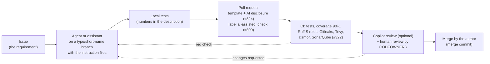

# AI Usage in OmniLog

Part of the review checklist in [#252] (section E). Issue: [#308]. This page explains how the team uses AI from the issue to the merge, who is responsible, and how the output is checked. Every statement links to something in the repository. A part that a member still has to confirm says **pending**.

## 1. Tools

| Tool | Model | Who | How it is used | Source |
|---|---|---|---|---|
| Claude Code | Claude Opus 5.5 | `Mhmd77Edrees` | Agent with the repository, a shell and the browser: reads the issue, writes code, tests and docs, opens the pull request | [`mhmd-edrees.md`](mhmd-edrees.md), trailers in [#235], [#236], [#237] |
| Claude Code | Claude Opus 5.5 | `sidarurey` | Agent with the repository, a shell, Docker and the browser: CI checks, security fixes, tests, test documents and reports, from [#318] to [#363] | [`sidar-urey.md`][sidar], trailers in every commit of [#349] to [#363] |
| Codex desktop app (ChatGPT) | `gpt-6-luna` | `sidarurey` | Agent for US-13 ([#258]): code, tests, commits after approval | [`sidar-urey.md`][sidar] ([#319]) |
| ChatGPT | not recorded | `sidarurey` | Chat for [#186], [#187], [#238], [#247] | [`sidar-urey.md`][sidar] ([#319]) |
| Claude | Claude Sonnet 5.5 | `KeremKenet` | Tests of the statistics screen ([#255]). The tool is **pending** ([#313]) | `Co-Authored-By` trailer of [`8335c9d`][8335c9d] |
| GitHub Copilot code review | - | - | An extra reviewer on 14 pull requests, from [#25] to [#228]. It does not count as an approval ([CONTRIBUTING.md](../../CONTRIBUTING.md#code-review)) | [`evidence.md`][evidence] ([#318]), section 2 |
| Copilot Autofix | - | `metezd` | Fixes that answered Copilot review comments in [#41], [#66] and [#143] | `Co-authored-by: Copilot Autofix` in [`fa01da5`][fa01da5], [`e97895e`][e97895e] |
| Claude (chat on claude.ai) | Claude Opus (version not recorded) | `musabalperenbasol` | Chat for [#6], [#78], [#84], [#240], [#254]. No repository access. The notes were drafted by a Cowork agent (Claude Opus 5.5) | [`musab-alperen-basol.md`](musab-alperen-basol.md) ([#316]) |
| Other use by `metezd`, `KaganKonuk` | | | **pending** | [#312], [#314] |

## 2. The pipeline

1. **Issue.** The issue is the specification. The agent reads it and does what it says, so the issue names the files, the rules and the definition of done (for example [#311], [#294]).
2. **Branch.** The agent works on a branch named `type/short-description` ([CONTRIBUTING.md](../../CONTRIBUTING.md#branch-names), checked by [#320]). It never works on `main`.
3. **Local tests.** The agent runs the tests and writes the numbers in the pull request, for example "768 passed, 16 skipped, coverage 91%" in [#236].
4. **Pull request.** The [template](../../.github/pull_request_template.md) asks what changed and how it was tested. The section "AI assistance" and the label `ai-assisted` came with [#324], and the check "AI disclosure" fails when the section is not filled in or the label is missing ([#309]). The label is also on the merged pull requests where the member notes, a commit trailer or the description show AI help. List them with `gh pr list --label ai-assisted --state all`.
5. **CI.** The required checks are in [`.github/rulesets/main.json`](../../.github/rulesets/main.json). SonarQube is prepared in [#322].
6. **Review.** CODEOWNERS asks the owner of the changed area for a review, and the review rota of [CONTRIBUTING.md](../../CONTRIBUTING.md#review-rota) names a second reviewer when the author owns the area ([#293]). How every merged pull request was reviewed is in the [code review log](../code-review-log.md). One approval from a teammate is required. A Copilot review is optional and is not an approval.
7. **Merge.** The author merges after the approval and the green checks.

## 3. Instruction files

| File | What it tells the AI | Maintained by |
|---|---|---|
| [`.github/skills/code-review/SKILL.md`](../../.github/skills/code-review/SKILL.md) | Review rules: stack fixed by the Charter, PostgreSQL only, migrations with `downgrade`, no secrets with a default, tests for 401, 404, 409 and 422, the description matches the files | `metezd` (added in [#41], owner of `/.github/` in [CODEOWNERS](../../.github/CODEOWNERS)) |
| [`frontend/AGENTS.md`](../../frontend/AGENTS.md) | This Next.js version differs from what the model learned. Read the guide in `node_modules/next/dist/docs/` before writing code | Written by `next dev`, committed by `KeremKenet` in [`7a1082d`][7a1082d] |
| [`frontend/CLAUDE.md`](../../frontend/CLAUDE.md) | Only imports `AGENTS.md` | Same as above |
| [`.github/pull_request_template.md`](../../.github/pull_request_template.md) | The sections and the checklist of every pull request, which agents fill like a person | `metezd` |

## 4. Rules

What AI may do, and what stays with a person:

- **The stack is fixed** by the [Charter](../CHARTER.md#4-technology-stack). AI does not add a framework, service or library that the Charter does not list (rule of the review skill and of the template).
- **Design decisions are made by the team** before the code. AI may draft a comparison, but the decision is written in an issue, for example the embedding model in [#44] and [#186].
- **No secrets in prompts.** No key, token, password or `.env` content is pasted into an AI tool. An agent on a computer can read local files, so real keys are not kept in the checkout while an agent works ([`sidar-urey.md`][sidar], Limits).
- **The author must be able to explain every line** of AI output when the reviewer asks ([#309]).
- **AI output is never merged without CI and a human review.** AI never merges. `main` accepts changes only through a pull request.
- **Copilot comments get an answer.** The author fixes what Copilot finds or answers why not ([CONTRIBUTING.md](../../CONTRIBUTING.md#code-review)).

## 5. Controls that catch AI mistakes

| Control | What it caught | Link |
|---|---|---|
| Ruleset on `main` (pull request, approval, required checks) | An agent tried `git push origin main`. GitHub refused it | [#258], [`sidar-urey.md`][sidar] |
| Required checks in CI | A test that the agent did not run broke on the token change of [#231] (fixed in [`c841987`][c841987]). A `DeprecationWarning` on Python 3.15 in [#235] | [`mhmd-edrees.md`](mhmd-edrees.md), [#235] |
| Running the whole test suite, not only the new tests | A test of [#258] that depended on the order of other tests | [`sidar-urey.md`][sidar] |
| Penetration test | `ENABLE_DOCS` was set in one deployment file but not in `render.yaml` ([#231], fixed in [#260]) | [`docs/tests/penetration`](../tests/penetration/README.md) |
| Copilot review | A guessable `SECRET_KEY` default, an open Redis port, a password check that a long suffix could pass | [#41], [#66], [`evidence.md`][evidence] |
| Test-first rule | Tests are written before the code, and a fix starts with a test that fails for the right reason. Nine red then green cycles are recorded ([#307], [#345], [#350]) | [`docs/tests/tdd-evidence.md`](../tests/tdd-evidence.md) |
| Production stack smoke test in CI | Removing the last file of `frontend/public` removed the folder, and the production image did not build ([#362], M10 in the register) | [`mistakes.md`](mistakes.md) |
| Review checklist | The template and the review skill above | Section 3 |

The full list of mistakes is the register of [#310]: [`mistakes.md`](mistakes.md).

## 6. What worked and what did not

Worked:

1. **Issues became complete pull requests.** With a detailed issue, an agent delivered code, tests, docs and a filled template in one or two commits ([#235], [#236], [#237]).
2. **GitHub rules stopped an agent.** The push of an agent to `main` was refused by the ruleset ([#258]).
3. **Copilot found real security problems** in the first pull requests ([#41], [#66]).

Did not work:

1. **The reviews of agent pull requests were approvals without comments.** No human review changed the code of an agent pull request ([`evidence.md`][evidence], section 1, and [#293]).
2. **About half of the Copilot comments were not acted on, and none of those has a written reason.** No pull request after [#228] has a Copilot review ([`evidence.md`][evidence], section 2).
3. **AI misses the second place.** It changed `docker-compose.prod.yml` but not `render.yaml` ([#231]), and it ran only part of the tests. Three agent pull requests were merged while CI did not run at all because of the GitHub Actions billing stop ([#255], [#259], [#260]).

## 7. Index

| Document | Link |
|---|---|
| Notes of Mohammed Edris ([#317]) | [`mhmd-edrees.md`](mhmd-edrees.md) |
| Notes of Sidar Ürey ([#315]) | [`sidar-urey.md`][sidar] (in [#319]) |
| Notes of Musab Alperen Başol ([#316]) | [`musab-alperen-basol.md`](musab-alperen-basol.md) |
| Notes of Mete Özdoğan, Kerem Kenet, Kağan Konuk | **pending**: [#312], [#313], [#314] |
| Register of AI mistakes ([#310]) | [`mistakes.md`](mistakes.md) |
| Evidence of AI use beyond autocomplete ([#311]) | [`evidence.md`][evidence] (in [#318]) |
| AI assisted pull requests | `gh pr list --repo metezd/OmniLog --label ai-assisted --state all` |

Each member confirms the row of their own use in section 1 in the review of this page or in their notes. Until then the row is as the repository shows it.

[sidar]: sidar-urey.md
[evidence]: evidence.md
[#6]: https://github.com/metezd/OmniLog/pull/6
[#25]: https://github.com/metezd/OmniLog/pull/25
[#41]: https://github.com/metezd/OmniLog/pull/41
[#44]: https://github.com/metezd/OmniLog/issues/44
[#66]: https://github.com/metezd/OmniLog/pull/66
[#78]: https://github.com/metezd/OmniLog/pull/78
[#84]: https://github.com/metezd/OmniLog/pull/84
[#143]: https://github.com/metezd/OmniLog/pull/143
[#186]: https://github.com/metezd/OmniLog/pull/186
[#187]: https://github.com/metezd/OmniLog/pull/187
[#228]: https://github.com/metezd/OmniLog/pull/228
[#231]: https://github.com/metezd/OmniLog/pull/231
[#235]: https://github.com/metezd/OmniLog/pull/235
[#236]: https://github.com/metezd/OmniLog/pull/236
[#237]: https://github.com/metezd/OmniLog/pull/237
[#238]: https://github.com/metezd/OmniLog/pull/238
[#240]: https://github.com/metezd/OmniLog/pull/240
[#247]: https://github.com/metezd/OmniLog/pull/247
[#252]: https://github.com/metezd/OmniLog/issues/252
[#254]: https://github.com/metezd/OmniLog/pull/254
[#255]: https://github.com/metezd/OmniLog/pull/255
[#258]: https://github.com/metezd/OmniLog/pull/258
[#259]: https://github.com/metezd/OmniLog/pull/259
[#260]: https://github.com/metezd/OmniLog/pull/260
[#293]: https://github.com/metezd/OmniLog/issues/293
[#294]: https://github.com/metezd/OmniLog/issues/294
[#307]: https://github.com/metezd/OmniLog/issues/307
[#308]: https://github.com/metezd/OmniLog/issues/308
[#309]: https://github.com/metezd/OmniLog/issues/309
[#310]: https://github.com/metezd/OmniLog/issues/310
[#311]: https://github.com/metezd/OmniLog/issues/311
[#312]: https://github.com/metezd/OmniLog/issues/312
[#313]: https://github.com/metezd/OmniLog/issues/313
[#314]: https://github.com/metezd/OmniLog/issues/314
[#315]: https://github.com/metezd/OmniLog/issues/315
[#316]: https://github.com/metezd/OmniLog/issues/316
[#317]: https://github.com/metezd/OmniLog/issues/317
[#318]: https://github.com/metezd/OmniLog/pull/318
[#319]: https://github.com/metezd/OmniLog/pull/319
[#320]: https://github.com/metezd/OmniLog/pull/320
[#322]: https://github.com/metezd/OmniLog/pull/322
[8335c9d]: https://github.com/metezd/OmniLog/commit/8335c9d
[fa01da5]: https://github.com/metezd/OmniLog/commit/fa01da5
[e97895e]: https://github.com/metezd/OmniLog/commit/e97895e
[7a1082d]: https://github.com/metezd/OmniLog/commit/7a1082d
[c841987]: https://github.com/metezd/OmniLog/commit/c841987
[#345]: https://github.com/metezd/OmniLog/pull/345
[#349]: https://github.com/metezd/OmniLog/pull/349
[#350]: https://github.com/metezd/OmniLog/pull/350
[#362]: https://github.com/metezd/OmniLog/pull/362
[#363]: https://github.com/metezd/OmniLog/pull/363
[#324]: https://github.com/metezd/OmniLog/pull/324
