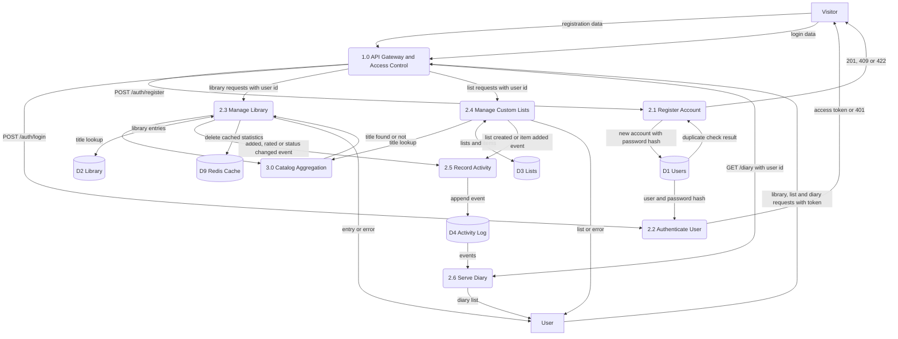

# DFD Level 2: Epic 2, User Management and Social Journal

This document is the detailed view (Level 2) of process **2.0 User and Journal Management**. The parent diagram is in [dfd-level0-1.md](dfd-level0-1.md).

## 1. Scope

| Story | Function |
|---|---|
| US-02 | Register an account |
| US-03 | Log in |
| US-04 | Add a title to the library with a status |
| US-05 | Rate a title and change its status |
| US-06 | Create custom lists and add titles |
| US-07 | View the activity diary |
| NFR-02, NFR-03 | Protected endpoints and safe passwords |

## 2. Components

| Type | Items |
|---|---|
| External entities | Visitor, User |
| Neighbor processes | 1.0 API Gateway (token check), 3.0 Catalog (title lookup) |
| Data stores | D1 Users, D2 Library, D3 Lists, D4 Activity Log, D5 Catalog (read only) |

### Process list

| ID | Process | Input | Output | Stores |
|---|---|---|---|---|
| 2.1 | Register Account | Username, email, password | Account without password data (201), 409 or 422 | D1 write |
| 2.2 | Authenticate User | Username, password | Access token (200) or 401 | D1 read |
| 2.3 | Manage Library | Media id, status, rating | Library entry (201 or 200), 409, 404 or 422 | D2 read and write, D5 read |
| 2.4 | Manage Custom Lists | List name, media id | List or list item (201 or 200), 422 | D3 read and write, D5 read |
| 2.5 | Record Activity | Event from 2.3, 2.4 or other processes | Stored event | D4 write |
| 2.6 | Serve Diary | Request of a user | List of events, newest first (200) | D4 read |

## 3. Level 2 diagram

## 4. Process rules

### 2.1 Register Account (US-02)
1. Check that the username is not empty and the email has a valid format. If not, answer 422.
2. Check that the username and email are not used. If they are, answer 409.
3. Hash the password. Save the user in D1.
4. Answer 201 with the user data. The answer never contains the password or the hash (NFR-03).

### 2.2 Authenticate User (US-03)
1. Find the user by username in D1.
2. Compare the password with the stored hash.
3. If they match, create a signed access token (JWT) and answer 200.
4. If they do not match, answer 401. No token is sent.

### 2.3 Manage Library (US-04 and US-05)
- **Add a title (`POST /library`):**
  1. Ask process 3.0 if the title exists.
  2. If the user already has the title, answer 409.
  3. Create the entry in D2. The default status is `PLAN_TO_WATCH`. Answer 201.
  4. Send a `LIBRARY_ADDED` event to 2.5.
- **List the library (`GET /library`):** return the entries of the logged-in user only.
- **Update an entry (`PATCH /library/{id}`):**
  1. Find the entry. If it does not exist or belongs to another user, answer 404 (or 403).
  2. If the rating is not from 1 to 10, answer 422. The entry stays unchanged.
  3. Save the new status or rating.
  4. Send a `RATED` event when the rating changed and a `STATUS_CHANGED` event when the status changed.
- **Remove an entry (`DELETE /library/{id}`, extension, not a story of the Charter):**
  1. Find the entry. If it does not exist or belongs to another user, answer 404. A second delete of the same entry is also a 404.
  2. Delete the entry. The chapter ratings, playtime and decisions of the user for this title are deleted with it (`ON DELETE CASCADE`). The title stays in the catalog. The client is expected to ask the user for confirmation first.
  3. Send a `LIBRARY_REMOVED` event to 2.5, in the same transaction as the delete. Answer 204.
- After every change, delete the cached statistics of the user (`omni:stats:{user_id}`).

### 2.4 Manage Custom Lists (US-06)
1. `POST /lists`: if the name is empty, answer 422. If the user already has a list with this name, answer 409. Otherwise create the list and answer 201.
2. `POST /lists/{id}/items`: check that the list belongs to the user and that the title exists. Add the item. A title that is already in the list is not added a second time: answer 201 when it is added, 200 when it was already there.
3. `GET /lists`: return all lists of the user. `GET /lists/{id}`: return the list with its items.
4. Send `LIST_CREATED` and `LIST_ITEM_ADDED` events to 2.5.
5. `DELETE /lists/{id}/items/{media_item_id}` (extension): take a title out of a list that belongs to the user. If the list is not the user's or the title is not in it, answer 404. Send a `LIST_ITEM_REMOVED` event. Answer 204. The title stays in the catalog and in the library.
6. `DELETE /lists/{id}` (extension): delete a list of the user with its items. If the list is not the user's, answer 404. Send a `LIST_DELETED` event (no title). Answer 204. The name can be used again.

### 2.5 Record Activity (US-07)
- Receives an event with the user id, the type, the title and a small payload.
- Appends the event to D4. Events are never edited and never deleted. A removal is a new event, and the older events about the same title stay.

### 2.6 Serve Diary (US-07)
- Reads the events of the logged-in user from D4. The newest event comes first.
- A new user with no events gets an empty list and status 200.

## 5. Data store usage (CRUD)

C is create, R is read, U is update and D is delete.

| Process | D1 Users | D2 Library | D3 Lists | D4 Activity Log | D5 Catalog |
|---|---|---|---|---|---|
| 2.1 Register Account | C, R | | | | |
| 2.2 Authenticate User | R | | | | |
| 2.3 Manage Library | | C, R, U, D | | | R |
| 2.4 Manage Custom Lists | | | C, R, D | | R |
| 2.5 Record Activity | | | | C | |
| 2.6 Serve Diary | | | | R | |

## 6. Mapping to stories and tests

| Story | Process | Endpoint | Test |
|---|---|---|---|
| US-02 | 2.1 | `POST /auth/register` | `test_us02_*` |
| US-03 | 2.2 | `POST /auth/login` | `test_us03_*` |
| US-04 | 2.3 | `POST /library`, `GET /library` | `test_us04_*` |
| US-05 | 2.3 | `PATCH /library/{id}` | `test_us05_*` |
| Extension | 2.3, 2.4 | `DELETE /library/{id}`, `DELETE /lists/{id}/items/{media_item_id}`, `DELETE /lists/{id}` | `test_epic2_removal.py` |
| US-06 | 2.4 | `POST /lists`, `POST /lists/{id}/items`, `GET /lists/{id}` | `test_us06_*` |
| US-07 | 2.5, 2.6 | `GET /diary` | `test_us07_*` |
| NFR-02 | 1.0 | All protected paths | `test_nfr02_*` |
| NFR-03 | 2.1 | All user responses | `test_nfr03_*` |

## 7. Notes

- The tests use `POST /media` to create catalog entries in the test setup. It is not a user story. It is listed as an assumption in the requirement specification.
- The Charter lists user profiles in Epic 2, but there is no user story for them. A profile screen is listed as optional in [../ui/screen-list.md](../ui/screen-list.md).
