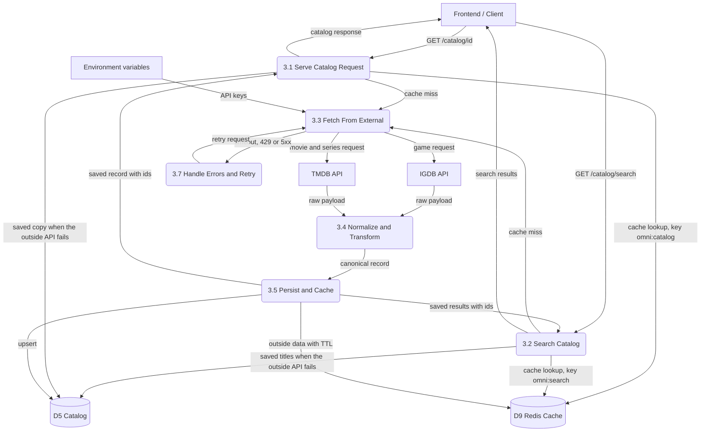

# DFD Level 2: Epic 3, IGDB and TMDB Catalog Integration

This document is the detailed view (Level 2) of process **3.0 Catalog Aggregation**. The parent diagram is in [dfd-level0-1.md](dfd-level0-1.md). It was checked against the code on 19.11.2026. Parts of the design that are not built are marked **not built**.

## 1. Purpose

- Get media data from IGDB and TMDB in a safe and consistent way.
- Normalize the data and save it in the cache (Redis) and in the database.
- Give the frontend fast answers through the cache.
- Show the rate limit, authentication and retry mechanisms. The sync mechanism is not built.

## 2. Components

| Type | Items |
|---|---|
| External entities | IGDB API, TMDB API, Frontend (Client). In the keyless demo mode the Steam Store, TVMaze and Wikidata take the place of IGDB and TMDB. The Operator (Admin UI) and the Secret Manager of the design are not built. The keys come from environment variables |
| Data stores | D5 Catalog (Persistent DB), D9 Redis Cache. D10 Sync Job Log is not built |
| Processes | 3.1 Serve Catalog Request, 3.2 Search Catalog, 3.3 Fetch From External, 3.4 Normalize and Transform, 3.5 Persist and Cache, 3.7 Handle Errors and Retry. 3.6 Run Sync is not built |

### Process list

| ID | Process | Stories | Description |
|---|---|---|---|
| 3.1 | Serve Catalog Request | US-09 | Answers a request for one title by its internal id. Checks the cache first. Starts a fetch when the cache has nothing. Falls back to the saved copy when the outside service fails. Adds seasons, episodes or chapters, genres and decision points to the answer |
| 3.2 | Search Catalog | US-08 | Answers a search by text and type. Uses the cache, then the external API. The database is read only when the external API fails |
| 3.3 | Fetch From External | US-08, US-09 | Calls IGDB or TMDB with the API key |
| 3.4 | Normalize and Transform | US-08, US-09 | Turns the source answer into the OmniLog format |
| 3.5 | Persist and Cache | US-08, US-09 | Saves the record in D5 and writes it to Redis with a TTL |
| 3.6 | Run Sync | UC-EP3-03 | **Not built.** Would run a scheduled or manual bulk sync and write the job log |
| 3.7 | Handle Errors and Retry | NFR-04 | Handles 429, timeouts, connection errors and 5xx errors with a limited number of retries (`request_with_retry` in `integrations/common.py`) |

## 3. Level 2 diagram

The sync flows of the design (the Operator, process 3.6 and the sync job log D10) are not built and are left out of the diagram.

## 4. Main flows

### 4.1 Get one title (UC-EP3-01 and UC-EP3-02)

1. The client sends `GET /catalog/{id}` with the internal id. The lookup by outside id (`GET /catalog/{source}/{external_id}`) is not built.
2. Process 3.1 reads the title in D5. An unknown id gives status 404.
3. Process 3.1 checks Redis. The key pattern is `omni:catalog:{source}:{external_id}`.
4. **Cache hit:** the data is fresh, so no outside call is made. The saved copy in D5 is only written when the title was never saved.
5. **Cache miss:** 3.3 fetches the data from IGDB or TMDB. 3.4 normalizes it. 3.5 saves it in D5, sets `last_synced` and writes it to Redis with a TTL.
6. The answer includes the seasons and episodes of a series, or the chapters of an episodic game (US-09), with the genres, the description and the decision points.

**Implementation note (US-09).** Only a title with an outside id has anything to load: the seasons of a series, and the description and genres of any title. Process 3.1 looks in Redis (`omni:catalog:tmdb_tv:{external_id}` for a series, `omni:catalog:igdb:{external_id}` for a game, `omni:catalog:tmdb_movie:{external_id}` for a movie, TTL `DETAILS_CACHE_TTL_SECONDS`). A hit means the data is fresh, so TMDB is not called. On a miss, 3.3 asks TMDB for the season list and then for the episodes, up to 20 seasons in one call (`append_to_response`). 3.5 saves the seasons and episodes in D5, sets `last_synced` and writes the cache. The cache holds outside data only, not row ids, so the answer is always built from D5 and carries the ids of the seasons and chapters, which Epic 4 needs. When TMDB fails, the saved copy is returned even if it is old, and the answer is 503 when the series was never loaded. A failure is never cached. TMDB answering 404 for the outside id is cached too, so a wrong id does not call TMDB for every request. A refresh updates rows in place and never deletes any. A game or a movie is asked for its description and genres only (IGDB `/games` by id, TMDB `/movie/{id}`). For a series they come from the same TMDB call that lists the seasons, so there is no extra call. For a game or a movie a failure is not an error: the title is shown with what is saved, because these fields were never required. An empty answer never replaces a saved description or genre list. IGDB has no chapter list, so game chapters are only read from D5 (open point 3 in the domain model). The check of `last_synced` against a TTL, which the design planned, is not used: the cache is the freshness check, and `last_synced` only tells that a saved copy exists.

### 4.2 Search (US-08)

1. The client sends `GET /catalog/search?q=...&type=...`.
2. Process 3.2 cleans the text and builds the key `omni:search:{type}:{query_hash}`. An empty text gives status 422.
3. On a cache hit, the cached list is used without calling an outside API.
4. On a miss, 3.3 searches IGDB (for `GAME`) or TMDB (for `SERIES` and `MOVIE`).
5. The results are normalized, cached for `CACHE_TTL_SECONDS` and saved in D5. A cache hit is saved in D5 too, because the cache holds no row ids.
6. A query with no match returns an empty list with status 200.
7. Each result has the internal `id`, the title, the poster URL and the release date.

**Implementation note (US-08).** The code asks the outside API right after a cache miss. It does not read D5 first, because saved titles can be incomplete and a search should show the newest outside results. When a source has no keys, or the outside API fails, D5 is read: saved titles that match are returned, and when there are none the answer is 503. Each result is saved in D5 (one row for each media type and outside id) and has the internal `id`, so it can be added to the library. The cache holds outside data only, not row ids.

### 4.3 Manual sync (UC-EP3-03), built as a command

The operator runs `python -m app.sync` (in the backend container). It selects the titles that have an outside id and no `last_synced`, and loads each one with the same code as the details of a title (cache, then IGDB or TMDB, then D5), so the same rules apply. Options: `--type`, `--id`, `--limit` and `--dry-run`. A title that fails does not stop the others. The command prints the counts and exits with 1 when loading raised an error for a title. See `sync_titles` in `catalog_service.py`.

Not built: a scheduled sync, a sync endpoint, a job log (D10) and the feed of changed titles to process 5.1 for embedding (flow F-03). The result of a run is printed and written to the application log only.

### 4.4 Rate limit and errors (UC-EP3-04, NFR-04)

- A timeout, a connection error, HTTP 429 and any 5xx answer are tried again by `request_with_retry`. The number of retries is `EXTERNAL_API_MAX_RETRIES` (default 3).
- The wait before a retry starts at `EXTERNAL_API_BACKOFF_SECONDS` (default 0.5) and doubles each time. When the service sends a `Retry-After` header, that value is used. The code does not read `X-RateLimit-Remaining`, so calls are not slowed down before the limit is reached.
- Each call times out after `EXTERNAL_API_TIMEOUT_SECONDS` (default 8).
- The IGDB access token (Twitch OAuth) is kept in memory and renewed shortly before it expires. When IGDB answers 401 once, the token is replaced and the call is repeated.
- When the maximum is reached, the failure is written to the log (there is no D10) and the client gets a controlled answer.
- If the outside service is not available, the saved data is returned when it exists. If not, the API returns 503. It never returns an unhandled 500.

## 5. Data details

- Cache key patterns: `omni:catalog:{source}:{external_id}` and `omni:search:{type}:{query_hash}`.
- TTL: search results use `CACHE_TTL_SECONDS` (default 1 hour) and title details use `DETAILS_CACHE_TTL_SECONDS` (default 24 hours). Both are settings (AN-2). A TTL by content type is not built.
- Tables: `media_items`, `genres`, `media_item_genres`, `seasons`, `chapters`. The tables `external_sources` and `sync_job_logs` of the design are not built. See [../data/er-diagram.md](../data/er-diagram.md).
- Keyless demo mode: with `IGDB_CLIENT_ID=public` games come from the Steam Store, and with `TMDB_API_KEY=public` series come from TVMaze and movies from Wikidata. The ids are then the ids of those services.
- Games: seasons and episodes come from TMDB for series. For episodic games, chapters, decision points and options have no outside source. They come from a seed file (`backend/app/seed/game_chapters.json`, loaded with `python -m app.seed`). This is open point 3 in [../data/domain-model.md](../data/domain-model.md), answered.
- Secrets: the IGDB and TMDB keys stay in environment variables. A Secret Manager is not built. When the IGDB token expires, a new one is requested before the next call.

## 6. Endpoints

| Endpoint | Purpose | Status |
|---|---|---|
| `GET /catalog/search?q=&type=` | Search titles | Implemented (US-08). Needs a token |
| `GET /catalog/{id}` | Title details with seasons or chapters | Implemented (US-09). Needs a token |
| `GET /catalog/{source}/{external_id}` | Lookup by outside id. Starts a fetch when needed | Not built (R-EP3-01) |
| `python -m app.sync` | Start a manual sync (a command, not an endpoint) | Implemented (UC-EP3-03) |
| `POST /admin/sync` | Start a manual sync over HTTP | Not built. Needs the Operator role |
| `GET /admin/sync/status` | Show the last sync jobs | Not built. Needs a job table |

No `/api` prefix is used, because the tests call the paths without it.

## 7. Use case mapping

| Use case | Flow |
|---|---|
| UC-EP3-01 | Client asks for a title, cache hit, serve |
| UC-EP3-02 | Client asks for a title, cache miss, fetch, normalize, save, cache, serve |
| UC-EP3-03 | Operator starts a manual sync, bulk fetch. Built as `python -m app.sync`. The log is the application log (no D10) |
| UC-EP3-04 | Outside API is rate limited, backoff and retry, log the failure (to the application log only) |
| UC-EP3-05 | Client searches the catalog (new in this version) |
| UC-EP3-06 | Client opens title details with seasons or chapters (new in this version) |

## 8. Checklist

- [x] DFD file added to the repository.
- [x] Traceability table added. See [../data/traceability-epic3.md](../data/traceability-epic3.md) and [../data/traceability.md](../data/traceability.md).
- [x] Epic 3 requirements added to [../requirement-analysis-report.md](../requirement-analysis-report.md).
- [x] Field names matched with the domain model and the E-R diagram.
- [x] Search (US-08) and title details (US-09) added to the flows.
- [ ] UI mockups for the Integrations and Sync status screens. The sync screens are not needed while the sync is not built. See [../ui/screen-list.md](../ui/screen-list.md) for the screen list. The Figma file is still open.
