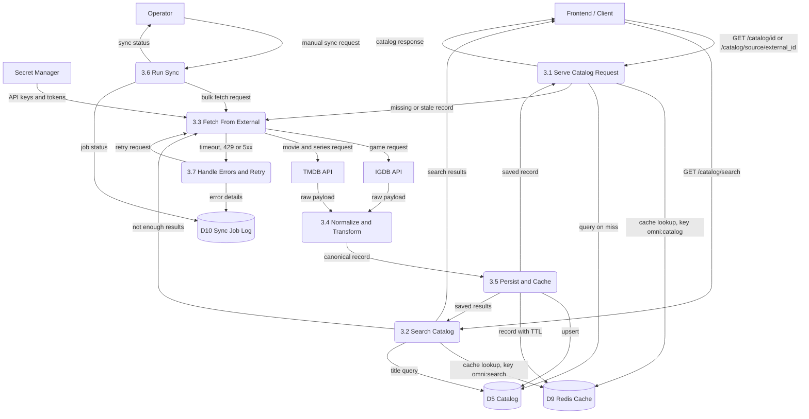

# DFD Level 2: Epic 3, IGDB and TMDB Catalog Integration

This document is the detailed view (Level 2) of process **3.0 Catalog Aggregation**. The parent diagram is in [dfd-level0-1.md](dfd-level0-1.md).

## 1. Purpose

- Get media data from IGDB and TMDB in a safe and consistent way.
- Normalize the data and save it in the cache (Redis) and in the database.
- Give the frontend fast answers through the cache.
- Show the rate limit, authentication, retry and sync mechanisms.

## 2. Components

| Type | Items |
|---|---|
| External entities | IGDB API, TMDB API, Frontend (Client), Operator (Admin UI), Secret Manager |
| Data stores | D5 Catalog (Persistent DB), D9 Redis Cache, D10 Sync Job Log |
| Processes | 3.1 Serve Catalog Request, 3.2 Search Catalog, 3.3 Fetch From External, 3.4 Normalize and Transform, 3.5 Persist and Cache, 3.6 Run Sync, 3.7 Handle Errors and Retry |

### Process list

| ID | Process | Stories | Description |
|---|---|---|---|
| 3.1 | Serve Catalog Request | US-09, R-EP3-01 | Answers a request for one title. Checks the cache first, then the database. Starts a fetch when the record is missing or stale. Adds seasons and chapters to the answer |
| 3.2 | Search Catalog | US-08 | Answers a search by text and type. Uses the cache, then the database, then the external APIs |
| 3.3 | Fetch From External | US-08, US-09 | Calls IGDB or TMDB with the API key |
| 3.4 | Normalize and Transform | US-08, US-09 | Turns the source answer into the OmniLog format |
| 3.5 | Persist and Cache | US-08, US-09 | Saves the record in D5 and writes it to Redis with a TTL |
| 3.6 | Run Sync | UC-EP3-03 | Runs a scheduled or manual bulk sync and writes the job log |
| 3.7 | Handle Errors and Retry | NFR-04 | Handles 429, timeouts and 5xx errors |

## 3. Level 2 diagram

## 4. Main flows

### 4.1 Get one title (UC-EP3-01 and UC-EP3-02)

1. The client sends `GET /catalog/{id}` (internal id) or `GET /catalog/{source}/{external_id}`.
2. Process 3.1 checks Redis. The key pattern is `omni:catalog:{source}:{external_id}`.
3. **Cache hit:** the cached record is returned. No outside call is made.
4. **Cache miss:** 3.1 reads D5.
   - If D5 has a fresh record, it is returned and the cache is refreshed.
   - If the record is missing or stale (`last_synced` is older than the TTL), 3.3 fetches it from IGDB or TMDB.
5. 3.4 normalizes the answer. 3.5 saves it in D5 and writes it to Redis with a TTL.
6. The answer includes the seasons and episodes of a series, or the chapters of an episodic game (US-09).
7. An unknown id gives status 404.

**Implementation note (US-09).** Only a title with an outside id has anything to load: the seasons of a series, and the description and genres of any title. Process 3.1 looks in Redis first (`omni:catalog:tmdb_tv:{external_id}` for a series, `omni:catalog:igdb:{external_id}` for a game, `omni:catalog:tmdb_movie:{external_id}` for a movie, TTL `DETAILS_CACHE_TTL_SECONDS`). A hit means the data is fresh, so TMDB is not called. On a miss, 3.3 asks TMDB for the season list and then for the episodes, up to 20 seasons in one call (`append_to_response`). 3.5 saves the seasons and episodes in D5, sets `last_synced` and writes the cache. The cache holds outside data only, not row ids, so the answer is always built from D5 and carries the ids of the seasons and chapters, which Epic 4 needs. When TMDB fails, the saved copy is returned even if it is old, and the answer is 503 when the series was never loaded. A failure is never cached. TMDB answering 404 for the outside id is cached too, so a wrong id does not call TMDB for every request. A refresh updates rows in place and never deletes any. A game or a movie is asked for its description and genres only (IGDB `/games` by id, TMDB `/movie/{id}`). For a series they come from the same TMDB call that lists the seasons, so there is no extra call. For a game or a movie a failure is not an error: the title is shown with what is saved, because these fields were never required. An empty answer never replaces a saved description or genre list. IGDB has no chapter list, so game chapters are only read from D5 (open point 3 in the domain model). The simple D5-first check of step 4 above is not used, for the same reason as in the US-08 note: the cache is the freshness check.

### 4.2 Search (US-08)

1. The client sends `GET /catalog/search?q=...&type=...`.
2. Process 3.2 builds the key `omni:search:{type}:{query_hash}` and checks Redis.
3. On a hit, the cached list is returned without calling an outside API.
4. On a miss, 3.2 looks in D5. If there are not enough results, 3.3 searches IGDB (for `GAME`) or TMDB (for `SERIES` and `MOVIE`).
5. The results are normalized, saved in D5 and cached.
6. A query with no match returns an empty list with status 200.
7. Each result has the title, the poster URL and the release date.

**Implementation note (US-08).** The code asks the outside API right after a cache miss. It does not read D5 first, because saved titles can be incomplete and a search should show the newest outside results. D5 is read when the outside API fails: saved titles that match are returned, and when there are none the answer is 503. Each result is saved in D5 (one row for each media type and outside id) and has the internal `id`, so it can be added to the library. The cache holds outside data only, not row ids.

### 4.3 Manual or scheduled sync (UC-EP3-03)

1. The Operator starts a manual sync, or the scheduler starts a job.
2. Process 3.6 plans a bulk fetch for each source and media type.
3. 3.3 fetches the data. The result, errors and duration of each call are kept.
4. Good records are normalized and written to D5 and Redis.
5. The summary of the job is written to D10.
6. Every new or changed title is sent to process 5.1 for embedding (flow F-03).

### 4.4 Rate limit and errors (UC-EP3-04, NFR-04)

- On HTTP 429, process 3.7 uses exponential backoff and retries. The maximum is 3 retries.
- If the source sends `X-RateLimit-Remaining`, the calls are slowed down before the limit is reached.
- Timeouts and 5xx errors are retried a limited number of times.
- When the maximum is reached, the error is written to D10 and the client gets a controlled answer.
- If the outside service is not available, the cached data is returned when it exists. If not, the API returns 503. It never returns an unhandled 500.

## 5. Data details

- Cache key patterns: `omni:catalog:{source}:{external_id}` and `omni:search:{type}:{query_hash}`.
- TTL: between 1 hour and 24 hours, by content type. Trending content gets 1 hour. Static metadata gets 24 hours. The TTL must be configurable (AN-2). The test default is 1 hour.
- Tables: `media_items`, `external_sources`, `genres`, `media_item_genres`, `seasons`, `chapters`, `sync_job_logs`. See [../data/er-diagram.md](../data/er-diagram.md).
- Games: seasons and episodes come from TMDB for series. For episodic games, chapters, decision points and options have no outside source. They must be added by hand or from a seed file. This is open point 3 in [../data/domain-model.md](../data/domain-model.md).
- Secrets: the IGDB and TMDB keys stay in environment variables or the Secret Manager. When a token expires, the token refresh flow runs before the next call.

## 6. Endpoints

| Endpoint | Purpose | Status |
|---|---|---|
| `GET /catalog/search?q=&type=` | Search titles | In the tests (US-08) |
| `GET /catalog/{id}` | Title details with seasons or chapters | Implemented (US-09) |
| `GET /catalog/{source}/{external_id}` | Lookup by outside id. Starts a fetch when needed | Proposed (R-EP3-01) |
| `POST /admin/sync` | Start a manual sync | Proposed (UC-EP3-03) |
| `GET /admin/sync/status` | Show the last sync jobs | Proposed (UC-EP3-03) |

No `/api` prefix is used, because the tests call the paths without it.

## 7. Use case mapping

| Use case | Flow |
|---|---|
| UC-EP3-01 | Client asks for a title, cache hit, serve |
| UC-EP3-02 | Client asks for a title, cache miss, DB stale, fetch, normalize, save, cache, serve |
| UC-EP3-03 | Operator starts a manual sync, bulk fetch, log |
| UC-EP3-04 | Outside API is rate limited, backoff and retry, log the failure |
| UC-EP3-05 | Client searches the catalog (new in this version) |
| UC-EP3-06 | Client opens title details with seasons or chapters (new in this version) |

## 8. Checklist

- [x] DFD file added to the repository.
- [x] Traceability table added. See [../data/traceability-epic3.md](../data/traceability-epic3.md) and [../data/traceability.md](../data/traceability.md).
- [x] Epic 3 requirements added to [../requirement-analysis-report.md](../requirement-analysis-report.md).
- [x] Field names matched with the domain model and the E-R diagram.
- [x] Search (US-08) and title details (US-09) added to the flows.
- [ ] UI mockups for the Integrations and Sync status screens. See [../ui/screen-list.md](../ui/screen-list.md) for the screen list. The Figma file is still open.
