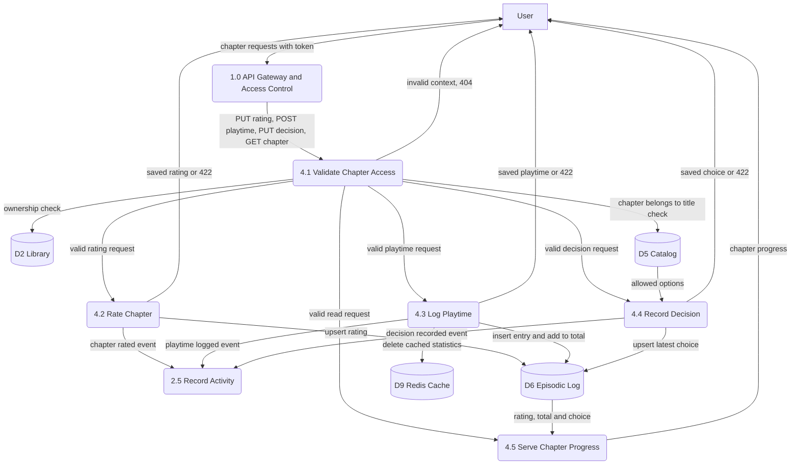

# DFD Level 2: Epic 4, Granular Episodic and Decision Logging

This document is the detailed view (Level 2) of process **4.0 Episodic and Decision Logging**. The parent diagram is in [dfd-level0-1.md](dfd-level0-1.md).

## 1. Scope

| Story | Function |
|---|---|
| US-10 | Rate a chapter or episode from 1 to 5 |
| US-11 | Log playtime for a chapter |
| US-12 | Record a branching decision |

## 2. Components

| Type | Items |
|---|---|
| External entity | User |
| Neighbor processes | 1.0 API Gateway (token check), 2.5 Record Activity |
| Data stores | D2 Library (read), D5 Catalog (read), D6 Episodic Log, D4 Activity Log, D9 Redis Cache |

The chapters and decision points are created by Epic 3. Epic 4 only reads them.

### Process list

| ID | Process | Input | Output | Stores |
|---|---|---|---|---|
| 4.1 | Validate Chapter Access | Library entry id, chapter id, user id | Valid context or 404 | D2 read, D5 read |
| 4.2 | Rate Chapter | Rating 1 to 5 | Saved rating (200) or 422 | D6 write |
| 4.3 | Log Playtime | Minutes | Saved entry (200 or 201) or 422 | D6 write |
| 4.4 | Record Decision | Choice such as A or B | Saved choice (200) or 422 | D6 write, D5 read |
| 4.5 | Serve Chapter Progress | Library entry id, chapter id | Rating, playtime total and choice | D6 read |

## 3. Level 2 diagram

## 4. Process rules

### 4.1 Validate Chapter Access
This check runs before every chapter operation. It protects the data of other users.
1. The library entry must exist and belong to the logged-in user.
2. The chapter must exist.
3. The chapter must belong to the title of the library entry (BR-11).
4. If a check fails, the answer is 404. No data is changed.

### 4.2 Rate Chapter (US-10)
1. Request: `PUT /library/{id}/chapters/{chapter_id}/rating` with a number.
2. The rating must be a whole number from 1 to 5. A value of 0 or 6 gives 422.
3. Save the rating in `chapter_progress`. The row is created when it does not exist.
4. Send a `CHAPTER_RATED` event to 2.5.

### 4.3 Log Playtime (US-11)
1. Request: `POST /library/{id}/chapters/{chapter_id}/playtime` with `minutes`.
2. The minutes must be 1 or more. A negative value gives 422.
3. Insert a row in `playtime_logs` and add the minutes to `playtime_minutes`. Both changes are made in one transaction.
4. Example: 90 minutes and then 30 minutes give a total of 120.
5. Send a `PLAYTIME_LOGGED` event to 2.5. Delete the cached statistics of the user.

### 4.4 Record Decision (US-12)
1. Request: `PUT /library/{id}/chapters/{chapter_id}/decision` with `choice`.
2. Read the allowed options of the chapter's decision point from D5.
3. If the choice is not an allowed option, answer 422.
4. Save the choice in `user_decisions`. If the user already chose, replace the old choice. Only the latest choice is kept.
5. Send a `DECISION_RECORDED` event to 2.5.

### 4.5 Serve Chapter Progress
- `GET /library/{id}/chapters/{chapter_id}` returns `rating`, `playtime_minutes` and `choice`.
- When the user has no data for the chapter, the values are empty or zero.

## 5. Data store usage (CRUD)

| Process | D2 Library | D5 Catalog | D6 Episodic Log | D4 Activity Log |
|---|---|---|---|---|
| 4.1 Validate Chapter Access | R | R | | |
| 4.2 Rate Chapter | | | C, U | C (through 2.5) |
| 4.3 Log Playtime | | | C, U | C (through 2.5) |
| 4.4 Record Decision | | R | C, U | C (through 2.5) |
| 4.5 Serve Chapter Progress | | | R | |

## 6. Mapping to stories and tests

| Story | Process | Endpoint | Test |
|---|---|---|---|
| US-10 | 4.1, 4.2 | `PUT /library/{id}/chapters/{chapter_id}/rating` | `test_us10_*` |
| US-11 | 4.1, 4.3, 4.5 | `POST .../playtime`, `GET .../chapters/{chapter_id}` | `test_us11_*` |
| US-12 | 4.1, 4.4, 4.5 | `PUT .../decision` | `test_us12_*` |

## 7. Notes

- The test fixture reads chapters from `GET /catalog/{id}`. Epic 4 tests cannot pass until Epic 3 returns chapters.
- A chapter can have more than one decision point in the model. The API in the tests has one `choice` for each chapter. The proposal is an optional `decision_point_id` in the request when a chapter has more than one.
- Comparing a decision with other players (the goal of US-12) is a read over `user_decisions`. It is not in the acceptance criteria, so it is not a process here.
