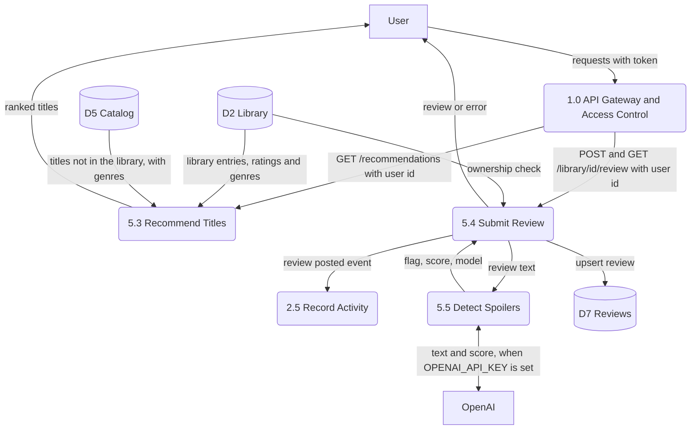

# DFD Level 2: Epic 5, Recommendations and Review Moderation

This document is the detailed view (Level 2) of process **5.0 AI Engine**. The parent diagram is in [dfd-level0-1.md](dfd-level0-1.md). It was checked against the code on 19.11.2026. Parts of the design that are not built are marked **not built**.

## 1. Scope

| Story | Function | State |
|---|---|---|
| US-13 | Cross-media recommendations | Built as a ranking by genre. The embedding part of the design is not built |
| US-14 | Spoiler detection in reviews | Built |

Version 1 of the recommendation engine in the code is content-based on the genres of the library. It does not use embeddings. The collaborative part from the Charter is not part of version 1.

## 2. Components

| Type | Items |
|---|---|
| External entities | User, OpenAI (spoiler classification only) |
| Neighbor processes | 1.0 API Gateway (token check), 2.5 Record Activity |
| Data stores | D2 Library (read), D5 Catalog (read), D7 Reviews. D8 Vector Store is not built. The recommendations do not use D9 Redis Cache |

### Process list

| ID | Process | Input | Output | Stores | State |
|---|---|---|---|---|---|
| 5.1 | Generate Media Embedding | New or changed title | Vector saved in D8 | D5 read, D8 write | **Not built** |
| 5.2 | Build Taste Profile | Library of the user | Taste vector | D2 read, D8 read and write | **Not built** |
| 5.3 | Recommend Titles | Optional target type | List of titles (200) | D2 read, D5 read | Built. Ranks by genre |
| 5.4 | Submit Review | Review text | Stored review with spoiler flag (201), 404 or 422 | D2 read, D7 write | Built |
| 5.5 | Detect Spoilers | Review text | Spoiler flag, score and model name | OpenAI call, or local patterns | Built |

## 3. Level 2 diagram

The diagram shows what is built. The processes 5.1 and 5.2 are left out.

## 4. Process rules

### 5.1 Generate Media Embedding (not built)
The design builds one vector for each title from its title, genres and description and saves it in D8. There is no table for it and no process that calls it. The function `embed_texts` in `backend/app/integrations/openai_client.py` can ask OpenAI for embeddings with `EMBEDDING_MODEL` and `EMBEDDING_DIMENSIONS`, and nothing calls it.

### 5.2 Build Taste Profile (not built)
The design averages the vectors of the titles that the user liked. It is not built.

### 5.3 Recommend Titles (US-13)
1. Request: `GET /recommendations` with an optional `target` (`GAME`, `SERIES` or `MOVIE`). The token is required.
2. Read the library of the logged-in user from D2.
3. Add up a weight for each genre of the library. One entry gives its rating to each of its genres, or 5 when it has no rating.
4. Read from D5 every title of the target type (every type when there is no target) that is not in the library of the user (BR-14).
5. Give each title a score, the sum of the weights of its genres. Sort by score, highest first. Titles with the same score are sorted by id.
6. Answer 200 with the list. Each item has `id`, `title`, `media_type`, `poster_url`, `release_date`, `description`, `external_api_id` and `genres`. The list has no limit and is not cached. A user with an empty library gets every title with the score 0.
7. A title without genres scores 0. A title that was only found in a search has no genres until its details are opened, so it ranks last.

### 5.4 Submit Review (US-14)
1. Request: `POST /library/{id}/review` with `text`. The text is 1 to 5000 characters and not blank, or the answer is 422.
2. The library entry must belong to the user, or the answer is 404.
3. Create or replace the review first. A library entry has one review. If it exists, its text is replaced, its spoiler fields are set to NULL and `updated_at` is set. If not, a review is created. Send a `REVIEW_POSTED` event to 2.5 ("Review posted") in the same transaction and commit.
4. Process 5.5 classifies the text. No transaction is open and no database connection is held while it runs.
5. Write the result (`contains_spoiler`, `spoiler_score`, `spoiler_model_version`) in a second short transaction. The result is dropped when the review was deleted or its text changed in the meantime.
6. Answer 201 with the review. `GET /library/{id}/review` returns the review, or `null` when there is none.
7. The review does not change the statistics, so the cache of the statistics is not deleted.

### 5.5 Detect Spoilers (US-14)
1. When `OPENAI_API_KEY` is set, ask the model in `SPOILER_MODEL` for a JSON answer with `contains_spoiler` and a `score` from 0 to 1. The review is flagged when the model says it contains a spoiler and the score is at least `SPOILER_THRESHOLD` (default 0.5). The model name is stored as the model version.
2. When there is no key, a list of local patterns decides instead: each pattern that matches adds its weight, the sum is cut at 1, and a sum of `SPOILER_THRESHOLD` or more is a spoiler. The model version is `omnilog-nlp-spoiler-v1`.
3. When a key is set and OpenAI is down, times out or answers something that is not valid, the review is not checked: `contains_spoiler`, `spoiler_score` and `spoiler_model_version` stay NULL. The review is still saved and the answer is a normal 201 or 200, never 503 or 500 (NFR-04).

## 5. Data store usage (CRUD)

| Process | D2 Library | D5 Catalog | D7 Reviews | D4 Activity Log |
|---|---|---|---|---|
| 5.3 Recommend Titles | R | R | | |
| 5.4 Submit Review | R | | C, R, U | C (through 2.5) |
| 5.5 Detect Spoilers | | | | |

## 6. Mapping to stories and tests

| Story | Process | Endpoint | Test |
|---|---|---|---|
| US-13 | 5.3 | `GET /recommendations` | `test_us13_*` |
| US-14 | 5.4, 5.5 | `POST` and `GET /library/{id}/review` | `test_us14_*`, `test_openai_client.py` |
| NFR-04 | 5.5 | | `test_nfr04_*` |

The full list of test functions for each story is in [../data/traceability.md](../data/traceability.md).

## 7. Review of the E-R model for Epic 5

The table `reviews` is built. The tables `media_embeddings` and `user_taste_vectors` are not. The data dictionary and the design of the vector space are in [../data/er-diagram.md](../data/er-diagram.md), sections 5, 6 and 8.
