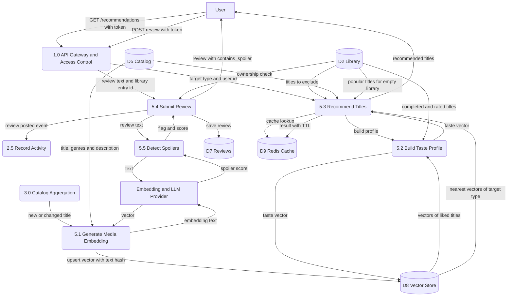

# DFD Level 2: Epic 5, AI-Powered Cross-Media Engine and Review Moderation

This document is the detailed view (Level 2) of process **5.0 AI Engine**. The parent diagram is in [dfd-level0-1.md](dfd-level0-1.md).

## 1. Scope

| Story | Function |
|---|---|
| US-13 | Cross-media recommendations (series from games and games from series) |
| US-14 | Spoiler detection in reviews |

Version 1 of the recommendation engine is content-based. It uses embeddings. The collaborative part from the Charter can be added later. It needs no new tables because it uses the ratings in D2.

## 2. Components

| Type | Items |
|---|---|
| External entities | User, Embedding and LLM Provider (OpenAI or Hugging Face) |
| Neighbor processes | 1.0 API Gateway (token check), 3.0 Catalog (sends new titles), 2.5 Record Activity |
| Data stores | D2 Library (read), D5 Catalog (read), D7 Reviews, D8 Vector Store, D9 Redis Cache |

### Process list

| ID | Process | Input | Output | Stores |
|---|---|---|---|---|
| 5.1 | Generate Media Embedding | New or changed title | Vector saved in D8 | D5 read, D8 write |
| 5.2 | Build Taste Profile | Library of the user | Taste vector | D2 read, D8 read and write |
| 5.3 | Recommend Titles | Target type | List of titles (200) | D8 read, D5 read, D2 read, D9 read and write |
| 5.4 | Submit Review | Review text | Stored review with spoiler flag (200 or 201) | D2 read, D7 write |
| 5.5 | Detect Spoilers | Review text | Spoiler flag and score | Provider call |

## 3. Level 2 diagram

## 4. Process rules

### 5.1 Generate Media Embedding
1. Trigger: process 3.5 saves a new or changed title (flow F-03), or an Operator starts a rebuild.
2. Build the embedding text from the title, the genres and the description. Use the same template for every media type.
3. Make a hash of the text. If the hash is the same as `source_text_hash` for the same model, stop. The vector is still good.
4. Send the text to the embedding provider. Normalize the vector to length 1.
5. Save the vector in `media_embeddings` with the model name, the dimension and the hash.
6. If the provider fails, retry later. The title stays without a vector and is not recommended until it has one.

### 5.2 Build Taste Profile
1. Read the titles in the library of the user that are `COMPLETED` or rated high.
2. Read their vectors. Weight each vector by the rating when there is one.
3. Average the vectors and normalize the result.
4. Optionally save the result in `user_taste_vectors`.

### 5.3 Recommend Titles (US-13)
1. Request: `GET /recommendations?target=SERIES` (or `GAME`).
2. Check the cache key `omni:reco:{user_id}:{target}`. On a hit, return it.
3. Build the taste vector with 5.2.
4. Find the nearest vectors with cosine distance. Only titles of the target `media_type` are used.
5. Remove every title that is already in the library of the user.
6. Return the list with status 200. Save it in Redis for 10 minutes.
7. **Cold start:** if the library is empty or has no usable vectors, return the most added titles of the target type (counted in D2), or an empty list. The status is still 200.

### 5.4 Submit Review (US-14)
1. Request: `POST /library/{id}/review` with `text`.
2. Check that the library entry belongs to the user. If not, answer 404.
3. Send the text to 5.5.
4. Save the review with `contains_spoiler`, `spoiler_score` and `spoiler_model_version`. One review for each entry. A second post replaces the first.
5. Send a `REVIEW_POSTED` event to 2.5.
6. Answer with the review and its `contains_spoiler` value.

### 5.5 Detect Spoilers
1. Classify the text with a transformer pipeline or a language model.
2. A score above the threshold gives `contains_spoiler = true`. Other texts give `false`.
3. If the model is not available, the review is still saved. `contains_spoiler` stays empty (NULL) and the check is repeated later.
4. The threshold is a design parameter. It must be tuned so that the two test reviews in `test_epic5_ai.py` give the expected result.

## 5. Data store usage (CRUD)

| Process | D2 Library | D5 Catalog | D7 Reviews | D8 Vector Store | D9 Redis Cache |
|---|---|---|---|---|---|
| 5.1 Generate Media Embedding | | R | | C, U | |
| 5.2 Build Taste Profile | R | | | R, C, U | |
| 5.3 Recommend Titles | R | R | | R | C, R |
| 5.4 Submit Review | R | | C, U | | |
| 5.5 Detect Spoilers | | | | | |

## 6. Mapping to stories and tests

| Story | Process | Endpoint | Test |
|---|---|---|---|
| US-13 | 5.1, 5.2, 5.3 | `GET /recommendations?target=` | `test_us13_*` |
| US-14 | 5.4, 5.5 | `POST /library/{id}/review` | `test_us14_*` |

## 7. Review of the E-R model for Epic 5

The E-R model was reviewed for this epic. The result is in [../data/er-diagram.md](../data/er-diagram.md), section 8. The main points are:
- The table `media_embeddings` was added. The earlier E-R had no vector table.
- The vector column has a fixed size, so one embedding model must be chosen first.
- All media types use one model and one text template. This is what makes the vector space shared.
- `reviews` has the spoiler fields. A review needs no vector.
