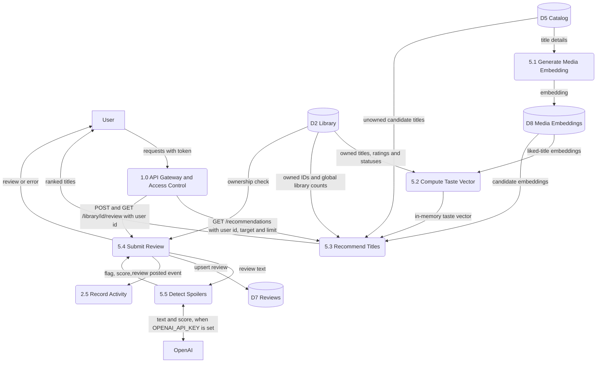

# DFD Level 2: Epic 5, Recommendations and Review Moderation

This document is the detailed view (Level 2) of process **5.0 AI Engine**. The parent diagram is in [dfd-level0-1.md](dfd-level0-1.md). It was checked against the code on 19.11.2026. Parts of the design that are not built are marked **not built**.

## 1. Scope

| Story | Function | State |
|---|---|---|
| US-13 | Cross-media recommendations | Built. Uses content embeddings with a popularity-based fallback |
| US-14 | Spoiler detection in reviews | Built |

The recommendation engine uses content embeddings. It averages embeddings from the logged-in user's positively rated or completed titles and ranks unowned candidates of the requested media type by cosine distance. When vector-based ranking is unavailable or the user has no usable taste vector, it falls back to global library-count popularity with a stable media ID tie-breaker. The collaborative part from the Charter is not part of version 1.

## 2. Components

| Type | Items |
|---|---|
| External entities | User, OpenAI (spoiler classification only) |
| Neighbor processes | 1.0 API Gateway (token check), 2.5 Record Activity |
| Data stores | D2 Library (read), D5 Catalog (read), D7 Reviews, D8 Media Embeddings (read/write). Taste vectors are computed per request and are not persisted. Recommendations do not use D9 Redis Cache |

### Process list

| ID | Process | Input | Output | Stores | State |
|---|---|---|---|---|---|
| 5.1 | Generate Media Embedding | Title details or embedding backfill | Embedding stored in D8 | D5 read, D8 read/write | Built |
| 5.2 | Compute Taste Vector | Current user's library and embeddings | In-memory average vector | D2 read, D8 read | Built at request time; not persisted |
| 5.3 | Recommend Titles | Required target type and optional limit | List of titles (200) | D2 read, D5 read, D8 read | Built. Cosine-distance ranking with popularity fallback |
| 5.4 | Submit Review | Review text | Stored review with spoiler flag (201), 404 or 422 | D2 read, D7 write | Built |
| 5.5 | Detect Spoilers | Review text | Spoiler flag, score and model name | OpenAI call, or local patterns | Built |

## 3. Level 2 diagram

The diagram includes the built embedding, taste-vector and recommendation processes. The taste vector exists only in memory for the recommendation request.

## 4. Process rules

### 5.1 Generate Media Embedding
1. Build source text from a title's name, media type, genres and description. Titles with neither genres nor description are skipped.
2. Generate an embedding using the configured embedding model and check that its dimension matches `EMBEDDING_DIMENSIONS`.
3. Store or update the vector in `media_embeddings`, together with the model name, dimension and source-text hash. The caller's transaction is not committed by this service.
4. Embeddings are updated when title details are loaded and can be backfilled with `python -m app.embeddings`. Failures in the safe-update wrapper are logged rather than raised to the caller.

### 5.2 Compute Taste Vector
1. Read embeddings for the logged-in user's library entries whose rating is at least 7, or whose status is `COMPLETED` and rating is NULL.
2. Use embeddings from the configured model only.
3. Compute the component-wise average in memory. No separate user taste-vector table is used, and the vector is not persisted.
4. If no qualifying embeddings are available, skip vector ranking and use the fallback recommendation strategy.

### 5.3 Recommend Titles (US-13)
1. Request: authenticated `GET /recommendations` with required `target` (`GAME`, `SERIES` or `MOVIE`) and optional `limit`. The default limit is 10; valid values are 1–50.
2. Exclude every title already present in the logged-in user's library (BR-14).
3. When a taste vector is available, rank candidates of the requested media type that have embeddings from the configured model by ascending cosine distance, with media ID as a stable tie-breaker.
4. If fewer than `limit` embedded candidates are found, append eligible candidates without embeddings, ordered by media ID, until the limit is filled or candidates run out.
5. If no usable taste vector is available, or the vector-ranking query fails, use a fallback ordered by the number of library entries across users, descending, then media ID ascending.
6. Answer 200 with up to `limit` items. The response fields are `id`, `title`, `media_type`, `poster_url`, `release_date`, `external_api_id` and `genres`. The endpoint does not return a score or description, and recommendations are not cached.

### 5.4 Submit Review (US-14)
1. Request: `POST /library/{id}/review` with `text`. The text is 1 to 5000 characters and not blank, or the answer is 422.
2. The library entry must belong to the user, or the answer is 404.
3. Create or replace the review first. A library entry has one review. If it exists, its text is replaced, its spoiler fields are set to NULL and `updated_at` is set. If not, a review is created. Send a `REVIEW_POSTED` event to 2.5 ("Review posted") in the same transaction and commit.
4. Process 5.5 classifies the text. No transaction is open and no database connection is held while it runs.
5. Write the result (`contains_spoiler`, `spoiler_score`, `spoiler_model_version`) in a second short transaction. The result is dropped when the review was deleted or its text changed in the meantime.
6. Answer 201 with the review. `GET /library/{id}/review` returns the review, or `null` when there is none.
7. The review does not change the statistics, so the cache of the statistics is not deleted.

### 5.5 Detect Spoilers (US-14)
1. When `OPENAI_API_KEY` is set, ask the model in `SPOILER_MODEL` for a JSON answer with `contains_spoiler` and a `score` from 0 to 1. The review is flagged when the model says it contains a spoiler and the score is at least `SPOILER_THRESHOLD` (default 0.5). The model name is stored as the model version.
2. When there is no key, a list of local patterns decides instead: each pattern that matches adds its weight, the sum is cut at 1, and a sum of `SPOILER_THRESHOLD` or more is a spoiler. The model version is `omnilog-nlp-spoiler-v1`.
3. When a key is set and OpenAI is down, times out or answers something that is not valid, the review is not checked: `contains_spoiler`, `spoiler_score` and `spoiler_model_version` stay NULL. The review is still saved and the answer is a normal 201 or 200, never 503 or 500 (NFR-04).

## 5. Data store usage (CRUD)

| Process | D2 Library | D5 Catalog | D7 Reviews | D4 Activity Log | D8 Media Embeddings |
|---|---|---|---|---|---|
| 5.1 Generate Media Embedding | | R | | | C, R, U |
| 5.2 Compute Taste Vector | R | | | | R |
| 5.3 Recommend Titles | R | R | | | R |
| 5.4 Submit Review | R | | C, R, U | C (through 2.5) | |
| 5.5 Detect Spoilers | | | | | |

## 6. Mapping to stories and tests

| Story | Process | Endpoint | Test |
|---|---|---|---|
| US-13 | 5.3 | `GET /recommendations` | `test_us13_*` |
| US-14 | 5.4, 5.5 | `POST` and `GET /library/{id}/review` | `test_us14_*`, `test_openai_client.py` |
| NFR-04 | 5.5 | | `test_nfr04_*` |

The full list of test functions for each story is in [../data/traceability.md](../data/traceability.md).

## 7. Review of the E-R model for Epic 5

The tables `reviews` and `media_embeddings` are built. A separate `user_taste_vectors` table is not used: the user's taste vector is computed in memory for each recommendation request. The data dictionary and vector-space design are documented in [../data/er-diagram.md](../data/er-diagram.md), sections 5, 6 and 8.
