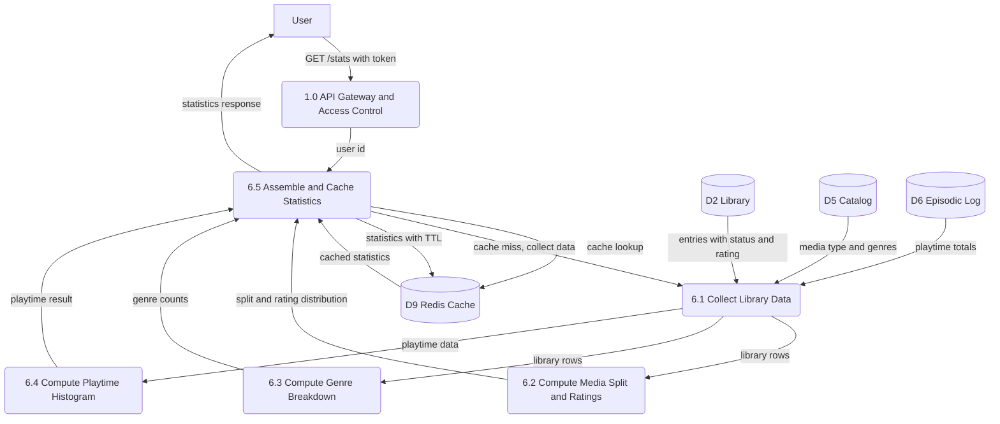

# DFD Level 2: Epic 6, Analytics Dashboard

This document is the detailed view (Level 2) of process **6.0 Analytics**. The parent diagram is in [dfd-level0-1.md](dfd-level0-1.md).

## 1. Scope

| Story | Function |
|---|---|
| US-15 | View personal statistics: genre breakdown, rating distribution, playtime and the game and series ratio |
| NFR-02 | `/stats` needs a valid token |

The Charter names four visual metrics: playtime histograms, genre breakdowns, rating distributions and media split ratios.

## 2. Components

| Type | Items |
|---|---|
| External entity | User |
| Neighbor processes | 1.0 API Gateway (token check), 2.3 and 4.3 (delete the cache after a change) |
| Data stores | D2 Library (read), D5 Catalog (read), D6 Episodic Log (read), D9 Redis Cache |

Epic 6 has no tables of its own. All numbers are computed from the other stores.

### Process list

| ID | Process | Input | Output |
|---|---|---|---|
| 6.1 | Collect Library Data | User id | Library rows with media type, rating, genres and playtime |
| 6.2 | Compute Media Split and Ratings | Library rows | Percent for each media type and rating counts |
| 6.3 | Compute Genre Breakdown | Library rows and genres | Count for each genre |
| 6.4 | Compute Playtime Histogram | Playtime of each title | Total minutes and bucket counts |
| 6.5 | Assemble and Cache Statistics | Results of 6.2 to 6.4 | The `/stats` response |

## 3. Level 2 diagram



## 4. Process rules

### 6.1 Collect Library Data
- Read only the library entries of the logged-in user (BR-16).
- Join the media type and the genres from D5.
- Join the playtime totals from D6. A title has no playtime when no chapter has playtime.

### 6.2 Compute Media Split and Ratings
- **Media split:** the share of each media type in the library, as a whole percent. Example: 3 games and 1 series give `GAME` 75 and `SERIES` 25. `MOVIE` is also in the result and is 0 when there are none. The percents add up to 100: the types with the largest remainders get the leftover points, so three equal types give 34, 33 and 33 (a tie goes to the earlier type: `GAME`, `SERIES`, `MOVIE`).
- **Rating distribution:** the count of entries for each rating from 1 to 10. A rating with a decimal is rounded to the nearest whole number (halves go up). Entries without a rating are not counted. Example: ratings 8, 8 and 6 give 2 for `"8"` and 1 for `"6"`.
- **Empty library:** all counts and percentages are 0. The status is 200.

### 6.3 Compute Genre Breakdown
- Count the library entries for each genre. A title with two genres is counted once for each genre.
- Sort by count, largest first.

### 6.4 Compute Playtime Histogram
- Add up the chapter playtime of each title. Show the total minutes for the whole library.
- Put the titles in buckets by total playtime. The bucket width is 5 hours. A title with no playtime is in the first bucket (`0-5h`). A bucket includes its lower edge, so exactly 5 hours is in `5-10h`. Empty buckets between the first and the last are listed, so a chart has no gaps. An empty library has an empty histogram.

### 6.5 Assemble and Cache Statistics
> **Status:** `GET /stats` is implemented without the cache. The numbers are computed on every request, so they are never old. The cache (steps 1 and 3) and the deletion of the entry after a change (step 4) are planned as one change, because a cache without the deletion would show old numbers.

1. Check Redis with the key `omni:stats:{user_id}`. On a hit, return the cached response.
2. On a miss, run 6.1 to 6.4 and build the response.
3. Save the response in Redis for 5 minutes.
4. The cache entry is deleted when the library changes (process 2.3) or playtime is logged (process 4.3). So the user never sees old numbers after a change.

## 5. Response format

```json
{
  "total_items": 4,
  "media_split": {"GAME": 75, "SERIES": 25, "MOVIE": 0},
  "rating_distribution": {"1": 0, "2": 0, "3": 0, "4": 0, "5": 0, "6": 1, "7": 0, "8": 2, "9": 0, "10": 0},
  "genre_breakdown": [{"genre": "Adventure", "count": 3}],
  "playtime": {
    "total_minutes": 0,
    "histogram": [{"bucket": "0-5h", "count": 4}]
  }
}
```

The tests check `media_split`, `rating_distribution` (with string keys) and `total_items`. The other fields follow the Charter. `genre_breakdown` is sorted by count, largest first, and by name when the counts are equal. A title without genres is not in it.

## 6. Data store usage (CRUD)

| Process | D2 Library | D5 Catalog | D6 Episodic Log | D9 Redis Cache |
|---|---|---|---|---|
| 6.1 Collect Library Data | R | R | R | |
| 6.2 Compute Media Split and Ratings | | | | |
| 6.3 Compute Genre Breakdown | | | | |
| 6.4 Compute Playtime Histogram | | | | |
| 6.5 Assemble and Cache Statistics | | | | C, R |

Processes 6.2 to 6.4 work only on data in memory.

## 7. Mapping to stories and tests

| Story | Process | Endpoint | Test |
|---|---|---|---|
| US-15 | 6.1 to 6.5 | `GET /stats` | `test_us15_*` |
| NFR-02 | 1.0 | `GET /stats` without token returns 401 | `test_nfr02_*` |

## 8. Dashboard screen

The statistics are shown on the Statistics screen. Each metric is one chart (Recharts): a donut for the media split, a bar chart for the rating distribution, a bar chart for the genres and a histogram for the playtime. See [../ui/screen-list.md](../ui/screen-list.md).
