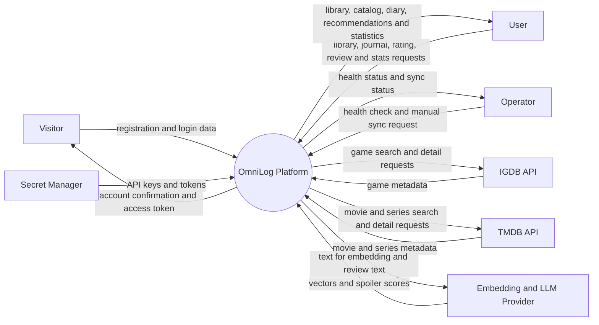
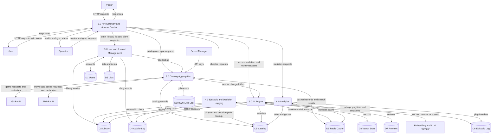

# DFD Level 0 and Level 1: OmniLog

This document shows the whole OmniLog system at two levels of detail.

- **Level 0** is the context diagram. It shows the system as one process and its data exchange with the outside world.
- **Level 1** splits the system into six main processes. Each process matches one epic.

Each Level 1 process is explained in more detail (Level 2) in its own document:

| Process | Epic | Level 2 document |
|---|---|---|
| 2.0 User and Journal Management | 2 | [dfd-epic2-journal.md](dfd-epic2-journal.md) |
| 3.0 Catalog Aggregation | 3 | [dfd-epic3-catalog.md](dfd-epic3-catalog.md) |
| 4.0 Episodic and Decision Logging | 4 | [dfd-epic4-episodic.md](dfd-epic4-episodic.md) |
| 5.0 AI Engine | 5 | [dfd-epic5-ai.md](dfd-epic5-ai.md) |
| 6.0 Analytics | 6 | [dfd-epic6-analytics.md](dfd-epic6-analytics.md) |

Process 1.0 (API gateway and access control) belongs to Epic 1. It is small and is explained in this document only.

## 1. Level 0: context diagram

### External entities

| Entity | Description |
|---|---|
| Visitor | A person who is not logged in. Can register and log in |
| User | A logged-in person who tracks media |
| Operator | A team member who runs the system and starts manual syncs (the Admin UI) |
| IGDB API | Outside source of game data |
| TMDB API | Outside source of movie and series data |
| Embedding and LLM Provider | Outside service for embeddings and language models (OpenAI or Hugging Face) |
| Secret Manager | Keeps API keys and tokens safe |

## 2. Level 1: main processes

### Processes

| ID | Process | Epic | Stories | Short description |
|---|---|---|---|---|
| 1.0 | API Gateway and Access Control | 1 | US-01, NFR-02 | Receives every request, checks the token, answers the health check, and sends the request to the right process |
| 2.0 | User and Journal Management | 2 | US-02 to US-07, NFR-03 | Accounts, login, library, custom lists and activity diary |
| 3.0 | Catalog Aggregation | 3 | US-08, US-09, NFR-01, NFR-04 | Search and details of titles. Fetches, normalizes, caches and stores outside data |
| 4.0 | Episodic and Decision Logging | 4 | US-10 to US-12 | Chapter ratings, playtime and branching decisions |
| 5.0 | AI Engine | 5 | US-13, US-14 | Embeddings, recommendations, reviews and spoiler detection |
| 6.0 | Analytics | 6 | US-15 | Personal statistics |

### Data stores

All stores live in one PostgreSQL database, except the cache. The split below is logical. The tables are listed in [../data/er-diagram.md](../data/er-diagram.md).

| ID | Data store | Main tables or keys |
|---|---|---|
| D1 | Users | `users` |
| D2 | Library | `user_libraries` |
| D3 | Lists | `custom_lists`, `custom_list_items` |
| D4 | Activity Log | `activity_events` |
| D5 | Catalog (Persistent DB) | `media_items`, `genres`, `media_item_genres`, `seasons`, `chapters`, `decision_points`, `decision_options`, `external_sources` |
| D6 | Episodic Log | `chapter_progress`, `playtime_logs`, `user_decisions` |
| D7 | Reviews | `reviews` |
| D8 | Vector Store | `media_embeddings`, `user_taste_vectors` |
| D9 | Redis Cache | Keys that start with `omni:` |
| D10 | Sync Job Log | `sync_job_logs` |

### Main data flows between processes

| Flow | From | To | Content |
|---|---|---|---|
| F-01 | 1.0 | 2.0, 3.0, 4.0, 5.0, 6.0 | The request and the id of the logged-in user |
| F-02 | 2.0 | 3.0 | Check that a title exists before it is added to a library or list |
| F-03 | 3.0 | 5.0 | A new or changed title that needs an embedding |
| F-04 | 2.0, 4.0, 5.0 | D4 | A diary event for each user action |
| F-05 | 2.0, 4.0 | D9 | Delete the cached statistics of the user after a change |

## 3. Process 1.0: API Gateway and Access Control

| Step | Description |
|---|---|
| 1 | Receive the HTTP request. |
| 2 | If the path is `/health`, answer `{"status": "healthy"}` with status 200 (US-01). |
| 3 | If the path starts with `/auth`, send the request to 2.0 without a token check. |
| 4 | For all other protected paths, read the bearer token and check its signature and expiry. |
| 5 | If the token is missing or not valid, answer 401 (NFR-02). |
| 6 | If the token is valid, add the user id to the request and send it to the right process. |
| 7 | Convert errors into clear HTTP answers. An outside failure must give cached data or 503, never an unhandled 500 (NFR-04). |

Protected paths are `/library`, `/lists`, `/diary`, `/stats`, `/recommendations` and the chapter paths. Catalog paths also need a token. Admin paths need a token of a user with `is_admin` set.

## 4. Data store rules

| Data store | Responsibility | Consistency rule |
|---|---|---|
| D1 Users | Accounts | Username and email are unique. Only password hashes are stored |
| D2 Library | Personal state of each title | One entry for each user and title |
| D3 Lists | Custom lists | One title appears once in a list |
| D4 Activity Log | Diary | Events are only appended. Newest first when read |
| D5 Catalog | Shared normalized catalog | One record for each (source, external id) |
| D6 Episodic Log | Chapter data of users | One progress row for each library entry and chapter. The playtime total is the sum of the entries |
| D7 Reviews | Reviews and spoiler flags | One review for each library entry |
| D8 Vector Store | Embeddings | One vector for each title and model. Rebuilt when the source text changes |
| D9 Redis Cache | Fast reads | A record is stale when its TTL has ended |
| D10 Sync Job Log | Sync history | Every job has a start time, an end time and a status |

Secrets are never stored in the database or in source code. They are read from environment variables or the Secret Manager.

## 5. Related documents

- [dfd-epic2-journal.md](dfd-epic2-journal.md)
- [dfd-epic3-catalog.md](dfd-epic3-catalog.md)
- [dfd-epic4-episodic.md](dfd-epic4-episodic.md)
- [dfd-epic5-ai.md](dfd-epic5-ai.md)
- [dfd-epic6-analytics.md](dfd-epic6-analytics.md)
- [../data/domain-model.md](../data/domain-model.md)
- [../data/er-diagram.md](../data/er-diagram.md)
- [../data/traceability.md](../data/traceability.md)
- [../requirement-analysis-report.md](../requirement-analysis-report.md)
