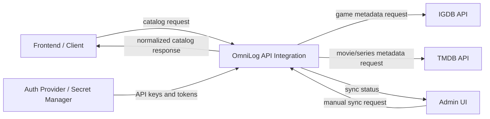
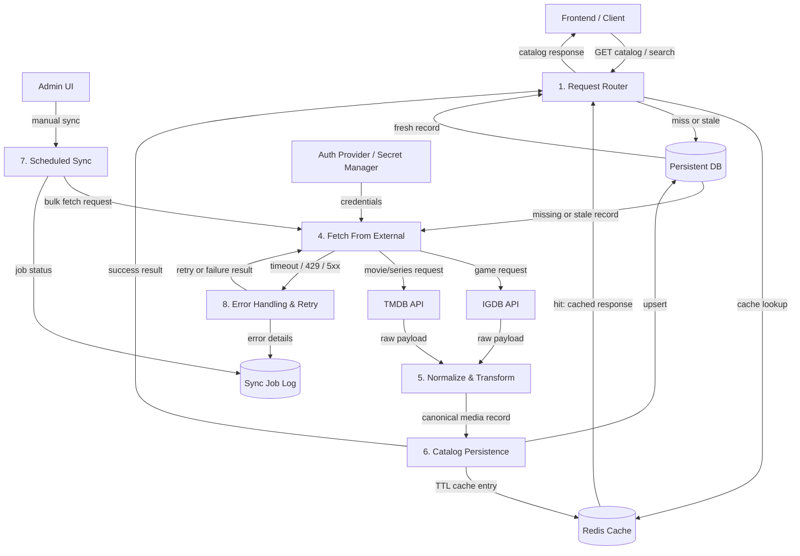

# DFD — Seviye 0 ve Seviye 1: OmniLog API Entegrasyon Bağlamı

Bu belge, OmniLog'un API entegrasyon katmanını iki ayrıntı seviyesinde açıklar:

- **Seviye 0:** Sistemin dış aktörler ve harici servislerle olan genel veri alışverişi
- **Seviye 1:** Katalog sorgulama, önbellek kontrolü, harici API çağrısı, normalizasyon ve senkronizasyon süreçlerinin ayrıştırılmış görünümü

Belge, özellikle Epic 3 kapsamındaki IGDB, TMDB ve Redis entegrasyonlarıyla uyumludur.

## 1. Seviye 0 — Bağlam diyagramı

### Dış varlıklar

- **Frontend / Client:** Katalog arama ve medya detay isteklerini gönderir.
- **Admin UI:** Manuel senkronizasyon veya yeniden indeksleme işlemlerini başlatır.
- **IGDB API:** Oyun metadata'sı sağlayan harici kaynak.
- **TMDB API:** Film ve dizi metadata'sı sağlayan harici kaynak.
- **Auth Provider / Secret Manager:** Harici servis anahtarlarının güvenli yönetimini sağlar.

### Ana sistem

- **OmniLog API Integration:** İstekleri karşılar, cache ve veritabanını kontrol eder, gerektiğinde harici servislerden veri alır, veriyi normalize eder ve sonucu istemciye sunar.

### Seviye 0 veri akışı



## 2. Seviye 1 — API entegrasyon süreçleri

Seviye 1'de ana sistem aşağıdaki süreçlere ayrılır:

1. **Request Router:** İstek kaynağını, medya türünü ve dış kaynak bilgisini belirler.
2. **Cache Read / Cache Write:** Redis üzerinde hızlı okuma ve TTL kontrollü yazma yapar.
3. **Persistent DB Check:** Kalıcı veritabanında mevcut veya güncel katalog kaydını arar.
4. **Fetch From External:** IGDB veya TMDB API'sine güvenli çağrı yapar.
5. **Normalize & Transform:** Kaynaklara özgü yanıtları ortak OmniLog katalog formatına dönüştürür.
6. **Catalog Persistence:** Normalize edilen kaydı kalıcı veritabanına ekler veya günceller.
7. **Scheduled Sync:** Toplu ve periyodik senkronizasyon görevlerini yürütür.
8. **Error Handling & Retry:** Rate limit, timeout ve geçici harici servis hatalarını yönetir.
9. **Sync Job Log:** Senkronizasyon ve entegrasyon sonuçlarını gözlemlenebilir hale getirir.

### Seviye 1 veri akışı



## 3. Temel akışlar

### 3.1 Cache hit

1. Client katalog isteği gönderir.
2. Request Router, Redis anahtarını kontrol eder.
3. Geçerli cache kaydı bulunursa veri doğrudan istemciye döndürülür.
4. Harici API çağrısı yapılmaz.

Önerilen anahtar biçimi:

```text
omni:catalog:{source}:{external_id}
```

### 3.2 Cache miss veya stale kayıt

1. Redis'te kayıt bulunamaz veya TTL sona ermiş olur.
2. Persistent DB kontrol edilir.
3. Veritabanında güncel kayıt varsa istemciye sunulur ve cache yenilenebilir.
4. Kayıt yoksa veya stale ise IGDB/TMDB çağrısı başlatılır.
5. Yanıt normalize edilir, DB'ye yazılır ve Redis'e TTL ile eklenir.
6. Normalize edilmiş sonuç istemciye döndürülür.

### 3.3 Manuel veya zamanlanmış senkronizasyon

1. Admin UI manuel sync isteği gönderir veya Scheduler görevi başlatır.
2. Kaynak ve medya türüne göre toplu fetch işlemi planlanır.
3. Her dış API çağrısı için sonuç, hata ve süre bilgisi tutulur.
4. Başarılı kayıtlar normalize edilerek DB ve Redis'e yazılır.
5. İş özeti `sync_job_log` kaydına eklenir.

### 3.4 Rate limit ve hata yönetimi

- HTTP 429 durumunda exponential backoff uygulanır.
- Geçici timeout ve 5xx hataları sınırlı sayıda yeniden denenir.
- Maksimum deneme sayısı aşıldığında hata loglanır ve istemciye kontrollü bir hata yanıtı verilir.
- Harici servis kullanılamıyorsa mevcut cache verisi varsa tercih edilir; yoksa uygun bir 503 yanıtı döndürülür.

## 4. Veri depoları ve tutarlılık kuralları

| Veri deposu | Sorumluluk | Tutarlılık kuralı |
|---|---|---|
| Redis Cache | Düşük gecikmeli katalog okuma | TTL dolduğunda kayıt stale kabul edilir |
| Persistent DB | Kalıcı normalize katalog verisi | Aynı kaynak ve dış ID için tek kanonik kayıt tutulur |
| Sync Job Log | Senkronizasyon ve hata geçmişi | Her iş için başlangıç, bitiş ve durum bilgisi tutulur |
| Secret Manager / Env | API anahtarı ve token yönetimi | Gizli bilgiler kaynak koduna yazılmaz |

## 5. İlgili belgeler

- `docs/analysis/behavior/dfd-epic3-catalog.md`
- `docs/analysis/data/traceability-epic3.md`
- `docs/analysis/requirement-analysis-report.md`
- `docs/analysis/data/domain-model.md`
- `docs/analysis/data/er-diagram.md`

Bu belge, Epic 3 gereksinimlerinin DFD süreçleri, veri depoları ve entegrasyon sınırlarıyla izlenebilir biçimde eşleştirilmesi için üst seviye referans olarak kullanılır.
