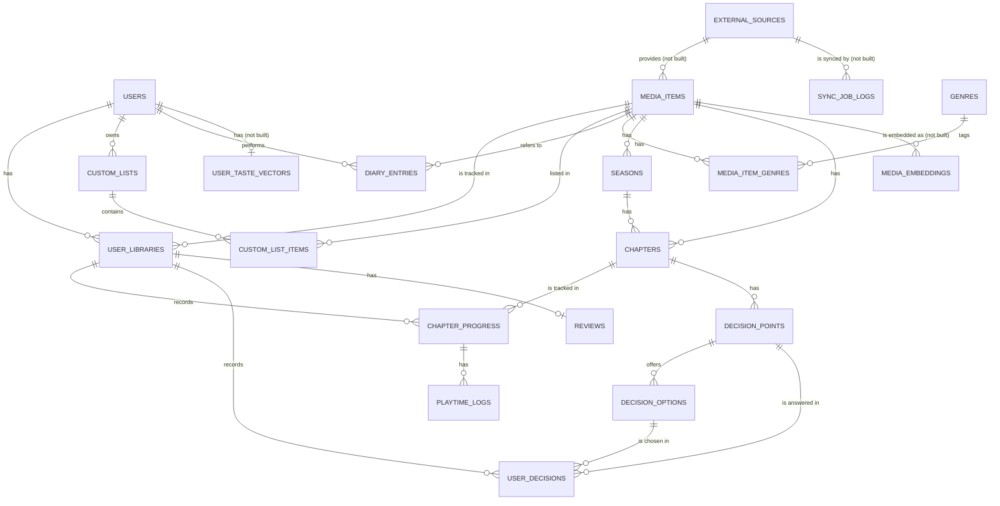
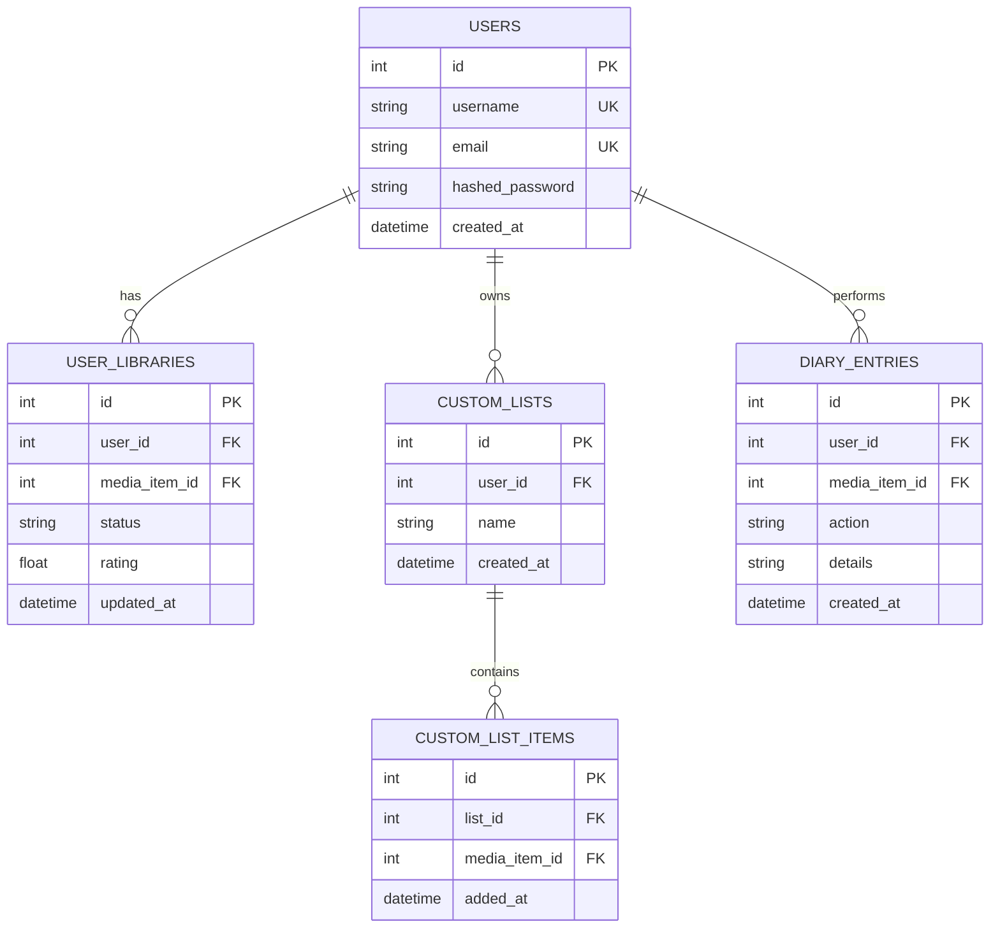
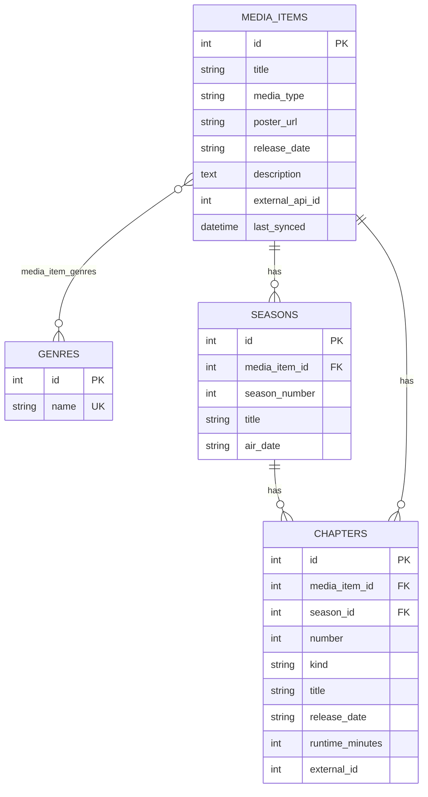
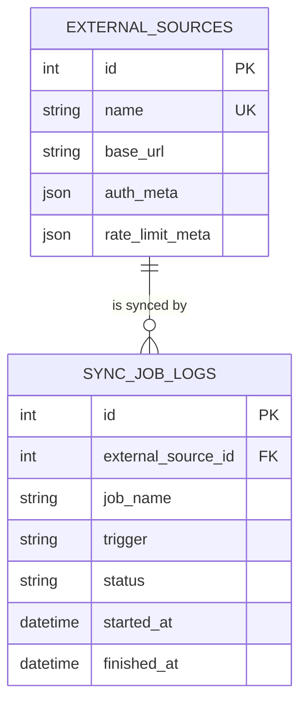
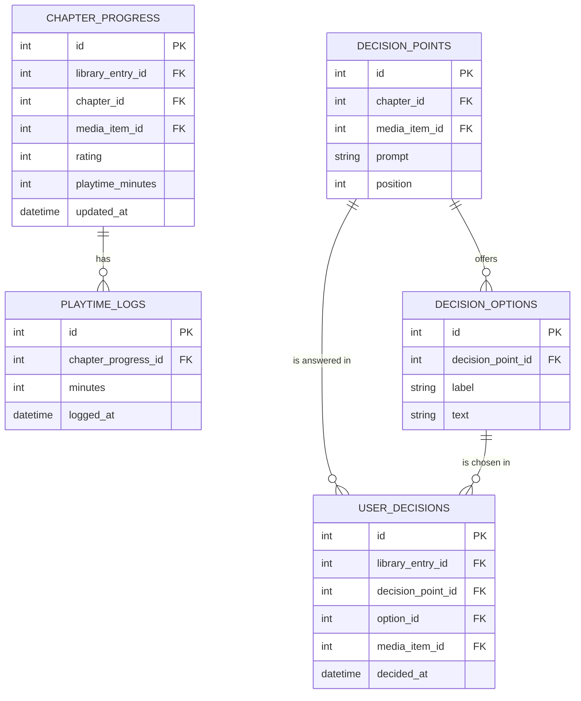
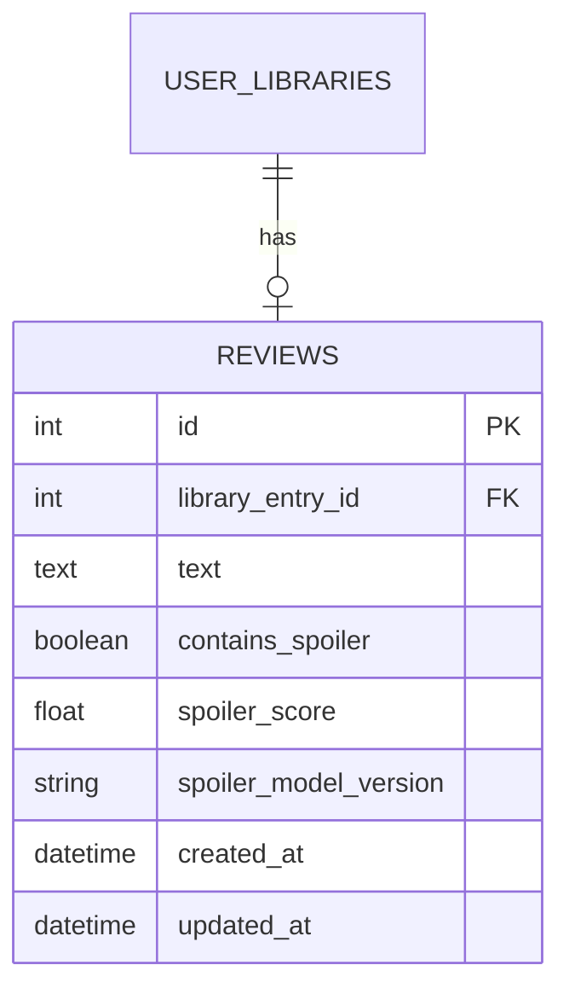
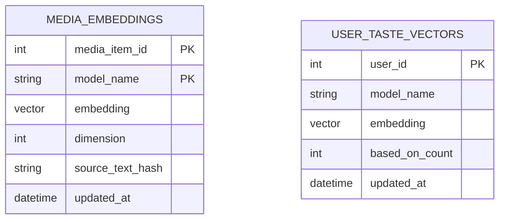

# E-R Diagram and Data Dictionary: OmniLog

This document has the entity-relationship diagrams, the data dictionary, the Redis key dictionary and the review of the embedding table.

The entities are explained in [domain-model.md](domain-model.md). Tables marked **Implemented** exist in `backend/app/models/entities.py` and in the migrations (the last one is `0011_reviews.py`). Tables marked **Proposed, not built** are part of the design only. Nothing in the code uses them. This document was checked against the code on 19.11.2026.

| Table | State |
|---|---|
| `users`, `media_items`, `genres`, `media_item_genres`, `seasons`, `chapters`, `user_libraries`, `custom_lists`, `custom_list_items`, `diary_entries`, `chapter_progress`, `playtime_logs`, `decision_points`, `decision_options`, `user_decisions`, `reviews` | **Implemented** |
| `external_sources`, `sync_job_logs`, `media_embeddings`, `user_taste_vectors` | **Proposed, not built** |

The diary table is called `diary_entries` in the code. Earlier drafts called it `activity_events`.

## 1. Overview diagram

This diagram shows all tables and their relationships. The columns are in the next sections.

The relationships marked "not built" belong to `EXTERNAL_SOURCES`, `SYNC_JOB_LOGS`, `MEDIA_EMBEDDINGS` and `USER_TASTE_VECTORS`. These four tables do not exist in the database.

## 2. Core and journal tables (Epic 2)

The column `users.is_admin` of the design is not built.

## 3. Catalog tables (Epic 3)

### Proposed, not built

These two tables and the columns of `media_items` that go with them are in the design only. The code identifies a title by `media_type` and `external_api_id` and has no sync job log (the manual sync is the command `python -m app.sync`), so it needs none of them.

## 4. Episodic logging tables (Epic 4)

## 5. AI tables (Epic 5)

Only `reviews` is built.

### Proposed, not built

The two vector tables have no model, no migration and no code that writes or reads them. The recommendations (US-13) do not need them, because they rank by genre.

## 6. Data dictionary

Notation: PK is primary key, FK is foreign key, UK is unique, NN is not null. A delete rule such as "cascade" means that the child rows are deleted with the parent row.

### users (Implemented)
| Column | Type | Constraints | Description |
|---|---|---|---|
| `id` | INTEGER | PK | Identifier |
| `username` | VARCHAR(50) | UK, NN, indexed, check without `@` | Login and display name. The check `chk_username_no_at` keeps a username from looking like an email, so a login name or an email is never ambiguous |
| `email` | VARCHAR(100) | UK, NN, indexed | Email address |
| `hashed_password` | VARCHAR(255) | NN | Password hash. Never returned by the API |
| `created_at` | DATETIME | NULL, default now | Account creation time |

The column `is_admin` of the design (manual sync and admin screens) is not built.

### external_sources (Proposed, not built)
| Column | Type | Constraints | Description |
|---|---|---|---|
| `id` | INTEGER | PK | Identifier |
| `name` | VARCHAR(30) | UK, NN | `IGDB` or `TMDB` |
| `base_url` | VARCHAR(255) | NN | API base address |
| `auth_meta` | JSON | NULL | Token type and expiry. Never the secret key itself |
| `rate_limit_meta` | JSON | NULL | Known rate limit information |

### media_items (Implemented)
| Column | Type | Constraints | Description |
|---|---|---|---|
| `id` | INTEGER | PK | Identifier |
| `title` | VARCHAR(200) | NN, indexed | Title |
| `media_type` | ENUM | NN | `GAME`, `SERIES` or `MOVIE` |
| `poster_url` | VARCHAR(500) | NULL | Cover image |
| `release_date` | VARCHAR(50) | NULL | Release date text |
| `description` | TEXT | NULL | Synopsis (migration 0010). Loaded when the details of the title are opened (US-09) |
| `external_api_id` | INTEGER | NULL, indexed | Id at IGDB or TMDB. Empty for titles that were created by hand |
| `last_synced` | DATETIME | NULL | Last successful fetch of the details (US-09) |

Unique on (`media_type`, `external_api_id`), named `uq_media_type_external_id` (migration 0004). TMDB ids of series and movies are different number spaces, so the media type is part of the key.

Columns of the design that are not built: `source_id` (foreign key to `external_sources`), `external_id` (a text id that would replace `external_api_id`), `normalized_payload`, `created_at` and `updated_at`. The unique index on (`source_id`, `external_id`) and the index on `last_synced` are not built either.

### genres and media_item_genres (Implemented, migration 0010)
| Column | Type | Constraints | Description |
|---|---|---|---|
| `genres.id` | INTEGER | PK | Identifier |
| `genres.name` | VARCHAR(50) | UK, NN | Canonical genre name. The few rules are in `backend/app/integrations/genres.py`: other names stay as the source wrote them. A new genre is matched to an existing one without regard to case |
| `media_item_genres.media_item_id` | INTEGER | PK, FK, cascade | Title |
| `media_item_genres.genre_id` | INTEGER | PK, FK, cascade | Genre |

### seasons (Implemented, US-09)
| Column | Type | Constraints | Description |
|---|---|---|---|
| `id` | INTEGER | PK | Identifier |
| `media_item_id` | INTEGER | FK, NN, cascade | The series |
| `season_number` | INTEGER | NN | Season number |
| `title` | VARCHAR(200) | NULL | Season title |
| `air_date` | VARCHAR(50) | NULL | First air date |

Unique on (`media_item_id`, `season_number`).

### chapters (Implemented, US-09)
| Column | Type | Constraints | Description |
|---|---|---|---|
| `id` | INTEGER | PK | Identifier |
| `media_item_id` | INTEGER | FK, NN, cascade | The series or game |
| `season_id` | INTEGER | FK, NULL, cascade | Season of an episode. Empty for game chapters |
| `number` | INTEGER | NN | Episode or chapter number |
| `kind` | ENUM | NN | `EPISODE` or `CHAPTER` |
| `title` | VARCHAR(200) | NULL | Title |
| `release_date` | VARCHAR(50) | NULL | Release or air date |
| `runtime_minutes` | INTEGER | NULL | Length of an episode |
| `external_id` | INTEGER | NULL | Id at the provider. An integer, like `media_items.external_api_id` |

Unique on (`season_id`, `number`) for episodes, and a partial unique index on (`media_item_id`, `number`) where `season_id` is empty for game chapters. Check constraints: an `EPISODE` has a season and a `CHAPTER` has none, and `number` and `runtime_minutes` are not negative. Unique on (`id`, `media_item_id`) as well, for the composite foreign key of `chapter_progress`. Rows are never deleted by a refresh or by the seed command, because the ratings, playtime and decisions of users point to them.

### user_libraries (Implemented)
| Column | Type | Constraints | Description |
|---|---|---|---|
| `id` | INTEGER | PK | Identifier |
| `user_id` | INTEGER | FK, NN, cascade | Owner |
| `media_item_id` | INTEGER | FK, NN, cascade | Title |
| `status` | ENUM | NN, default `PLAN_TO_WATCH` | `PLAN_TO_WATCH`, `IN_PROGRESS`, `COMPLETED` or `DROPPED` |
| `rating` | FLOAT | NULL, check 1 to 10 | Personal rating |
| `updated_at` | DATETIME | default now, on update | Last change |

Unique on (`user_id`, `media_item_id`) and on (`id`, `media_item_id`). The second one is needed by the composite foreign key of `chapter_progress`.

### custom_lists and custom_list_items (Implemented, migration 16c8eff0da76)
| Column | Type | Constraints | Description |
|---|---|---|---|
| `custom_lists.id` | INTEGER | PK | Identifier |
| `custom_lists.user_id` | INTEGER | FK, NN, cascade | Owner |
| `custom_lists.name` | VARCHAR(200) | NN | List name. Unique for one user |
| `custom_lists.created_at` | DATETIME | NN, default now | Creation time |
| `custom_list_items.id` | INTEGER | PK | Identifier |
| `custom_list_items.list_id` | INTEGER | FK, NN, cascade | The list |
| `custom_list_items.media_item_id` | INTEGER | FK, NN, cascade | The title |
| `custom_list_items.added_at` | DATETIME | NN, default now | When it was added |

Unique on (`custom_lists.user_id`, `custom_lists.name`) and on (`custom_list_items.list_id`, `custom_list_items.media_item_id`). The list has no description column. The name is checked as not empty by the API.

### diary_entries (Implemented, US-07)
| Column | Type | Constraints | Description |
|---|---|---|---|
| `id` | INTEGER | PK | Identifier |
| `user_id` | INTEGER | FK, NN, cascade | Who did it |
| `media_item_id` | INTEGER | FK, NULL, cascade | Title that the event is about |
| `action` | VARCHAR(50) | NN | Event type. The values are listed in the enum table below. The database does not check them, the code in `diary_service.py` does |
| `details` | VARCHAR(255) | NULL | Short text about the event. The service cuts it at 255 characters |
| `created_at` | DATETIME | NN, default now | Event time |

Events are only added. They are never changed or deleted, and a removal is a new event. A title is never deleted from the catalog, so the cascade on `media_item_id` does not remove events in practice. There is no index beyond the primary key.

### chapter_progress (Implemented, US-10)
| Column | Type | Constraints | Description |
|---|---|---|---|
| `id` | INTEGER | PK | Identifier |
| `library_entry_id` | INTEGER | FK, NN, cascade | The library entry of the user |
| `chapter_id` | INTEGER | FK, NN, cascade | The chapter |
| `media_item_id` | INTEGER | FK, NN | The title of the library entry and of the chapter |
| `rating` | SMALLINT | NULL, check 1 to 5 | Chapter rating |
| `playtime_minutes` | INTEGER | NN, default 0, check 0 or more | Total of all playtime entries |
| `updated_at` | DATETIME | NN, default now (UTC), on update | Last change |

Unique on (`library_entry_id`, `chapter_id`). The foreign keys are composite: (`library_entry_id`, `media_item_id`) points to `user_libraries` and (`chapter_id`, `media_item_id`) points to `chapters`, both with cascade. So the database itself refuses a progress row whose chapter belongs to another title than the library entry (BR-11). This needs a unique constraint on (`id`, `media_item_id`) in `user_libraries` and in `chapters`. Check constraints: `rating` is empty or from 1 to 5, and `playtime_minutes` is not negative. The row is created by the first rating. The column `playtime_minutes` stays 0 until the first playtime entry (US-11).

### playtime_logs (Implemented, US-11)
| Column | Type | Constraints | Description |
|---|---|---|---|
| `id` | INTEGER | PK | Identifier |
| `chapter_progress_id` | INTEGER | FK, NN, cascade | The progress row |
| `minutes` | INTEGER | NN, check 1 or more | Minutes of this entry |
| `logged_at` | DATETIME | NN, default now (UTC) | When it was logged |

Index on `chapter_progress_id`. The check constraint `chk_playtime_minutes` keeps every entry at 1 minute or more (BR-12). `chapter_progress.playtime_minutes` is the sum of the entries and is raised by the database in the same transaction as the new entry.

### decision_points, decision_options and user_decisions (Implemented, US-12, migration 0008)
| Column | Type | Constraints | Description |
|---|---|---|---|
| `decision_points.id` | INTEGER | PK | Identifier |
| `decision_points.chapter_id` | INTEGER | FK, NN, cascade, indexed | The chapter |
| `decision_points.media_item_id` | INTEGER | NN | The title of the chapter. Part of a composite foreign key |
| `decision_points.prompt` | VARCHAR(300) | NN | The question of the decision |
| `decision_points.position` | INTEGER | NN, default 1, check 1 or more | Order inside the chapter |
| `decision_options.id` | INTEGER | PK | Identifier |
| `decision_options.decision_point_id` | INTEGER | FK, NN, cascade | The decision point |
| `decision_options.label` | VARCHAR(10) | NN | Short label such as `A` or `B` |
| `decision_options.text` | VARCHAR(200) | NULL | Description of the option |
| `user_decisions.id` | INTEGER | PK | Identifier |
| `user_decisions.library_entry_id` | INTEGER | FK, NN, cascade | The library entry of the user |
| `user_decisions.decision_point_id` | INTEGER | FK, NN, cascade, indexed | The decision point |
| `user_decisions.option_id` | INTEGER | FK, NN | The chosen option. No cascade, so a chosen option cannot be deleted |
| `user_decisions.media_item_id` | INTEGER | NN | The title of the library entry and of the decision point |
| `user_decisions.decided_at` | DATETIME | NN, default now (UTC) | Time of the latest choice |

Unique on (`decision_options.decision_point_id`, `decision_options.label`) and on (`user_decisions.library_entry_id`, `user_decisions.decision_point_id`). The foreign keys are composite, like the ones of `chapter_progress`: (`chapter_id`, `media_item_id`) of a decision point points to `chapters`, (`library_entry_id`, `media_item_id`) of a decision points to `user_libraries`, (`decision_point_id`, `media_item_id`) points to `decision_points`, and (`decision_point_id`, `option_id`) points to `decision_options`. So the database refuses a decision whose option belongs to another decision point or whose decision point belongs to another title than the library entry. The unique constraints on (`id`, `media_item_id`) in `decision_points` and on (`decision_point_id`, `id`) in `decision_options` support this.

### reviews (Implemented, US-14, migration 0011)
| Column | Type | Constraints | Description |
|---|---|---|---|
| `id` | INTEGER | PK | Identifier |
| `library_entry_id` | INTEGER | FK, UK, NN, cascade | The library entry. One review for each entry |
| `text` | TEXT | NN | Review text. The API accepts 1 to 5000 characters |
| `contains_spoiler` | BOOLEAN | NULL | True or false. The API always sets it |
| `spoiler_score` | FLOAT | NULL | Classifier score from 0 to 1 |
| `spoiler_model_version` | VARCHAR(50) | NULL | The model that classified the text, for example `gpt-4o-mini`, or `omnilog-nlp-spoiler-v1` for the local patterns |
| `created_at` | DATETIME | NN, default now (UTC) | Creation time |
| `updated_at` | DATETIME | NULL | Empty until the review is replaced. The service sets it, the database does not |

A second review for the same entry replaces the first one, so the unique constraint `uq_review_library_entry` is never hit by the API.

### media_embeddings (Proposed, not built)
This table does not exist. There is no model, no migration and no code that reads or writes it. The function `embed_texts` in `backend/app/integrations/openai_client.py` can ask OpenAI for vectors, but nothing calls it.

| Column | Type | Constraints | Description |
|---|---|---|---|
| `media_item_id` | INTEGER | PK, FK, cascade | The title |
| `model_name` | VARCHAR(100) | PK | Embedding model that made the vector |
| `embedding` | VECTOR(1536) | NN | The vector from OpenAI `text-embedding-3-small` |
| `dimension` | INTEGER | NN | Size of the vector |
| `source_text_hash` | CHAR(64) | NN | Hash of the text that was embedded |
| `created_at` | DATETIME | default now | First creation |
| `updated_at` | DATETIME | default now, on update | Last refresh |

### user_taste_vectors (Proposed, optional, not built)
| Column | Type | Constraints | Description |
|---|---|---|---|
| `user_id` | INTEGER | PK, FK, cascade | The user |
| `model_name` | VARCHAR(100) | NN | Model of the vectors that were averaged |
| `embedding` | VECTOR(1536) | NN | Average vector of the liked titles using `text-embedding-3-small` |
| `based_on_count` | INTEGER | NN | Number of titles used |
| `updated_at` | DATETIME | NN | Last refresh |

### sync_job_logs (Proposed, not built)
| Column | Type | Constraints | Description |
|---|---|---|---|
| `id` | INTEGER | PK | Identifier |
| `external_source_id` | INTEGER | FK, NULL | The source that was synced |
| `job_name` | VARCHAR(100) | NN | Name of the job |
| `trigger` | ENUM | NN | `SCHEDULED` or `MANUAL` |
| `started_at` | DATETIME | NN | Start time |
| `finished_at` | DATETIME | NULL | End time. Empty while running |
| `status` | ENUM | NN | `RUNNING`, `SUCCESS` or `FAILED` |
| `records_processed` | INTEGER | NN, default 0 | Number of records written |
| `error_text` | TEXT | NULL | Error message when the job failed |

### Enum values

| Enum | Values |
|---|---|
| MediaType | `GAME`, `SERIES`, `MOVIE` |
| WatchStatus | `PLAN_TO_WATCH`, `IN_PROGRESS`, `COMPLETED`, `DROPPED` |
| ChapterKind | `EPISODE`, `CHAPTER` |
| DiaryAction (text in `diary_entries.action`) | `LIBRARY_ADDED`, `STATUS_CHANGED`, `RATED`, `CHAPTER_RATED`, `PLAYTIME_LOGGED`, `DECISION_RECORDED`, `LIST_CREATED`, `LIST_ITEM_ADDED`, `LIBRARY_REMOVED`, `LIST_ITEM_REMOVED`, `LIST_DELETED`, `REVIEW_POSTED` |
| JobTrigger (not built) | `SCHEDULED`, `MANUAL` |
| JobStatus (not built) | `RUNNING`, `SUCCESS`, `FAILED` |

## 7. Redis key dictionary

| Key pattern | Content | TTL | Written by |
|---|---|---|---|
| `omni:catalog:{source}:{external_id}` | Normalized catalog record. For US-09 the source is `tmdb_tv` (the ids of TMDB series and movies are different number spaces) and the record is the seasons and episodes of the series with its description and genres, or `{"found": false}` when TMDB does not know the id. The sources `igdb` (a game) and `tmdb_movie` (a movie) hold the description and genres of one title | `DETAILS_CACHE_TTL_SECONDS`, default 24 hours | Process 3.5 |
| `omni:search:{type}:{query_hash}` | List of search results | `CACHE_TTL_SECONDS`, default 1 hour | Process 3.2 |
| `omni:stats:{user_id}` | Statistics response | 24 hours. Deleted when the user changes a library entry, a chapter rating, playtime or a decision, or removes a list item or a list | Process 6.5 |

The key `omni:reco:{user_id}:{target}` of the design is not built. The recommendations are computed on every request. Every key falls back to an in-process cache when Redis is down.

## 8. Embedding table and vector space review

This section reviews the Epic 5 data design. **It is a design only and none of it is built.** The code has no `media_embeddings` table, and `GET /recommendations` ranks the titles by the genres of the library. Only the model name and the size (`text-embedding-3-small`, 1536) exist in the settings, and the function `embed_texts` exists in the OpenAI client without a caller.

### 8.1 What was checked

| Check | Result |
|---|---|
| Is there a table for the vectors? | Not in the code. The design has `media_embeddings`, which is not built. |
| Can games and series be compared? | Yes, if one model and one text template are used for all media types. Then all titles share one vector space. |
| Can the model be changed later? | Yes. The primary key (`media_item_id`, `model_name`) allows two models at the same time during a migration. |
| Does the vector become old when the title changes? | `source_text_hash` detects this. If the hash changes, the vector is made again. |
| Where is the user profile? | It is computed from the vectors of liked titles. `user_taste_vectors` is an optional cache. |
| Where are reviews stored? | In `reviews`. Spoiler detection does not need vectors. |

### 8.2 Design decisions for the vector space

1. **One model for all media types.** Vectors from different models cannot be compared. The model name is stored in each row.
2. **One embedding text template.** The text is the title, the genres and the description. Every media type uses the same template.
3. **Fixed dimension.** Use OpenAI `text-embedding-3-small` with its default dimension of 1536 (no shortening).
4. **Cosine distance.** Vectors are normalized to length 1. The index uses cosine distance. A HNSW index is the proposed index type.
5. **Vector store.** The Charter allows pgvector or Pinecone. The proposal is pgvector. PostgreSQL is already in the stack and the Compose image is a pgvector image, but no migration creates the extension yet.
6. **Recommendation query.** The query takes the taste vector of the user and finds the nearest vectors of the target type. It removes titles that are already in the library.

### 8.3 Open points for the AI work

| # | Question |
|---|---|
| 1 | Which embedding model is used (hosted or open source), and what is its dimension? Decided: OpenAI `text-embedding-3-small`, 1536 dimensions. |
| 2 | Is the Charter's collaborative filtering part of version 1? Decided: No. Version 1 uses content-based recommendations only. |
| 3 | Are the embeddings built? No. Version 1 of the code ranks by genre and never creates a vector. The two tables stay proposed. |
| 3 | Which model detects spoilers? Decided: OpenAI `gpt-4o-mini`, with a threshold of `0.5`. The model name is stored in `spoiler_model_version`. |
