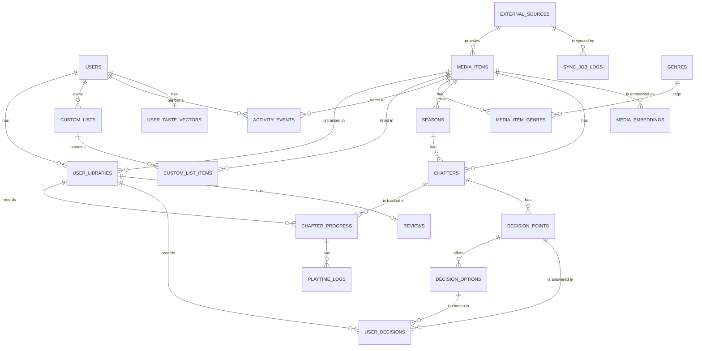
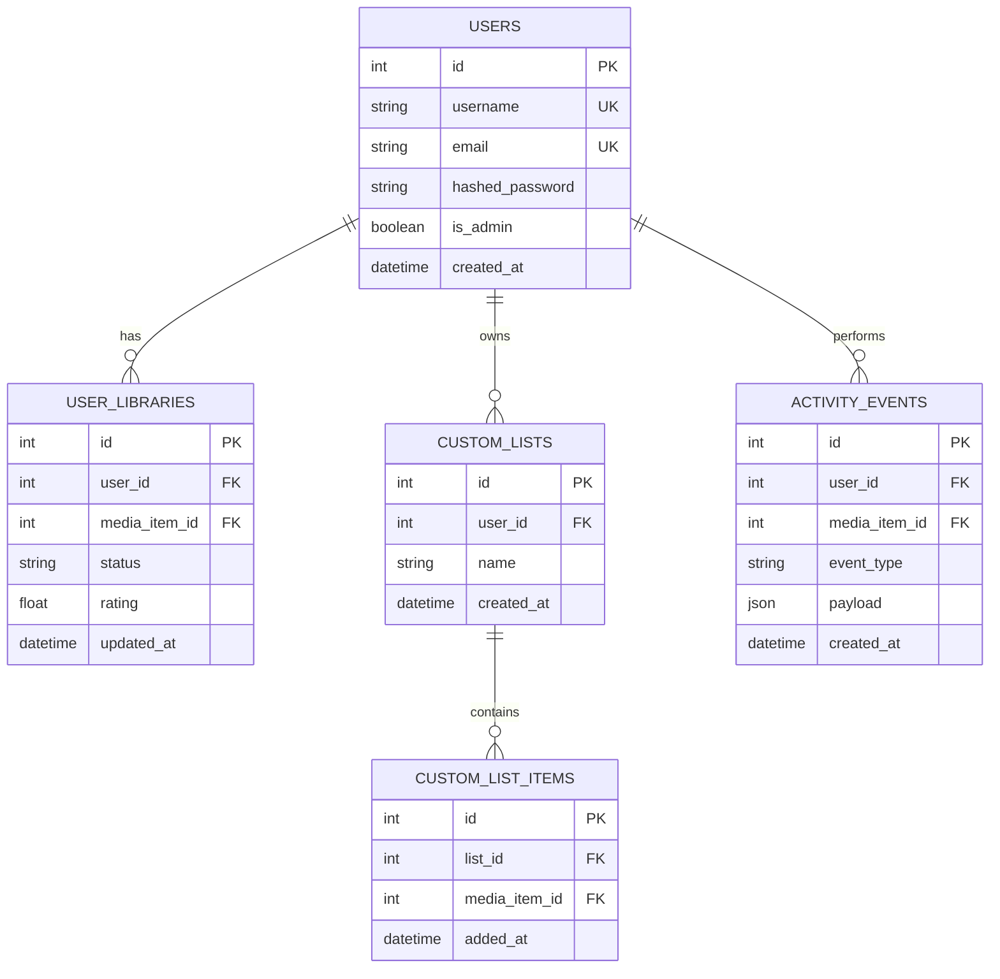
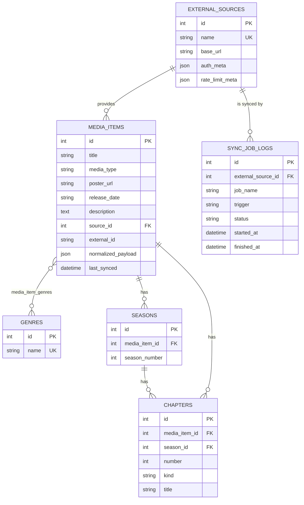
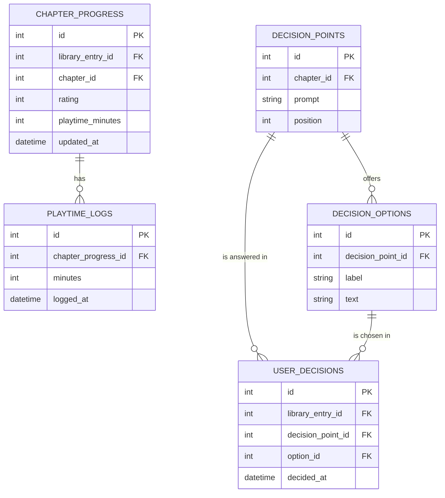
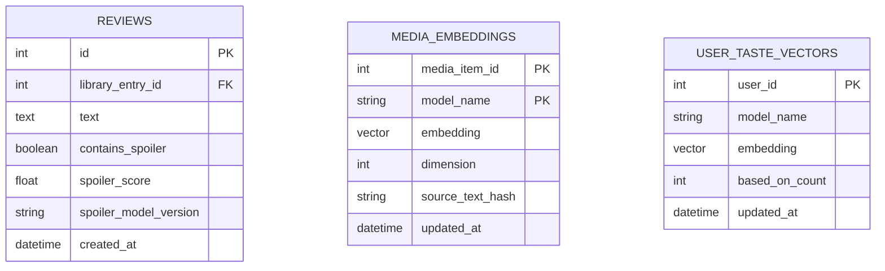

# E-R Diagram and Data Dictionary: OmniLog

This document has the entity-relationship diagrams, the data dictionary, the Redis key dictionary and the review of the embedding table.

The entities are explained in [domain-model.md](domain-model.md). Tables marked **Implemented** already exist in `backend/app/models/entities.py`. Tables marked **Proposed** are new.

## 1. Overview diagram

This diagram shows all tables and their relationships. The columns are in the next sections.

## 2. Core and journal tables (Epic 2)

## 3. Catalog tables (Epic 3)

## 4. Episodic logging tables (Epic 4)

## 5. AI tables (Epic 5)

## 6. Data dictionary

Notation: PK is primary key, FK is foreign key, UK is unique, NN is not null. A delete rule such as "cascade" means that the child rows are deleted with the parent row.

### users (Implemented, one column proposed)
| Column | Type | Constraints | Description |
|---|---|---|---|
| `id` | INTEGER | PK | Identifier |
| `username` | VARCHAR(50) | UK, NN | Login and display name |
| `email` | VARCHAR(100) | UK, NN | Email address |
| `hashed_password` | VARCHAR(255) | NN | Password hash. Never returned by the API |
| `is_admin` | BOOLEAN | NN, default false | **New.** Allows manual sync and the admin screens |
| `created_at` | DATETIME | default now | Account creation time |

### external_sources (Proposed)
| Column | Type | Constraints | Description |
|---|---|---|---|
| `id` | INTEGER | PK | Identifier |
| `name` | VARCHAR(30) | UK, NN | `IGDB` or `TMDB` |
| `base_url` | VARCHAR(255) | NN | API base address |
| `auth_meta` | JSON | NULL | Token type and expiry. Never the secret key itself |
| `rate_limit_meta` | JSON | NULL | Known rate limit information |

### media_items (Implemented, columns proposed)
Of the new columns, only `last_synced` is implemented so far (US-09).
| Column | Type | Constraints | Description |
|---|---|---|---|
| `id` | INTEGER | PK | Identifier |
| `title` | VARCHAR(200) | NN, indexed | Title |
| `media_type` | ENUM | NN | `GAME`, `SERIES` or `MOVIE` |
| `poster_url` | VARCHAR(500) | NULL | Cover image |
| `release_date` | VARCHAR(50) | NULL | Release date text |
| `description` | TEXT | NULL | **New. Implemented (migration 0010).** Synopsis. Used for embeddings. Loaded when the details of the title are opened (US-09) |
| `source_id` | INTEGER | FK to `external_sources.id`, NULL | **New.** Data provider. Empty for items created by hand |
| `external_id` | VARCHAR(50) | NULL | **New.** Id at the provider. Replaces `external_api_id` |
| `normalized_payload` | JSON | NULL | **New.** Normalized provider data |
| `last_synced` | DATETIME | NULL | **New.** Last successful fetch. Used for stale checks |
| `created_at` | DATETIME | default now | **New.** Creation time |
| `updated_at` | DATETIME | default now, on update | **New.** Last change |

Unique index on (`source_id`, `external_id`). Index on `last_synced`.

### genres and media_item_genres (Implemented, migration 0010)
| Column | Type | Constraints | Description |
|---|---|---|---|
| `genres.id` | INTEGER | PK | Identifier |
| `genres.name` | VARCHAR(50) | UK, NN | Canonical genre name. The few rules are in `backend/app/integrations/genres.py`: other names stay as the source wrote them. A new genre is matched to an existing one without regard to case |
| `media_item_genres.media_item_id` | INTEGER | PK, FK, cascade | Title |
| `media_item_genres.genre_id` | INTEGER | PK, FK, cascade | Genre |

### seasons (Implemented, US-09)
| Column | Type | Constraints | Description |
|---|---|---|---|
| `id` | INTEGER | PK | Identifier |
| `media_item_id` | INTEGER | FK, NN, cascade | The series |
| `season_number` | INTEGER | NN | Season number |
| `title` | VARCHAR(200) | NULL | Season title |
| `air_date` | VARCHAR(50) | NULL | First air date |

Unique on (`media_item_id`, `season_number`).

### chapters (Implemented, US-09)
| Column | Type | Constraints | Description |
|---|---|---|---|
| `id` | INTEGER | PK | Identifier |
| `media_item_id` | INTEGER | FK, NN, cascade | The series or game |
| `season_id` | INTEGER | FK, NULL, cascade | Season of an episode. Empty for game chapters |
| `number` | INTEGER | NN | Episode or chapter number |
| `kind` | ENUM | NN | `EPISODE` or `CHAPTER` |
| `title` | VARCHAR(200) | NULL | Title |
| `release_date` | VARCHAR(50) | NULL | Release or air date |
| `runtime_minutes` | INTEGER | NULL | Length of an episode |
| `external_id` | INTEGER | NULL | Id at the provider. An integer, like `media_items.external_api_id` |

Unique on (`season_id`, `number`) for episodes, and a partial unique index on (`media_item_id`, `number`) where `season_id` is empty for game chapters. Check constraints: an `EPISODE` has a season and a `CHAPTER` has none, and `number` and `runtime_minutes` are not negative. Unique on (`id`, `media_item_id`) as well, for the composite foreign key of `chapter_progress`. Rows are never deleted by a refresh, because the ratings of users (Epic 4) will point to them.

### user_libraries (Implemented)
| Column | Type | Constraints | Description |
|---|---|---|---|
| `id` | INTEGER | PK | Identifier |
| `user_id` | INTEGER | FK, NN, cascade | Owner |
| `media_item_id` | INTEGER | FK, NN, cascade | Title |
| `status` | ENUM | NN, default `PLAN_TO_WATCH` | `PLAN_TO_WATCH`, `IN_PROGRESS`, `COMPLETED` or `DROPPED` |
| `rating` | FLOAT | NULL, check 1 to 10 | Personal rating |
| `updated_at` | DATETIME | default now, on update | Last change |

Unique on (`user_id`, `media_item_id`) and on (`id`, `media_item_id`). The second one is needed by the composite foreign key of `chapter_progress`.

### custom_lists and custom_list_items (Proposed)
| Column | Type | Constraints | Description |
|---|---|---|---|
| `custom_lists.id` | INTEGER | PK | Identifier |
| `custom_lists.user_id` | INTEGER | FK, NN, cascade | Owner |
| `custom_lists.name` | VARCHAR(100) | NN | List name. Not empty. Unique for one user |
| `custom_lists.description` | VARCHAR(500) | NULL | Optional text |
| `custom_lists.created_at` | DATETIME | default now | Creation time |
| `custom_list_items.id` | INTEGER | PK | Identifier |
| `custom_list_items.list_id` | INTEGER | FK, NN, cascade | The list |
| `custom_list_items.media_item_id` | INTEGER | FK, NN, cascade | The title |
| `custom_list_items.added_at` | DATETIME | default now | When it was added |

Unique on (`list_id`, `media_item_id`).

### activity_events (Proposed)
| Column | Type | Constraints | Description |
|---|---|---|---|
| `id` | INTEGER | PK | Identifier |
| `user_id` | INTEGER | FK, NN, cascade | Who did it |
| `media_item_id` | INTEGER | FK, NULL, set null | Title that the event is about |
| `event_type` | ENUM | NN | See the enum list below |
| `payload` | JSON | NULL | Details such as the old and new value |
| `created_at` | DATETIME | NN, default now | Event time |

Index on (`user_id`, `created_at` descending).

### chapter_progress (Implemented, US-10)
| Column | Type | Constraints | Description |
|---|---|---|---|
| `id` | INTEGER | PK | Identifier |
| `library_entry_id` | INTEGER | FK, NN, cascade | The library entry of the user |
| `chapter_id` | INTEGER | FK, NN, cascade | The chapter |
| `media_item_id` | INTEGER | FK, NN | The title of the library entry and of the chapter |
| `rating` | SMALLINT | NULL, check 1 to 5 | Chapter rating |
| `playtime_minutes` | INTEGER | NN, default 0, check 0 or more | Total of all playtime entries |
| `updated_at` | DATETIME | NN, default now (UTC), on update | Last change |

Unique on (`library_entry_id`, `chapter_id`). The foreign keys are composite: (`library_entry_id`, `media_item_id`) points to `user_libraries` and (`chapter_id`, `media_item_id`) points to `chapters`, both with cascade. So the database itself refuses a progress row whose chapter belongs to another title than the library entry (BR-11). This needs a unique constraint on (`id`, `media_item_id`) in `user_libraries` and in `chapters`. Check constraints: `rating` is empty or from 1 to 5, and `playtime_minutes` is not negative. The row is created by the first rating. The column `playtime_minutes` stays 0 until the first playtime entry (US-11).

### playtime_logs (Implemented, US-11)
| Column | Type | Constraints | Description |
|---|---|---|---|
| `id` | INTEGER | PK | Identifier |
| `chapter_progress_id` | INTEGER | FK, NN, cascade | The progress row |
| `minutes` | INTEGER | NN, check 1 or more | Minutes of this entry |
| `logged_at` | DATETIME | NN, default now (UTC) | When it was logged |

Index on `chapter_progress_id`. The check constraint `chk_playtime_minutes` keeps every entry at 1 minute or more (BR-12). `chapter_progress.playtime_minutes` is the sum of the entries and is raised by the database in the same transaction as the new entry.

### decision_points, decision_options and user_decisions (Proposed)
| Column | Type | Constraints | Description |
|---|---|---|---|
| `decision_points.id` | INTEGER | PK | Identifier |
| `decision_points.chapter_id` | INTEGER | FK, NN, cascade | The chapter |
| `decision_points.prompt` | VARCHAR(300) | NN | The question of the decision |
| `decision_points.position` | INTEGER | NN, default 1 | Order inside the chapter |
| `decision_options.id` | INTEGER | PK | Identifier |
| `decision_options.decision_point_id` | INTEGER | FK, NN, cascade | The decision point |
| `decision_options.label` | VARCHAR(10) | NN | Short label such as `A` or `B` |
| `decision_options.text` | VARCHAR(200) | NULL | Description of the option |
| `user_decisions.id` | INTEGER | PK | Identifier |
| `user_decisions.library_entry_id` | INTEGER | FK, NN, cascade | The library entry of the user |
| `user_decisions.decision_point_id` | INTEGER | FK, NN, cascade | The decision point |
| `user_decisions.option_id` | INTEGER | FK, NN | The chosen option |
| `user_decisions.decided_at` | DATETIME | NN, default now | Time of the latest choice |

Unique on (`decision_options.decision_point_id`, `decision_options.label`). Unique on (`user_decisions.library_entry_id`, `user_decisions.decision_point_id`).

### reviews (Proposed)
| Column | Type | Constraints | Description |
|---|---|---|---|
| `id` | INTEGER | PK | Identifier |
| `library_entry_id` | INTEGER | FK, UK, NN, cascade | The library entry. One review for each entry |
| `text` | TEXT | NN | Review text |
| `contains_spoiler` | BOOLEAN | NULL | True or false. NULL when not checked yet |
| `spoiler_score` | FLOAT | NULL | Classifier score from 0 to 1 |
| `spoiler_model_version` | VARCHAR(50) | NULL | Classifier version |
| `created_at` | DATETIME | NN, default now | Creation time |
| `updated_at` | DATETIME | default now, on update | Last change |

### media_embeddings (Proposed)
| Column | Type | Constraints | Description |
|---|---|---|---|
| `media_item_id` | INTEGER | PK, FK, cascade | The title |
| `model_name` | VARCHAR(100) | PK | Embedding model that made the vector |
| `embedding` | VECTOR(n) | NN | The vector. `n` is the model dimension |
| `dimension` | INTEGER | NN | Size of the vector |
| `source_text_hash` | CHAR(64) | NN | Hash of the text that was embedded |
| `created_at` | DATETIME | default now | First creation |
| `updated_at` | DATETIME | default now, on update | Last refresh |

### user_taste_vectors (Proposed, optional)
| Column | Type | Constraints | Description |
|---|---|---|---|
| `user_id` | INTEGER | PK, FK, cascade | The user |
| `model_name` | VARCHAR(100) | NN | Model of the vectors that were averaged |
| `embedding` | VECTOR(n) | NN | Average vector of the liked titles |
| `based_on_count` | INTEGER | NN | Number of titles used |
| `updated_at` | DATETIME | NN | Last refresh |

### sync_job_logs (Proposed)
| Column | Type | Constraints | Description |
|---|---|---|---|
| `id` | INTEGER | PK | Identifier |
| `external_source_id` | INTEGER | FK, NULL | The source that was synced |
| `job_name` | VARCHAR(100) | NN | Name of the job |
| `trigger` | ENUM | NN | `SCHEDULED` or `MANUAL` |
| `started_at` | DATETIME | NN | Start time |
| `finished_at` | DATETIME | NULL | End time. Empty while running |
| `status` | ENUM | NN | `RUNNING`, `SUCCESS` or `FAILED` |
| `records_processed` | INTEGER | NN, default 0 | Number of records written |
| `error_text` | TEXT | NULL | Error message when the job failed |

### Enum values

| Enum | Values |
|---|---|
| MediaType | `GAME`, `SERIES`, `MOVIE` |
| WatchStatus | `PLAN_TO_WATCH`, `IN_PROGRESS`, `COMPLETED`, `DROPPED` |
| ChapterKind | `EPISODE`, `CHAPTER` |
| ActivityType | `LIBRARY_ADDED`, `STATUS_CHANGED`, `RATED`, `CHAPTER_RATED`, `PLAYTIME_LOGGED`, `DECISION_RECORDED`, `LIST_CREATED`, `LIST_ITEM_ADDED`, `LIBRARY_REMOVED`, `LIST_ITEM_REMOVED`, `LIST_DELETED`, `REVIEW_POSTED` |
| JobTrigger | `SCHEDULED`, `MANUAL` |
| JobStatus | `RUNNING`, `SUCCESS`, `FAILED` |

## 7. Redis key dictionary

| Key pattern | Content | TTL | Written by |
|---|---|---|---|
| `omni:catalog:{source}:{external_id}` | Normalized catalog record. For US-09 the source is `tmdb_tv` (the ids of TMDB series and movies are different number spaces) and the record is the seasons and episodes of the series with its description and genres, or `{"found": false}` when TMDB does not know the id. The sources `igdb` (a game) and `tmdb_movie` (a movie) hold the description and genres of one title | 1 hour to 24 hours. US-09 uses `DETAILS_CACHE_TTL_SECONDS`, default 24 hours | Process 3.5 |
| `omni:search:{type}:{query_hash}` | List of search results | 1 hour | Process 3.2 |
| `omni:reco:{user_id}:{target}` | List of recommended media ids | 10 minutes | Process 5.3 |
| `omni:stats:{user_id}` | Statistics response | 5 minutes. Deleted when the library or progress changes | Process 6.5 |

## 8. Embedding table and vector space review

This section reviews the Epic 5 data design.

### 8.1 What was checked

| Check | Result |
|---|---|
| Is there a table for the vectors? | No. The earlier draft had none. `media_embeddings` was added. |
| Can games and series be compared? | Yes, if one model and one text template are used for all media types. Then all titles share one vector space. |
| Can the model be changed later? | Yes. The primary key (`media_item_id`, `model_name`) allows two models at the same time during a migration. |
| Does the vector become old when the title changes? | `source_text_hash` detects this. If the hash changes, the vector is made again. |
| Where is the user profile? | It is computed from the vectors of liked titles. `user_taste_vectors` is an optional cache. |
| Where are reviews stored? | In `reviews`. Spoiler detection does not need vectors. |

### 8.2 Design decisions for the vector space

1. **One model for all media types.** Vectors from different models cannot be compared. The model name is stored in each row.
2. **One embedding text template.** The text is the title, the genres and the description. Every media type uses the same template.
3. **Fixed dimension.** A pgvector column has a fixed size. The dimension depends on the model. For example, a small open model gives 384 values and a large hosted model gives 1536 values. The team must choose one model before the table is created.
4. **Cosine distance.** Vectors are normalized to length 1. The index uses cosine distance. A HNSW index is the proposed index type.
5. **Vector store.** The Charter allows pgvector or Pinecone. The proposal is pgvector. PostgreSQL is already in the stack, and no extra service is needed. This depends on the move from SQLite to PostgreSQL (open point 1 in the domain model).
6. **Recommendation query.** The query takes the taste vector of the user and finds the nearest vectors of the target type. It removes titles that are already in the library.

### 8.3 Open points for the AI work

| # | Question |
|---|---|
| 1 | Which embedding model is used (hosted or open source), and what is its dimension? |
| 2 | Is the Charter's collaborative filtering part of version 1? This document assumes version 1 is content-based. No extra table is needed for the collaborative part because it uses the ratings in `user_libraries`. |
| 3 | Which model detects spoilers? It needs no table, but `spoiler_model_version` must be filled. |
