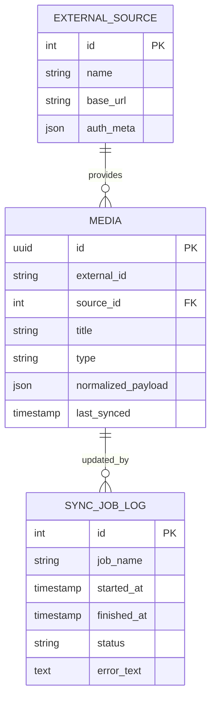

# E-R Diyagramı — (Metin/ASCII açıklama + Mermaid)

Basit E-R diyagramı Mermaid formatında. Dosya: docs/analysis/data/er-diagram.md

Açıklama:
- EXTERNAL_SOURCE -> MEDIA (1 - many)
- MEDIA -> SYNC_JOB_LOG (1 - many) (her senkronizasyon medya üzerindeki güncellemeleri tetikleyebilir)

Görsel ihtiyaçları için PlantUML veya Draw.io kullanılabilir; bu mermaid temelli şablon repo'ya gömülebilir.