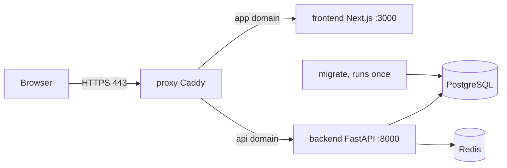

# Deployment

This document explains how to run OmniLog on a server with Docker. The stack has five services: PostgreSQL with pgvector, Redis, the backend, the frontend and a reverse proxy with automatic HTTPS.

## 1. What is deployed



- Only the proxy publishes ports (80 and 443). The database, Redis, the backend and the frontend are on a private Docker network. They cannot be reached from outside the server.
- The browser opens the frontend at the app domain, and the frontend code calls the backend at the API domain. This is why two names are needed, for example `app.example.com` and `api.example.com`.
- The service `migrate` runs `alembic upgrade head` and stops. The backend starts only after it finished without an error.

| File | Purpose |
|---|---|
| `docker-compose.prod.yml` | The production stack |
| `backend/Dockerfile` | Backend image (Python 3.11, runs as a normal user) |
| `frontend/Dockerfile` | Frontend image (Node 24, Next.js standalone output) |
| `docker/Caddyfile` | The proxy settings |
| `env.prod.example` | A list of all settings. Copy it to `.env.prod` |
| `.github/workflows/docker-build.yml` | Builds the images and tests the stack on every change |

`docker-compose.yml` (without `.prod`) is not changed. It is still the small stack for development, with only PostgreSQL and Redis.

## 2. What you need

- A Linux server with Docker Engine and the Compose plugin (`docker compose version` works).
- Two DNS A records that point to the server, one for the app and one for the API.
- Ports 80 and 443 open in the firewall. The proxy needs port 80 to get the certificates.
- Enough memory for the build of the frontend. In our test the build took 27 seconds and its largest process used about 1.3 GB, so a server with 2 GB is a safe size.
- The build needs internet access. The frontend loads its fonts from Google Fonts during `next build`.

## 3. First deployment

```bash
git clone https://github.com/metezd/OmniLog.git
cd OmniLog

cp env.prod.example .env.prod
# Fill in .env.prod (see section 4). Make the passwords with:  openssl rand -hex 32

docker compose -f docker-compose.prod.yml --env-file .env.prod up -d --build
```

Check the result:

```bash
docker compose -f docker-compose.prod.yml --env-file .env.prod ps
curl https://api.example.com/health        # {"status":"healthy"}
```

Then open the app domain in the browser. The proxy asks for the certificates when it starts, so wait a minute after the first start.

## 4. Settings

All settings are in `.env.prod`. The file holds secrets and is ignored by Git. Compose stops with a clear message if a required value is empty.

| Name | Required | Meaning |
|---|---|---|
| `POSTGRES_PASSWORD` | yes | Password of the database user |
| `REDIS_PASSWORD` | yes | Password of Redis |
| `SECRET_KEY` | yes | Signs the login tokens. At least 32 characters. The backend does not start with a shorter key |
| `APP_DOMAIN` | yes | Name of the frontend, for example `app.example.com` |
| `API_DOMAIN` | yes | Name of the backend, for example `api.example.com` |
| `API_URL` | yes | The address that the browser calls, for example `https://api.example.com`. Built into the frontend image |
| `CORS_ORIGINS` | yes | The address of the frontend, for example `https://app.example.com`. The backend accepts browser calls only from here |
| `IGDB_CLIENT_ID`, `IGDB_CLIENT_SECRET`, `TMDB_API_KEY` | no | Keys of the catalog services. Without them the catalog search cannot reach the outside services |
| `POSTGRES_USER`, `POSTGRES_DB` | no | Defaults are `omnilog` |
| `TAG` | no | Tag of the built images. Default is `latest` |

Use passwords that have only letters and digits (`openssl rand -hex 32`). The passwords are part of the database and Redis addresses, so characters such as `/` or `@` would break them.

`API_URL` is written into the JavaScript of the frontend when the image is built (Next.js does this for every variable that starts with `NEXT_PUBLIC_`). After you change it, build again with `--build`.

## 5. Update

```bash
git pull
docker compose -f docker-compose.prod.yml --env-file .env.prod up -d --build
```

The migrations run by themselves before the new backend starts. The data stays in the Docker volumes `pgdata` and `redisdata`.

To go back to an older version, check out the older commit and run the same command. A migration that was already applied is not undone. Restore a backup if the database also has to go back.

## 6. Backup and restore

```bash
# Backup
docker compose -f docker-compose.prod.yml --env-file .env.prod exec -T db \
  pg_dump -U omnilog -d omnilog --format=custom > omnilog-$(date +%F).dump

# Restore into an empty database
docker compose -f docker-compose.prod.yml --env-file .env.prod exec -T db \
  pg_restore -U omnilog -d omnilog --clean --if-exists < omnilog-2026-11-01.dump
```

Copy the backup files off the server. Backups are not made automatically.

## 7. Logs and health

```bash
docker compose -f docker-compose.prod.yml --env-file .env.prod logs -f backend
docker compose -f docker-compose.prod.yml --env-file .env.prod logs migrate
```

The backend answers `GET /health`. The images have a health check, and `docker compose ps` shows `healthy` when it passes.

## 8. Try it on your own computer

No real domain is needed. The proxy makes a certificate from its own local authority for `localhost` names. Use these values in `.env.prod`:

```
APP_DOMAIN=localhost
API_DOMAIN=api.localhost
API_URL=https://api.localhost
CORS_ORIGINS=https://localhost
```

Open `https://localhost` in the browser and accept the certificate warning, because the browser does not know the local authority. Open `https://api.localhost/health` once and accept the warning there too. Without that, the browser blocks the calls from the app to the API. This is the same setup that the CI workflow tests.

## 9. What protects what

| Risk | Protection |
|---|---|
| Someone reaches the database or Redis | They have no published ports. Redis also needs a password |
| Passwords or keys in the repository | `.env.prod` is in `.gitignore`. The images do not contain `.env` files (`.dockerignore`) |
| Traffic can be read | The proxy uses HTTPS with certificates that renew by themselves |
| Other websites call the API from a browser | `CORS_ORIGINS` lists only the app address |
| A break-in to a container gives full control | The backend and the frontend run as a normal user, not as root |
| A forgotten setting | Compose and the frontend build stop with a message when a required value is missing |

## 10. What is not included yet

- The images are not pushed to a registry. The server builds them itself.
- There is no automatic deployment to a server or a hosting platform. The workflow only checks that the stack starts and answers.
- There are no automatic backups, no monitoring and no alerts.
- The stack runs one copy of each service. Running more copies of the backend is not set up and not tested.
- The frontend does not call the API yet, because the login and register screens still use a mock service. `API_URL` has an effect when the frontend starts to use the API client.
- The AI features (US-13 and US-14) are not built, so nothing of them is deployed.

## 11. Problems

| Message or behavior | Cause and fix |
|---|---|
| `required variable ... is missing a value` | A value is empty in `.env.prod`. Fill it in |
| The browser shows a certificate error on a real domain | The DNS record does not point to the server yet, or port 80 is blocked. See `docker compose ... logs proxy` |
| The login page cannot reach the API | `API_URL` is wrong or was changed without `--build` |
| The API answers 4xx in the browser console with a CORS message | `CORS_ORIGINS` does not match the address of the frontend exactly. It has no trailing slash |
| `next build` fails with a font error | The build machine cannot reach `fonts.googleapis.com` |
