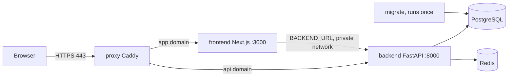
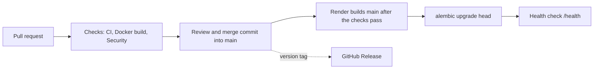

# Deployment

This document explains how to run OmniLog on a server with Docker. The stack has five services: PostgreSQL with pgvector, Redis, the backend, the frontend and a reverse proxy with automatic HTTPS.

## 1. What is deployed



- Only the proxy publishes ports (80 and 443). The database, Redis, the backend and the frontend are on a private Docker network. They cannot be reached from outside the server.
- The browser opens the frontend at the app domain. The server code of the frontend calls the backend over the private network at `BACKEND_URL` (`http://backend:8000`), and the browser itself does not call the backend. The proxy still publishes the backend at the API domain, for the interactive docs (`/docs`), the health checks and other clients. This is why two names are needed, for example `app.example.com` and `api.example.com`.
- The service `migrate` runs `alembic upgrade head` and stops. The backend starts only after it finished without an error.

| File | Purpose |
|---|---|
| `docker-compose.prod.yml` | The production stack |
| `backend/Dockerfile` | Backend image (Python 3.15, runs as a normal user) |
| `frontend/Dockerfile` | Frontend image (Node 26, Next.js standalone output) |
| `docker/Caddyfile` | The proxy settings |
| `env.prod.example` | A list of all settings. Copy it to `.env.prod` |
| `.github/workflows/docker-build.yml` | Builds the images and tests the stack on every change |
| `.github/workflows/release.yml` | Creates the GitHub Release when a version tag is pushed |

`docker-compose.yml` (without `.prod`) is not changed. It is still the small stack for development, with only PostgreSQL and Redis.

## 2. What you need

- A Linux server with Docker Engine and the Compose plugin (`docker compose version` works).
- Two DNS A records that point to the server, one for the app and one for the API.
- Ports 80 and 443 open in the firewall. The proxy needs port 80 to get the certificates.
- Enough memory for the build of the frontend. In our test the build took 27 seconds and its largest process used about 1.3 GB, so a server with 2 GB is a safe size.
- The build needs internet access. The frontend loads its fonts from Google Fonts during `next build`.

## 3. First deployment

```bash
git clone https://github.com/metezd/OmniLog.git
cd OmniLog

cp env.prod.example .env.prod
# Fill in .env.prod (see section 4). Make the passwords with:  openssl rand -hex 32

docker compose -f docker-compose.prod.yml --env-file .env.prod up -d --build
```

Check the result:

```bash
docker compose -f docker-compose.prod.yml --env-file .env.prod ps
curl https://api.example.com/health        # {"status":"healthy"}
```

Then load the chapters and decision points of the games, once after the first start and again whenever `backend/app/seed/game_chapters.json` changes:

```bash
docker compose -f docker-compose.prod.yml --env-file .env.prod exec backend python -m app.seed
```

The command checks the file first and saves nothing when the file has an error. It can be run again without harm. The shipped file holds one game (Life is Strange, 5 chapters, 6 decision points). To load another file, copy it into the container or rebuild the image. The tables for the migrations are created by the service `migrate`, so no other database command is needed.

To load the details (description, genres, seasons) of titles that were found in a search but never opened, run the manual sync. `--dry-run` only counts them. The command can be run again without harm, and a title that the outside service could not answer is tried again:

```bash
docker compose -f docker-compose.prod.yml --env-file .env.prod exec backend python -m app.sync
```

There is no command for embeddings. The API does not create them yet, and the recommendations use the genres of the library.

Then open the app domain in the browser. The proxy asks for the certificates when it starts, so wait a minute after the first start.

## 4. Settings

All settings are in `.env.prod`. The file holds secrets and is ignored by Git. Compose stops with a clear message if a required value is empty.

| Name | Required | Meaning |
|---|---|---|
| `POSTGRES_PASSWORD` | yes | Password of the database user |
| `REDIS_PASSWORD` | yes | Password of Redis |
| `SECRET_KEY` | yes | Signs the login tokens. At least 32 characters. The backend does not start with a shorter key |
| `APP_DOMAIN` | yes | Name of the frontend, for example `app.example.com` |
| `API_DOMAIN` | yes | Name of the backend, for example `api.example.com` |
| `API_URL` | yes | The public address of the backend, for example `https://api.example.com`. Built into the frontend image as `NEXT_PUBLIC_API_URL`. No code reads it since the Axios client `src/lib/api.ts` was removed, but the build still stops when it is empty |
| `CORS_ORIGINS` | yes | The address of the frontend, for example `https://app.example.com`. The backend accepts browser calls only from here |
| `FORWARDED_TRUSTED_HOPS` | no | How many proxies add an address to `X-Forwarded-For` in front of the backend. The login and register limits then count the address that many places from the right end of the header. Default `0` (use the address that uvicorn gives, right for this Docker setup). `render.yaml` sets `1` (section 9.1) |
| `FRONTEND_PROXY_SECRET` | no | A key that the backend and the frontend share, at least 32 characters. With it the frontend sends the browser address in `X-Client-IP`, and the backend uses that address only when `X-Frontend-Key` matches. Empty turns it off. `render.yaml` generates it for the backend and copies it to the frontend (section 9.1). Leave it empty for `docker-compose.prod.yml`: `FORWARDED_ALLOW_IPS` is enough there (see below) |
| `ENABLE_DOCS` | no | Shows the API documentation at `/docs`, `/redoc` and `/openapi.json`. Default is `false`, also when the backend starts without it (#394). `docker-compose.prod.yml` and `render.yaml` set `false` too. For development, set `ENABLE_DOCS=true` in `backend/.env` |
| `ALLOW_MEDIA_CREATE` | no | Turns on `POST /media`, which adds a title to the shared catalog. Default is `false`, so the route answers 404. Leave it off in production: titles come from the catalog search. Only the tests turn it on |
| `IGDB_CLIENT_ID`, `IGDB_CLIENT_SECRET`, `TMDB_API_KEY` | no | Keys of the catalog services. Without them the catalog search cannot reach the outside services |
| `OPENAI_API_KEY` | no | OpenAI API key. Without it, OpenAI-backed features are disabled |
| `EMBEDDING_MODEL`, `EMBEDDING_DIMENSIONS`, `SPOILER_MODEL`, `SPOILER_THRESHOLD`, `OPENAI_TIMEOUT_SECONDS`, `OPENAI_MAX_RETRIES` | no | Models, spoiler confidence threshold, request timeout in seconds and retry count |
| `OPENAI_COOLDOWN_SECONDS` | no | After a failed OpenAI call (no connection, timeout, 429 or 5xx), OpenAI is not called for this many seconds (default `60`, `0` turns it off) |
| `BACKGROUND_WORKERS` | no | Threads for the work after the answer: the embedding of a title and the OpenAI spoiler check (default `2`). No request waits for OpenAI (#382) |
| `IGDB_CLIENT_ID`, `IGDB_CLIENT_SECRET`, `TMDB_API_KEY` | no | Keys of the catalog services. Without them the catalog search cannot reach the outside services. For a demo without keys, set `IGDB_CLIENT_ID=public` (and any value in `IGDB_CLIENT_SECRET`) for games from the Steam Store, and `TMDB_API_KEY=public` for series from TVMaze and movies from Wikidata (without posters). Their ids are not IGDB or TMDB ids, so fill one database in one mode only |
| `OPENAI_API_KEY` | no | OpenAI API key. Without it, the spoiler check of a review uses local patterns instead of OpenAI, and no review text leaves the system (section 4.1). The review is saved first in both cases. When the key is set and OpenAI fails, the spoiler fields of the review stay NULL (not checked) |
| `SPOILER_PROVIDER` | no | Who checks a review for spoilers: `openai` (default) or `local`. With `openai` and a key, the review text is sent to OpenAI. `local` uses the local patterns and keeps the review text inside the system, while the key is still used for the embeddings of titles (#397). The backend does not start with another value |
| `SPOILER_MODEL` | no | Model that classifies a review. Default `gpt-4o-mini` |
| `SPOILER_THRESHOLD` | no | Score from 0 to 1 at which a review is flagged. Default `0.5` |
| `OPENAI_TIMEOUT_SECONDS`, `OPENAI_MAX_RETRIES` | no | Time limit of one OpenAI call in seconds (default `8`) and number of retries (default `2`) |
| `EMBEDDING_MODEL`, `EMBEDDING_DIMENSIONS` | no | Embedding model (default `text-embedding-3-small`) and its size (default `1536`). Opening a title creates its embedding in a background job when `OPENAI_API_KEY` is set (section 4.1) |
| `RATE_LIMIT_ENABLED` | no | `false` turns all rate limits off. Default `true`. See section 9.1 |
| `RATE_LIMIT_LOGIN_ACCOUNT` | no | Failed logins of one account from any address, as `<count>/<period>`. Default `20/hour` (section 9.1) |
| `RATE_LIMIT_REGISTER_DAY` | no | Registrations of one browser address in a day, besides `RATE_LIMIT_REGISTER`, as `<count>/<period>`. Default `20/day` (section 9.2) |
| `RATE_LIMIT_LOGIN`, `RATE_LIMIT_REGISTER`, `RATE_LIMIT_SEARCH`, `RATE_LIMIT_REVIEW`, `RATE_LIMIT_DETAILS`, `RATE_LIMIT_RECOMMENDATIONS` | no | The rate limits as `<count>/<second\|minute\|hour\|day>`. Defaults `10/minute`, `5/hour`, `30/minute`, `20/minute`, `60/minute` and `30/minute`. `RATE_LIMIT_RECOMMENDATIONS` counts `GET /recommendations` per user (#396). The backend does not start with a value in another form |
| `POSTGRES_USER`, `POSTGRES_DB` | no | Defaults are `omnilog` |
| `TAG` | no | Tag of the built images. Default is `latest` |

Use passwords that have only letters and digits (`openssl rand -hex 32`). The passwords are part of the database and Redis addresses, so characters such as `/` or `@` would break them.

`API_URL` is written into the JavaScript of the frontend when the image is built (Next.js does this for every variable that starts with `NEXT_PUBLIC_`). After you change it, build again with `--build`.

`OPENAI_*`, `SPOILER_*` and `EMBEDDING_*` are passed from `.env.prod` to the backend by `docker-compose.prod.yml`. The values in the table are the defaults, so an empty or missing line keeps them.

**Settings that are not in `.env.prod`.** The compose file sets `BACKEND_URL=http://backend:8000` for the frontend. The frontend needs it, because its server code calls the backend at this address, and it stops with `BACKEND_URL is not set` without it. On Render, set `BACKEND_URL` by hand to the address of the backend service (`render.yaml` lists it). The backend reads some more settings that have defaults. `docker-compose.prod.yml` passes them on too (`x-backend-env`), so a line in `.env.prod` changes them, and `env.prod.example` lists them as comments. The default in the compose file is the same as in `backend/app/core/config.py`. A test (`tests/test_prod_compose_env.py`) checks that every setting of `backend/.env.example` is in `x-backend-env`, so a new setting cannot be forgotten:

| Name | Default | Meaning |
|---|---|---|
| `ACCESS_TOKEN_EXPIRE_MINUTES` | `90` | How long a login token stays valid |
| `CACHE_TTL_SECONDS` | `3600` | How long search results stay in Redis |
| `DETAILS_CACHE_TTL_SECONDS` | `86400` | How long title details stay in Redis |
| `NEGATIVE_CACHE_TTL_SECONDS` | `300` | How long an empty answer from IGDB or TMDB (no search result, or an id the service does not know) stays in Redis. Keep it short. `0` turns it off |
| `DB_CACHE_TTL_DAYS` | `7` | A title whose details were loaded less than this many days ago is served from PostgreSQL (`media_items.last_synced`), with no call to IGDB or TMDB. `0` turns it off |
| `REDIS_SOCKET_TIMEOUT_SECONDS` | `0.5` | Time limit of one Redis call. Raise it for a Redis that is far away, such as a managed one |
| `EXTERNAL_API_TIMEOUT_SECONDS` | `8` | Time limit of one call to IGDB or TMDB |
| `EXTERNAL_API_MAX_RETRIES` | `3` | Retries after a timeout, a 429 or a 5xx answer |
| `EXTERNAL_API_BACKOFF_SECONDS` | `0.5` | First wait between retries. It doubles after each retry |
| `EXTERNAL_API_COOLDOWN_SECONDS` | `60` | When every try of a call got no answer (timeouts, no connection), that host is not called again for this many seconds, and the saved data is used (#428). An answer such as 503 is still tried again as before. `0` turns the pause off |
| `IGDB_MAX_REQUESTS_PER_SECOND` | `3` | The most requests per second that one backend process sends to IGDB (IGDB allows 4). A call that would wait more than 5 seconds fails at once, and the saved copy is used. `0` turns it off. The limit counts per process: the default setup runs one, so give each process its share when you start more |

The backend finds the database and Redis through `DATABASE_URL` and `REDIS_URL`, which the compose file builds from the passwords.

Two settings of `backend/.env.example` are left out of `x-backend-env` on purpose: `TEST_DATABASE_URL` is for the tests only, and `FORWARDED_TRUSTED_HOPS` stays `0`, because uvicorn already takes the browser address from the proxy and the frontend (`FORWARDED_ALLOW_IPS`).

**`FRONTEND_PROXY_SECRET` in the compose setup (#393).** It is not needed. The frontend has a fixed address (`172.30.42.11`) that is in `FORWARDED_ALLOW_IPS`, so uvicorn accepts the `X-Forwarded-For` header that the frontend passes on, and the backend counts the browser address that Caddy wrote. On Render the address of the frontend is not fixed, so the key is needed there (section 9.1). The compose file passes the setting to the backend with an empty default, but not to the frontend, so a value in `.env.prod` has no effect unless you also give the same key to the `frontend` service.

**The database on Render is Supabase.** `omnilog-api` uses PostgreSQL on Supabase, the same database that the workflow "Database Migration (Supabase)" migrates. The Render database `omnilog-db` is not used any more and is not in `render.yaml`. `DATABASE_URL` of `omnilog-api` has `sync: false`, so it is set once in the Render dashboard and a Blueprint sync keeps it. Before, the Blueprint set it from `omnilog-db` again after every sync. Use the **Session pooler** address of Supabase (`postgresql://postgres.<project>:<password>@<region>.pooler.supabase.com:5432/postgres`): the direct address `db.<project>.supabase.co` has only IPv6, which the runners of GitHub and many hosts cannot reach, and the Transaction pooler (port 6543) does not keep a session, which the migrations and the pool of the API need. The GitHub secret `SUPABASE_DB_URL` holds the same address.

**Managed Redis (Upstash).** Redis holds the search cache, the details cache and the rate limit counters. The Redis of the `render.yaml` free plan keeps nothing on disk, so the counters and the cache are lost when it restarts. To keep them, set `REDIS_URL` to a persistent managed instance, for example the TLS address of Upstash (`rediss://default:<password>@<name>.upstash.io:6379`, with two `s`). Keep the address secret, because it holds the password. A managed Redis is farther away, so raise `REDIS_SOCKET_TIMEOUT_SECONDS` (for example to `1`) when calls time out. An empty `REDIS_URL` or a Redis that is down never stops the API: the in-process cache is used. The titles saved in PostgreSQL are a second cache layer: a title that was loaded less than `DB_CACHE_TTL_DAYS` days ago is served from the database without a call to IGDB or TMDB, even when Redis has lost its entries.

### 4.1 Data sent to other services (#397)

The backend calls these services from the server. The browser does not talk to them, so they do not get the user's address, account, email or token. Posters are loaded through the image service of the frontend (`next.config.ts`), also from the server.

| Service | When | What is sent | User data |
|---|---|---|---|
| IGDB (Twitch login at `id.twitch.tv`, then `api.igdb.com`) | A game search, opening a game, `python -m app.sync` | The search text that the user typed, IGDB ids of games, the keys `IGDB_CLIENT_ID` and `IGDB_CLIENT_SECRET` | Only the search text, without the name of the user |
| TMDB (`api.themoviedb.org`) | A movie or series search, opening a movie or series, the sync | The search text, TMDB ids, the key `TMDB_API_KEY` | Only the search text, without the name of the user |
| Steam Store, TVMaze, Wikidata | Only in the demo mode without keys (`IGDB_CLIENT_ID=public`, `TMDB_API_KEY=public`) | The search text and the ids of these services | Only the search text, without the name of the user |
| OpenAI, spoiler check (`SPOILER_MODEL`) | A review is saved, with `OPENAI_API_KEY` set and `SPOILER_PROVIDER=openai` | **The full text of the review** | Yes: the review is text that the user wrote. The name of the user is not sent |
| OpenAI, embeddings (`EMBEDDING_MODEL`) | A title is opened and has no embedding yet, or its text changed, with `OPENAI_API_KEY` set | The title, the media type, the genres and the description from the catalog | No |

**Keeping review text inside the system.** Leave `OPENAI_API_KEY` empty: then nothing is sent to OpenAI, and a review is checked with the local patterns at once. To keep the embeddings (they feed the recommendations) but not send reviews, set the key and `SPOILER_PROVIDER=local`. A review checked with the local patterns has `spoiler_model_version` `omnilog-nlp-spoiler-v1`.

What OpenAI does with the text it gets is set by the terms of the OpenAI account that owns the key. The project does not tell the user yet that a review goes to OpenAI. A notice near the review form is planned in a separate frontend issue.

## 5. Update

```bash
git pull
docker compose -f docker-compose.prod.yml --env-file .env.prod up -d --build
```

The migrations run by themselves before the new backend starts. The data stays in the Docker volumes `pgdata` and `redisdata`.

To go back to an older version, check out the older commit and run the same command. A migration that was already applied is not undone. Restore a backup if the database also has to go back.

### Backend dependencies

`backend/requirements.txt` is a lock file. It holds every package of the backend with an exact version and the hashes of its files. The Docker image, CI and Render install it with `pip install --require-hashes`, so they all get the versions that the tests checked, and pip refuses a file that does not match a hash. `pip-audit` in CI checks the same file.

Do not change `requirements.txt` by hand. Change `backend/requirements.in` (the direct dependencies) and make the lock again with the command at the top of that file. The tools for the tests have their own lock, `tests/requirements-test.txt`, made from `tests/requirements-test.in` on top of the backend lock.

The lock is made for Linux and the Python version of `backend/Dockerfile`. When the base image moves to a new Python version, make both locks again with the new `--python-version`. The job "Security lint (Ruff)" in CI makes both locks again and fails when the result differs from the committed files, so a forgotten step shows up in the pull request.

### Deployment pipeline

A change reaches the running app in these steps. Only the first one is done by a person.



1. **Pull request.** The checks of `.github/workflows` run: `ci.yml` (tests, coverage gate, migrations, dependency audit, lock files, Compose smoke test, frontend lint, types, tests and build), `docker-build.yml` (the production images and the whole stack) and `security.yml` (secrets, vulnerabilities, workflow audit). The ruleset of `main` needs the required checks and one approval before the merge (see [CONTRIBUTING.md](../CONTRIBUTING.md#code-review)).
2. **Merge.** The pull request is merged into `main` with a merge commit. The same checks run again on `main`.
3. **Deploy.** `render.yaml` sets `autoDeployTrigger: checksPass` for both web services, so Render builds and starts a new version of `main` only after its GitHub checks have passed. A red commit is never deployed.
4. **Migrations and health.** The start command of the backend runs `alembic upgrade head` before `uvicorn`. Render keeps the old version running until the new one answers the health check `/health`, so a version that does not start does not replace the running one.
5. **Release.** A version tag (`v0.8.0`) on `main` starts `release.yml`, which creates the GitHub Release from `CHANGELOG.md`. The tag deploys nothing. It marks the version that was deployed (see [CONTRIBUTING.md](../CONTRIBUTING.md#versioning-and-releases)).

The deployment with Docker on your own server (sections 3 and 5) is done by hand with `git pull` and `docker compose up -d --build`, from a tagged version if you want a fixed version.

**Rollback.** On Render, open the service, choose an earlier deploy in the list of events and select **Rollback**. The code goes back at once. A migration that was already applied is not undone (see above), so a change with a migration is rolled forward with a fix instead. Then make a patch release.

**Roll forward after a migration.** When the deploy that must go back has a migration:

1. Do not roll back past that deploy. The old code may not work with the new tables.
2. Open a `fix/` pull request that fixes the code, or that adds a new migration that undoes the change (never edit a migration that already ran).
3. Merge it. Render deploys it after the checks pass, and `alembic upgrade head` applies the new migration.
4. If data was lost, restore the last backup first (section 6).

**After a deploy.** Run the workflow **Post-deploy check** (Actions > Post-deploy check > Run workflow) with the public URL of the API and of the frontend. It fails when `/health` or `/health/ready` of the API, or `/api/health` of the frontend, does not answer 200, or when `/docs` is public. It needs no secret.

### How to check the pipeline on Render

The steps above come from `render.yaml`. A test (`tests/test_render_blueprint.py`) checks that the file keeps `autoDeployTrigger: checksPass`, the health paths of section 7 and the migration in the start command. The settings in Render can still differ from the file, for example after a change by hand, so check them on Render too:

1. **Blueprint sync.** Open the Blueprint and select **Manual Sync**. The sync must end without changes, or with only the changes of the last merged `render.yaml`.
2. **Auto-Deploy.** Open `omnilog-api` and `omnilog-web` > Settings > Build & Deploy. Auto-Deploy must be **After CI checks pass**, not **On Commit**.
3. **Deploy after the checks.** Merge a small pull request. In the Events tab of the service, the deploy must start after the time when the last GitHub check of that commit finished (the Checks tab of the commit on GitHub).
4. **Health check and migrations.** In the deploy log, find the line of `alembic upgrade head` (for example `Running upgrade ... -> ...`, or no line when there is nothing new) and the line where the health check of `/health` passes.
5. **Rollback drill.** At a quiet moment, choose the deploy before the last one and select **Rollback**. Write down how long it took until `/health` answered again. Then deploy the latest commit of `main` again (**Manual Deploy > Deploy latest commit**) and run the post-deploy check.

### Evidence

The results of the checks above. The screenshots are in [`docs/evidence/`](evidence/).

| Date | Check | Result | Screenshot |
|---|---|---|---|
| 2026-11-26 | `render.yaml` against this section | The web service of the frontend had no health check path. Fixed: `healthCheckPath: /api/health` (#292) | - |
| 2026-11-26 | Post-deploy check against the production Docker stack (`docker-compose.prod.yml`, through Caddy with HTTPS) | All four paths gave the expected answer. With the database stopped, `/health/ready` gave 503 and the check failed, as it should | - |
| Open | Steps 1 to 5 on Render | Needs a member with access to the Render account | - |

## 6. Backup and restore

```bash
# Backup
docker compose -f docker-compose.prod.yml --env-file .env.prod exec -T db \
  pg_dump -U omnilog -d omnilog --format=custom > omnilog-$(date +%F).dump

# Restore into an empty database
docker compose -f docker-compose.prod.yml --env-file .env.prod exec -T db \
  pg_restore -U omnilog -d omnilog --clean --if-exists < omnilog-2026-11-01.dump
```

Copy the backup files off the server. Backups are not made automatically.

## 7. Logs and health

```bash
docker compose -f docker-compose.prod.yml --env-file .env.prod logs -f backend
docker compose -f docker-compose.prod.yml --env-file .env.prod logs migrate
```

The backend answers two health paths. The frontend answers `GET /api/health`. This path does not call the backend, so it stays green when the backend is down.

| Path | What it checks | Use it for |
|---|---|---|
| `GET /health` | Only that the process answers | The health check of the container and of the host (Render) |
| `GET /health/ready` | The database (`SELECT 1`) and Redis. It answers 503 when the database is down. Redis down gives 200 with `"cache": "down"`, because the API works without it | An uptime monitor |
| `GET /api/health` (frontend) | Only that the frontend answers | The health check of the host |

The images have a health check, and `docker compose ps` shows `healthy` when it passes.

### Render

- `render.yaml` sets the **Health Check Path** of each web service: `/health` for the backend and `/api/health` for the frontend. If you create a service by hand, set the same paths in its settings.
- A free web service on Render sleeps when nobody uses it, and the first request wakes it, which can take about a minute. When the login or register page opens, the frontend sends one `GET /health` to the backend from its server, after the page is sent and at most once a minute (`frontend/src/lib/server/warmup.ts`), so the backend starts while the user types (#250).
- Do not use `/health/ready` there. When the database is down, Render would mark the service as unhealthy and restart it, and a restart does not fix the database. Point an uptime monitor at `/health/ready` instead.
- Third party APIs (TMDB, IGDB, OpenAI) are not checked on purpose. Their outages must not stop the service.
- `render.yaml` sets `NODE_VERSION` to `26` for the frontend, the same major version as `frontend/Dockerfile`. It sets `PYTHON_VERSION` to a full version of the Python of `backend/Dockerfile` (`3.15.0` for `python:3.15`; Render needs the full version there). Use a patch release that Render offers: `3.15.2` stopped the build of `omnilog-api`, so `3.15.0` stays until Render has a newer one. CI reads both versions from the `FROM` lines of the Dockerfiles, and `tests/test_runtime_versions.py` fails when `render.yaml` gives another version, so update it together with a base image. If you create the service by hand, set the same value. Tailwind needs Node 20.19 or 22.12 and newer, and `frontend/package.json` asks for Node 24 or newer. An older Node stops the build with `require() of ES Module ... not supported`.
- Set `OPENAI_API_KEY` (optional), the keys of the catalog services and `BACKEND_URL` by hand. They are listed in `render.yaml` without a value.

## 8. Try it on your own computer

No real domain is needed. The proxy makes a certificate from its own local authority for `localhost` names. Use these values in `.env.prod`:

```
APP_DOMAIN=localhost
API_DOMAIN=api.localhost
API_URL=https://api.localhost
CORS_ORIGINS=https://localhost
```

Open `https://localhost` in the browser and accept the certificate warning, because the browser does not know the local authority. Open `https://api.localhost/health` once and accept the warning there too if you want to use the API domain from the browser, for example `https://api.localhost/docs`. The app itself does not need it, because its server code calls the backend inside the Docker network. This is the same setup that the CI workflow tests.

## 9. What protects what

| Risk | Protection |
|---|---|
| Someone reaches the database or Redis | They have no published ports. Redis also needs a password |
| Passwords or keys in the repository | `.env.prod` is in `.gitignore`. The images do not contain `.env` files (`.dockerignore`) |
| Traffic can be read | The proxy uses HTTPS with certificates that renew by themselves |
| Other websites call the API from a browser | `CORS_ORIGINS` lists only the app address. The API reads the token from the `Authorization` header and sets no cookie, so CORS runs without credentials (`allow_credentials=False`). A preflight may ask only for the methods of the API (`GET`, `POST`, `PUT`, `PATCH`, `DELETE`) and the headers `Authorization` and `Content-Type`. Anything else gets no `Access-Control-Allow-*` answer (#394) |
| A stolen token works forever | Every token has `exp`. A token without `exp` or `sub` is rejected with 401 |
| The browser guesses the type of an answer, sends the API address to other sites, shows a page in a frame, or learns the server software | The backend sends `X-Content-Type-Options: nosniff`, `Referrer-Policy: no-referrer`, `X-Frame-Options: DENY`, `Content-Security-Policy: default-src 'none'; frame-ancestors 'none'` and `Permissions-Policy` on every answer, also on a 500 (`app/core/security_headers.py`, the API docs pages leave out the CSP). The frontend sends the same browser headers from `next.config.ts` and no `X-Powered-By`. Uvicorn runs with `--no-server-header`. So these also work on Render, where no Caddy of ours is in front. In the Docker setup Caddy adds them too, with `Strict-Transport-Security` and without `Server` (#304) |
| HTTPS is skipped after the first visit | Caddy sends `Strict-Transport-Security: max-age=86400` (one day). Raise it to a year after a week without problems. The backend sends `Strict-Transport-Security: max-age=31536000` itself when the request came over HTTPS (the scheme of the request, or `X-Forwarded-Proto: https` from the proxy in front), so the API on Render has it too. A plain HTTP request (development) gets none. Behind Caddy, the API proxy removes the header of the backend (`header_down -Strict-Transport-Security`) and sends its own, so a browser never gets two (#394). Check it with one `curl -sI https://<api-host>/health` |
| A token or user data stays in a browser or proxy cache | Every answer of the API has `Cache-Control: no-store` unless the endpoint sets its own: the library, lists, diary, statistics and recommendations, and the errors too. Only a successful catalog answer keeps `private, max-age=300, stale-while-revalidate=600` (#250). Answers of `/auth/*` always have `no-store` (#394) |
| A user fills the shared catalog with false titles or outside images | `POST /media` answers 404 unless `ALLOW_MEDIA_CREATE` is on. When it is on, `poster_url` must be an `https` address on `image.tmdb.org` or `images.igdb.com`. `GET /media/{id}` needs a login (#218) |
| The full list of endpoints is public | `ENABLE_DOCS` is `false` in production, so `/docs`, `/redoc` and `/openapi.json` answer 404 |
| The login token is stolen by a script in the page | The frontend keeps the token in an `httpOnly` cookie and sends it to the backend from its server code |
| A break-in to a container gives full control | The backend and the frontend run as a normal user, not as root |
| A forgotten setting | Compose and the frontend build stop with a message when a required value is missing |
| Guessing passwords, creating many accounts, using up the IGDB, TMDB or OpenAI quota | Rate limits on login, register, search, title details, review and recommendations answer 429 with `Retry-After` (section 9.1) |
| Finding out whether an email or a username has an account | Login gives the same answer, at about the same time, for unknown accounts. Registration answers 409 for a taken name on purpose, slowed by a limit per hour and per day (section 9.2) |

### 9.1 Rate limits

| Endpoint | Counted per | Default | Why |
|---|---|---|---|
| `POST /auth/login` | Browser address | `10/minute` | Every try costs a bcrypt check |
| `POST /auth/login`, failed tries only | Account (`RATE_LIMIT_LOGIN_ACCOUNT`) | `20/hour` | Guessing the password of one account from many addresses (#391) |
| `POST /auth/register` | Browser address | `5/hour` | A bcrypt hash, and new accounts |
| `POST /auth/register` | Browser address (`RATE_LIMIT_REGISTER_DAY`) | `20/day` | A slow search for registered emails (#395, section 9.2) |
| `GET /catalog/search` | User | `30/minute` | A new search text calls IGDB or TMDB with the shared keys |
| `POST /library/{entry_id}/review` | User | `20/minute` | A review can call OpenAI, which costs money |
| `GET /catalog/{media_id}` | User | `60/minute` | A title that was not loaded yet calls IGDB or TMDB, and OpenAI for its embedding (#390) |
| `GET /recommendations` | User (`RATE_LIMIT_RECOMMENDATIONS`) | `30/minute` | Each call averages the embeddings of the liked titles in PostgreSQL and runs a vector search (#396) |

**Failed logins of one account (#391).** The limit per address does not stop someone who guesses the password of one account from many addresses. So the failed logins of each account are counted too, whatever the address. The key is a SHA-256 hash of the normalized username or email, so no name or email address is written to Redis. A username and the email of the same account are two keys. Unknown accounts are counted the same way, so the answer does not show which accounts exist. A correct login is not counted.

This is a hard limit, not a slowdown: over the limit, every login of that account gets 429, also with the right password, because the password is not checked at all. A slowdown would keep a thread of the server busy for every try, and a guess could still succeed. The price is that someone can lock a user out on purpose by failing 20 times. The lock ends with its window, so it lasts at most one hour with the default, and the user's tokens that are already issued keep working. With email verification or a second factor this could become a softer rule later. Raise the count or shorten the period with `RATE_LIMIT_LOGIN_ACCOUNT` if locked-out users become a problem.

A call over the limit gets `429 Too Many Requests` with a `Retry-After` header (seconds until the window ends) and `{"detail": "Too many requests. Try again in N seconds."}`. A limit counts the calls in a fixed window, for example one minute. The counts are in Redis, so all workers share them. When Redis is down, each process counts for itself and the API keeps answering. A call without a valid token gets 401 and is not counted.

**Which address is counted.** The browser does not call the backend for the login and the registration. It calls the frontend, and the frontend's server code calls the backend. Without help, the backend would see the address of the frontend for every user, and one user could block the login of everybody. So:

1. Caddy writes the browser address into `X-Forwarded-For`.
2. The frontend passes this header on to the backend for the login and the registration (`src/lib/actions/auth.ts`).
3. Uvicorn runs with `--proxy-headers` (`backend/Dockerfile`) and uses `X-Forwarded-For` only from the addresses in `FORWARDED_ALLOW_IPS`. `docker-compose.prod.yml` gives the proxy (`172.30.42.10`) and the frontend (`172.30.42.11`) fixed addresses and trusts only these two. Calls through the API domain come from Caddy, so they are counted by the browser address too.

A client cannot choose the counted address by sending its own `X-Forwarded-For`: Caddy replaces the header of a client that it does not trust, and the backend ignores it from every other address. Without a proxy (development), the Dockerfile trusts only `127.0.0.1`.

**On Render (#251, #301).** The address of the proxy of Render is not fixed, so `render.yaml` starts uvicorn with `--proxy-headers --forwarded-allow-ips="*"`. Uvicorn then takes the **first** address of `X-Forwarded-For`, which the client can write (penetration finding F1). So the backend does not use that address for the limits:

1. **A call straight to the API.** `render.yaml` sets `FORWARDED_TRUSTED_HOPS=1`, so the backend counts the **right-most** address of `X-Forwarded-For`. The proxy of Render writes that one, whether it adds to the header of the client or replaces it. Anything the client writes stays on the left and is never counted.
2. **A call from the frontend** (the login and registration forms). The right-most address is then the frontend, which every user shares. So the frontend also sends the browser address in `X-Client-IP`, with the key `FRONTEND_PROXY_SECRET` in `X-Frontend-Key`. The frontend takes the right-most address of the header that the proxy of Render wrote in front of it. The backend uses `X-Client-IP` only when the key matches (it compares with `hmac.compare_digest`), so a client cannot choose its address with this header either.

This needs `BACKEND_URL` to be the public `https` address of `omnilog-api`. If the frontend calls the backend over the private network of Render, no second address is added, so set `FORWARDED_TRUSTED_HOPS=1`. A header that is too short or holds a value that is not an address falls back to the address that uvicorn gives.

A call that goes straight to the API domain has only one address from Render, so with `2` its counted address is the last address that the client wrote. Such a client can still change its counted address. The login form and the registration form never do this, because they go through the frontend. Check on the deployed service which addresses arrive before you rely on these limits.

### 9.2 Registration shows which names are taken (#395)

Registering a username or an email that already has an account answers `409 Username or email is already registered`. So anyone can find out whether an email address has an account: register with it and read the status. Login does not show this (same answer for unknown accounts and wrong passwords, and a bcrypt check for both), so registration is the only place.

**Decision: the project accepts this risk and keeps the 409.** There is no email verification. Without it, the only way to tell a user that the name or the email is taken is the answer of the registration. An answer that is the same for a taken and a free name (for example "check your inbox") needs an email that the backend can send, and that is not built. When email verification is added, the registration should answer the same for both and send the message by email instead, and this section should be changed.

What makes the search slow instead:

- **Two limits per browser address.** `RATE_LIMIT_REGISTER` (`5/hour`) and `RATE_LIMIT_REGISTER_DAY` (`20/day`). Without the second limit one address could test 120 emails a day, with it 20. A real user registers once, so the lower numbers cost nothing. The day is a fixed window that ends at 00:00 UTC. A wrong form (422) and a 409 count like a new account, because each one answers the question.
- **The same time for a taken and a free name.** The password is hashed with bcrypt before the check, so both answers cost one hash (`app/services/auth_service.py`). Before #395 a taken name answered without a hash and was faster. Only the status shows the answer now, not the time.
- **No names in the logs or in Redis.** The limit is counted by address, and the 429 log line does not name the address (section 9.1).

What is still possible: someone with many addresses (a botnet, many cloud machines) can test 20 emails a day from each one. The data that this gives is only "this email has an OmniLog account". The username of the account, the library and the diary are not shown. If this becomes a problem, lower `RATE_LIMIT_REGISTER_DAY`, or add email verification as said above.

## 10. What is not included yet

- The images are not pushed to a registry. The server builds them itself.
- There is no automatic deployment to your own server. Render deploys `main` by itself (see the deployment pipeline in section 5), but the Docker stack on a server is updated by hand. The workflow `docker-build.yml` only checks that the stack starts and answers.
- There are no automatic backups, no monitoring and no alerts.
- The stack runs one copy of each service. Running more copies of the backend is not set up and not tested.
- Rate limits on Render: the counted address depends on how the proxy of Render fills `X-Forwarded-For` (section 9.1). This was not checked on the deployed service. `RATE_LIMIT_ENABLED=false` turns the limits off.
- Only login, register, search, title details, review and recommendations have a rate limit.
- The friends page of the frontend shows sample data. The login, register, library, search, title, lists, diary, statistics and recommendations screens call the backend through the server code of Next.js (`BACKEND_URL`).
- Embeddings are not built. There is no `media_embeddings` table and no embeddings command. The recommendations (US-13) rank the catalog by the genres of the library, so they work without any key.
- The spoiler check (US-14) uses OpenAI only when `OPENAI_API_KEY` is set and `SPOILER_PROVIDER` is `openai` (section 4.1). Without the key or with `SPOILER_PROVIDER=local`, the review is checked with local patterns. When the key is set and OpenAI does not answer, the review is saved and not checked (the spoiler fields stay NULL). The check runs after the review is committed, so no database connection is held during the OpenAI call.
- The manual sync is the command `python -m app.sync`. The catalog has no sync endpoint, no scheduled sync and no admin endpoints. Title details also load from IGDB and TMDB when a title is opened.
- The migrations and the tests need PostgreSQL. If the backend finds nothing at `localhost:5432` outside Docker, it does not start and says `PostgreSQL does not answer at localhost:5432 ... Start it with docker compose up -d` (#371). A remote database only gives a warning, and `/health/ready` answers 503 until it answers.

## 11. Problems

| Message or behavior | Cause and fix |
|---|---|
| The Render deploy of `omnilog-api` fails with `could not translate host name "dpg-..."` | The private name of the database is not ready yet right after a new instance starts. The migrations try again for about 30 seconds and write `The database does not answer yet ..., try N of 10`. If all ten tries fail, `DATABASE_URL` points to a database that does not exist any more. On Render it must be the Session pooler address of Supabase, set in the dashboard (section 4) |
| `required variable ... is missing a value` | A value is empty in `.env.prod`. Fill it in |
| The browser shows a certificate error on a real domain | The DNS record does not point to the server yet, or port 80 is blocked. See `docker compose ... logs proxy` |
| The login page shows an error or the frontend log says `BACKEND_URL is not set` | The frontend has no `BACKEND_URL`. The compose file sets it, so check that you use `docker-compose.prod.yml`. On Render, set it by hand. Check also `docker compose ... logs backend` |
| `src/lib/api.ts` calls go to the wrong address | `API_URL` is wrong or was changed without `--build` |
| The API answers 4xx in the browser console with a CORS message | `CORS_ORIGINS` does not match the address of the frontend exactly. It has no trailing slash |
| `next build` fails with a font error | The build machine cannot reach `fonts.googleapis.com` |
| `Pool overlaps with other one on this host` when the stack starts | Another Docker network or the host already uses `172.30.42.0/24`. Change the subnet, the two fixed addresses and `FORWARDED_ALLOW_IPS` in `docker-compose.prod.yml` together |
| Users get `429 Too many requests` although each one calls rarely | The backend counts one address for everybody. Check that `FORWARDED_ALLOW_IPS` matches the fixed addresses of the proxy and the frontend |
