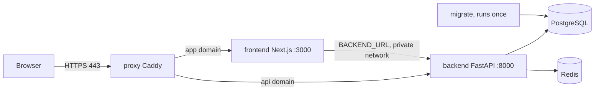

# Deployment

This document explains how to run OmniLog on a server with Docker. The stack has five services: PostgreSQL with pgvector, Redis, the backend, the frontend and a reverse proxy with automatic HTTPS.

## 1. What is deployed



- Only the proxy publishes ports (80 and 443). The database, Redis, the backend and the frontend are on a private Docker network. They cannot be reached from outside the server.
- The browser opens the frontend at the app domain. The server code of the frontend calls the backend over the private network at `BACKEND_URL` (`http://backend:8000`), and the browser itself does not call the backend. The proxy still publishes the backend at the API domain, for the interactive docs (`/docs`), the health checks and other clients. This is why two names are needed, for example `app.example.com` and `api.example.com`.
- The service `migrate` runs `alembic upgrade head` and stops. The backend starts only after it finished without an error.

| File | Purpose |
|---|---|
| `docker-compose.prod.yml` | The production stack |
| `backend/Dockerfile` | Backend image (Python 3.15, runs as a normal user) |
| `frontend/Dockerfile` | Frontend image (Node 26, Next.js standalone output) |
| `docker/Caddyfile` | The proxy settings |
| `env.prod.example` | A list of all settings. Copy it to `.env.prod` |
| `.github/workflows/docker-build.yml` | Builds the images and tests the stack on every change |

`docker-compose.yml` (without `.prod`) is not changed. It is still the small stack for development, with only PostgreSQL and Redis.

## 2. What you need

- A Linux server with Docker Engine and the Compose plugin (`docker compose version` works).
- Two DNS A records that point to the server, one for the app and one for the API.
- Ports 80 and 443 open in the firewall. The proxy needs port 80 to get the certificates.
- Enough memory for the build of the frontend. In our test the build took 27 seconds and its largest process used about 1.3 GB, so a server with 2 GB is a safe size.
- The build needs internet access. The frontend loads its fonts from Google Fonts during `next build`.

## 3. First deployment

```bash
git clone https://github.com/metezd/OmniLog.git
cd OmniLog

cp env.prod.example .env.prod
# Fill in .env.prod (see section 4). Make the passwords with:  openssl rand -hex 32

docker compose -f docker-compose.prod.yml --env-file .env.prod up -d --build
```

Check the result:

```bash
docker compose -f docker-compose.prod.yml --env-file .env.prod ps
curl https://api.example.com/health        # {"status":"healthy"}
```

Then load the chapters and decision points of the games, once after the first start and again whenever `backend/app/seed/game_chapters.json` changes:

```bash
docker compose -f docker-compose.prod.yml --env-file .env.prod exec backend python -m app.seed
```

The command checks the file first and saves nothing when the file has an error. It can be run again without harm. The shipped file holds one game (Life is Strange, 5 chapters, 6 decision points). To load another file, copy it into the container or rebuild the image. The tables for the migrations are created by the service `migrate`, so no other database command is needed.

There is no command for embeddings. The API does not create them yet, and the recommendations use the genres of the library.

Then open the app domain in the browser. The proxy asks for the certificates when it starts, so wait a minute after the first start.

## 4. Settings

All settings are in `.env.prod`. The file holds secrets and is ignored by Git. Compose stops with a clear message if a required value is empty.

| Name | Required | Meaning |
|---|---|---|
| `POSTGRES_PASSWORD` | yes | Password of the database user |
| `REDIS_PASSWORD` | yes | Password of Redis |
| `SECRET_KEY` | yes | Signs the login tokens. At least 32 characters. The backend does not start with a shorter key |
| `APP_DOMAIN` | yes | Name of the frontend, for example `app.example.com` |
| `API_DOMAIN` | yes | Name of the backend, for example `api.example.com` |
| `API_URL` | yes | The public address of the backend, for example `https://api.example.com`. Built into the frontend image as `NEXT_PUBLIC_API_URL`. Only the Axios client in `src/lib/api.ts` uses it, and the build stops when it is empty |
| `CORS_ORIGINS` | yes | The address of the frontend, for example `https://app.example.com`. The backend accepts browser calls only from here |
| `ENABLE_DOCS` | no | Shows the API documentation at `/docs`, `/redoc` and `/openapi.json`. Default is `false` in `docker-compose.prod.yml` and `true` when the backend runs without it (development) |
| `IGDB_CLIENT_ID`, `IGDB_CLIENT_SECRET`, `TMDB_API_KEY` | no | Keys of the catalog services. Without them the catalog search cannot reach the outside services |
| `OPENAI_API_KEY` | no | OpenAI API key. Without it, OpenAI-backed features are disabled |
| `EMBEDDING_MODEL`, `EMBEDDING_DIMENSIONS`, `SPOILER_MODEL`, `SPOILER_THRESHOLD`, `OPENAI_TIMEOUT_SECONDS`, `OPENAI_MAX_RETRIES` | no | Models, spoiler confidence threshold, request timeout in seconds and retry count |
| `IGDB_CLIENT_ID`, `IGDB_CLIENT_SECRET`, `TMDB_API_KEY` | no | Keys of the catalog services. Without them the catalog search cannot reach the outside services. For a demo without keys, set `IGDB_CLIENT_ID=public` (and any value in `IGDB_CLIENT_SECRET`) for games from the Steam Store, and `TMDB_API_KEY=public` for series from TVMaze and movies from iTunes. Their ids are not IGDB or TMDB ids, so fill one database in one mode only |
| `OPENAI_API_KEY` | no | OpenAI API key. Without it, the spoiler check of a review uses local patterns instead of OpenAI. The review is saved in both cases |
| `SPOILER_MODEL` | no | Model that classifies a review. Default `gpt-4o-mini` |
| `SPOILER_THRESHOLD` | no | Score from 0 to 1 at which a review is flagged. Default `0.5` |
| `OPENAI_TIMEOUT_SECONDS`, `OPENAI_MAX_RETRIES` | no | Time limit of one OpenAI call in seconds (default `8`) and number of retries (default `2`) |
| `EMBEDDING_MODEL`, `EMBEDDING_DIMENSIONS` | no | Embedding model (default `text-embedding-3-small`) and its size (default `1536`). The OpenAI client reads them, but no endpoint creates or stores embeddings yet, so they have no visible effect |
| `RATE_LIMIT_ENABLED` | no | `false` turns all rate limits off. Default `true`. See section 9.1 |
| `RATE_LIMIT_LOGIN`, `RATE_LIMIT_REGISTER`, `RATE_LIMIT_SEARCH`, `RATE_LIMIT_REVIEW` | no | The rate limits as `<count>/<second\|minute\|hour\|day>`. Defaults `10/minute`, `5/hour`, `30/minute` and `20/minute`. The backend does not start with a value in another form |
| `POSTGRES_USER`, `POSTGRES_DB` | no | Defaults are `omnilog` |
| `TAG` | no | Tag of the built images. Default is `latest` |

Use passwords that have only letters and digits (`openssl rand -hex 32`). The passwords are part of the database and Redis addresses, so characters such as `/` or `@` would break them.

`API_URL` is written into the JavaScript of the frontend when the image is built (Next.js does this for every variable that starts with `NEXT_PUBLIC_`). After you change it, build again with `--build`.

`OPENAI_*`, `SPOILER_*` and `EMBEDDING_*` are passed from `.env.prod` to the backend by `docker-compose.prod.yml`. The values in the table are the defaults, so an empty or missing line keeps them.

**Settings that are not in `.env.prod`.** The compose file sets `BACKEND_URL=http://backend:8000` for the frontend. The frontend needs it, because its server code calls the backend at this address, and it stops with `BACKEND_URL is not set` without it. On Render, set `BACKEND_URL` by hand to the address of the backend service (`render.yaml` lists it). The backend reads some more settings that have defaults and that the compose file does not pass on. To change one, add it to `x-backend-env` in `docker-compose.prod.yml`:

| Name | Default | Meaning |
|---|---|---|
| `ACCESS_TOKEN_EXPIRE_MINUTES` | `90` | How long a login token stays valid |
| `CACHE_TTL_SECONDS` | `3600` | How long search results stay in Redis |
| `DETAILS_CACHE_TTL_SECONDS` | `86400` | How long title details stay in Redis |
| `EXTERNAL_API_TIMEOUT_SECONDS` | `8` | Time limit of one call to IGDB or TMDB |
| `EXTERNAL_API_MAX_RETRIES` | `3` | Retries after a timeout, a 429 or a 5xx answer |
| `EXTERNAL_API_BACKOFF_SECONDS` | `0.5` | First wait between retries. It doubles after each retry |

The backend finds the database and Redis through `DATABASE_URL` and `REDIS_URL`, which the compose file builds from the passwords.

## 5. Update

```bash
git pull
docker compose -f docker-compose.prod.yml --env-file .env.prod up -d --build
```

The migrations run by themselves before the new backend starts. The data stays in the Docker volumes `pgdata` and `redisdata`.

To go back to an older version, check out the older commit and run the same command. A migration that was already applied is not undone. Restore a backup if the database also has to go back.

### Backend dependencies

`backend/requirements.txt` is a lock file. It holds every package of the backend with an exact version and the hashes of its files. The Docker image, CI and Render install it with `pip install --require-hashes`, so they all get the versions that the tests checked, and pip refuses a file that does not match a hash. `pip-audit` in CI checks the same file.

Do not change `requirements.txt` by hand. Change `backend/requirements.in` (the direct dependencies) and make the lock again with the command at the top of that file. The tools for the tests have their own lock, `tests/requirements-test.txt`, made from `tests/requirements-test.in` on top of the backend lock.

The lock is made for Linux and the Python version of `backend/Dockerfile`. When the base image moves to a new Python version, make both locks again with the new `--python-version`. The job "Security lint (Ruff)" in CI makes both locks again and fails when the result differs from the committed files, so a forgotten step shows up in the pull request.

## 6. Backup and restore

```bash
# Backup
docker compose -f docker-compose.prod.yml --env-file .env.prod exec -T db \
  pg_dump -U omnilog -d omnilog --format=custom > omnilog-$(date +%F).dump

# Restore into an empty database
docker compose -f docker-compose.prod.yml --env-file .env.prod exec -T db \
  pg_restore -U omnilog -d omnilog --clean --if-exists < omnilog-2026-11-01.dump
```

Copy the backup files off the server. Backups are not made automatically.

## 7. Logs and health

```bash
docker compose -f docker-compose.prod.yml --env-file .env.prod logs -f backend
docker compose -f docker-compose.prod.yml --env-file .env.prod logs migrate
```

The backend answers two health paths. The frontend answers `GET /api/health`. This path does not call the backend, so it stays green when the backend is down.

| Path | What it checks | Use it for |
|---|---|---|
| `GET /health` | Only that the process answers | The health check of the container and of the host (Render) |
| `GET /health/ready` | The database (`SELECT 1`) and Redis. It answers 503 when the database is down. Redis down gives 200 with `"cache": "down"`, because the API works without it | An uptime monitor |
| `GET /api/health` (frontend) | Only that the frontend answers | The health check of the host |

The images have a health check, and `docker compose ps` shows `healthy` when it passes.

### Render

- Set **Health Check Path** in the settings of each web service. Use `/health` for the backend and `/api/health` for the frontend.
- Do not use `/health/ready` there. When the database is down, Render would mark the service as unhealthy and restart it, and a restart does not fix the database. Point an uptime monitor at `/health/ready` instead.
- Third party APIs (TMDB, IGDB, OpenAI) are not checked on purpose. Their outages must not stop the service.
- `render.yaml` sets `NODE_VERSION` to `26` for the frontend, the same major version as `frontend/Dockerfile`. If you create the service by hand, set the same value. Tailwind needs Node 20.19 or 22.12 and newer, and `frontend/package.json` asks for Node 24 or newer. An older Node stops the build with `require() of ES Module ... not supported`.
- Set `OPENAI_API_KEY` (optional), the keys of the catalog services and `BACKEND_URL` by hand. They are listed in `render.yaml` without a value.

## 8. Try it on your own computer

No real domain is needed. The proxy makes a certificate from its own local authority for `localhost` names. Use these values in `.env.prod`:

```
APP_DOMAIN=localhost
API_DOMAIN=api.localhost
API_URL=https://api.localhost
CORS_ORIGINS=https://localhost
```

Open `https://localhost` in the browser and accept the certificate warning, because the browser does not know the local authority. Open `https://api.localhost/health` once and accept the warning there too if you want to use the API domain from the browser, for example `https://api.localhost/docs`. The app itself does not need it, because its server code calls the backend inside the Docker network. This is the same setup that the CI workflow tests.

## 9. What protects what

| Risk | Protection |
|---|---|
| Someone reaches the database or Redis | They have no published ports. Redis also needs a password |
| Passwords or keys in the repository | `.env.prod` is in `.gitignore`. The images do not contain `.env` files (`.dockerignore`) |
| Traffic can be read | The proxy uses HTTPS with certificates that renew by themselves |
| Other websites call the API from a browser | `CORS_ORIGINS` lists only the app address |
| A stolen token works forever | Every token has `exp`. A token without `exp` or `sub` is rejected with 401 |
| The browser guesses the type of an answer, or sends the API address to other sites | The backend sends `X-Content-Type-Options: nosniff` and `Referrer-Policy: no-referrer` on every answer. Caddy does not add them, so they also work on Render |
| A token or user data stays in a browser or proxy cache | Answers of `/auth/*` have `Cache-Control: no-store` |
| The full list of endpoints is public | `ENABLE_DOCS` is `false` in production, so `/docs`, `/redoc` and `/openapi.json` answer 404 |
| The login token is stolen by a script in the page | The frontend keeps the token in an `httpOnly` cookie and sends it to the backend from its server code |
| A break-in to a container gives full control | The backend and the frontend run as a normal user, not as root |
| A forgotten setting | Compose and the frontend build stop with a message when a required value is missing |
| Guessing passwords, creating many accounts, using up the IGDB, TMDB or OpenAI quota | Rate limits on login, register, search and review answer 429 with `Retry-After` (section 9.1) |

### 9.1 Rate limits

| Endpoint | Counted per | Default | Why |
|---|---|---|---|
| `POST /auth/login` | Browser address | `10/minute` | Every try costs a bcrypt check |
| `POST /auth/register` | Browser address | `5/hour` | A bcrypt hash, and new accounts |
| `GET /catalog/search` | User | `30/minute` | A new search text calls IGDB or TMDB with the shared keys |
| `POST /library/{entry_id}/review` | User | `20/minute` | A review can call OpenAI, which costs money |

A call over the limit gets `429 Too Many Requests` with a `Retry-After` header (seconds until the window ends) and `{"detail": "Too many requests. Try again in N seconds."}`. A limit counts the calls in a fixed window, for example one minute. The counts are in Redis, so all workers share them. When Redis is down, each process counts for itself and the API keeps answering. A call without a valid token gets 401 and is not counted.

**Which address is counted.** The browser does not call the backend for the login and the registration. It calls the frontend, and the frontend's server code calls the backend. Without help, the backend would see the address of the frontend for every user, and one user could block the login of everybody. So:

1. Caddy writes the browser address into `X-Forwarded-For`.
2. The frontend passes this header on to the backend for the login and the registration (`src/lib/actions/auth.ts`).
3. Uvicorn runs with `--proxy-headers` (`backend/Dockerfile`) and uses `X-Forwarded-For` only from the addresses in `FORWARDED_ALLOW_IPS`. `docker-compose.prod.yml` gives the proxy (`172.30.42.10`) and the frontend (`172.30.42.11`) fixed addresses and trusts only these two. Calls through the API domain come from Caddy, so they are counted by the browser address too.

A client cannot choose the counted address by sending its own `X-Forwarded-For`: Caddy replaces the header of a client that it does not trust, and the backend ignores it from every other address. Without a proxy (development), the Dockerfile trusts only `127.0.0.1`.

## 10. What is not included yet

- The images are not pushed to a registry. The server builds them itself.
- There is no automatic deployment to a server or a hosting platform. The workflow only checks that the stack starts and answers.
- There are no automatic backups, no monitoring and no alerts.
- The stack runs one copy of each service. Running more copies of the backend is not set up and not tested.
- Rate limits on Render: the backend there runs behind the proxy of Render, whose address is not fixed, and `render.yaml` does not set `FORWARDED_ALLOW_IPS`. Check which address is counted before you rely on the per-address limits there. `RATE_LIMIT_ENABLED=false` turns them off.
- Only login, register, search and review have a rate limit.
- The friends page of the frontend shows sample data. The login, register, library, search, title, lists, diary, statistics and recommendations screens call the backend through the server code of Next.js (`BACKEND_URL`).
- Embeddings are not built. There is no `media_embeddings` table and no embeddings command. The recommendations (US-13) rank the catalog by the genres of the library, so they work without any key.
- The spoiler check (US-14) uses OpenAI only when `OPENAI_API_KEY` is set. Without the key, or when OpenAI does not answer, the review is saved and checked with local patterns.
- The catalog has no manual sync and no admin endpoints. Title details load from IGDB and TMDB when a title is opened.
- The migrations and the tests need PostgreSQL. If the backend finds nothing at `localhost:5432` outside Docker, `app/core/database.py` falls back to a SQLite file. The production stack always has PostgreSQL, so this does not apply there.

## 11. Problems

| Message or behavior | Cause and fix |
|---|---|
| `required variable ... is missing a value` | A value is empty in `.env.prod`. Fill it in |
| The browser shows a certificate error on a real domain | The DNS record does not point to the server yet, or port 80 is blocked. See `docker compose ... logs proxy` |
| The login page shows an error or the frontend log says `BACKEND_URL is not set` | The frontend has no `BACKEND_URL`. The compose file sets it, so check that you use `docker-compose.prod.yml`. On Render, set it by hand. Check also `docker compose ... logs backend` |
| `src/lib/api.ts` calls go to the wrong address | `API_URL` is wrong or was changed without `--build` |
| The API answers 4xx in the browser console with a CORS message | `CORS_ORIGINS` does not match the address of the frontend exactly. It has no trailing slash |
| `next build` fails with a font error | The build machine cannot reach `fonts.googleapis.com` |
| `Pool overlaps with other one on this host` when the stack starts | Another Docker network or the host already uses `172.30.42.0/24`. Change the subnet, the two fixed addresses and `FORWARDED_ALLOW_IPS` in `docker-compose.prod.yml` together |
| Users get `429 Too many requests` although each one calls rarely | The backend counts one address for everybody. Check that `FORWARDED_ALLOW_IPS` matches the fixed addresses of the proxy and the frontend |
