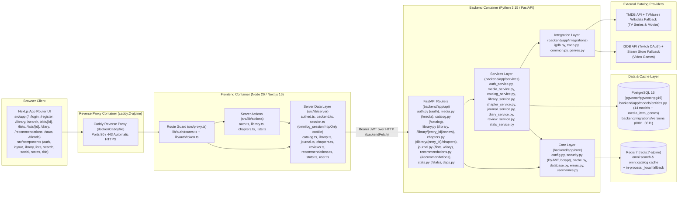

# OmniLog — System Architecture Diagram

This document defines the multi-tier containerized software architecture of **OmniLog**, aligned with `docker-compose.prod.yml`, `docker/Caddyfile`, `backend/app/`, and `frontend/src/`.

- **PlantUML Sources & Rendered Images**:
  - `01-system-architecture.puml` / `.png` / `.svg`
  - `02-backend-layers.puml` / `.png` / `.svg`
  - `03-frontend-structure.puml` / `.png` / `.svg`

