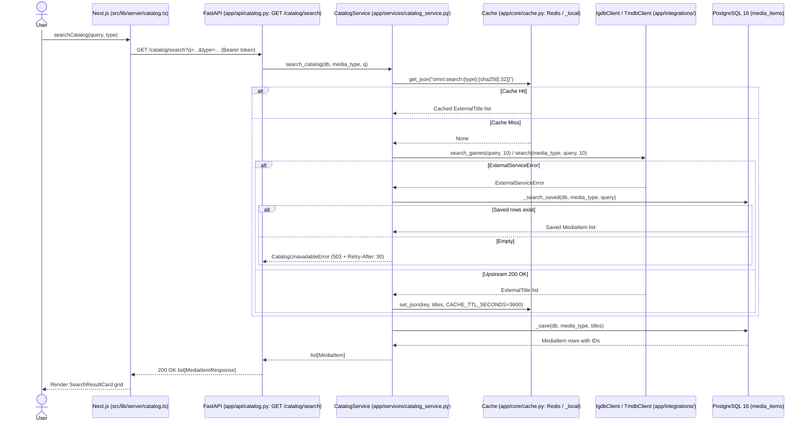
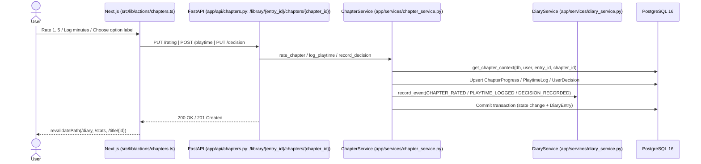
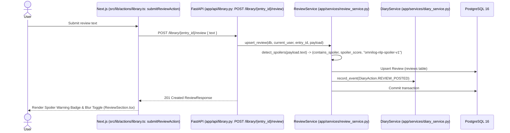

# OmniLog — Runtime Sequence Diagrams

This document summarizes the runtime interaction sequence diagrams for **OmniLog**. Full PlantUML models (`.puml`) and rendered `.png`/`.svg` images for 10 user stories (US-02, US-03, US-04, US-08, US-09, US-10, US-11, US-12, US-14, US-15 — 67% of the 15 user stories) are in this folder:

- `01-us02-register.puml` / `.png` / `.svg`
- `02-us03-login.puml` / `.png` / `.svg`
- `03-us04-add-to-library.puml` / `.png` / `.svg`
- `04-us08-catalog-search.puml` / `.png` / `.svg`
- `05-us09-title-details.puml` / `.png` / `.svg`
- `06-us10-rate-chapter.puml` / `.png` / `.svg`
- `07-us11-log-playtime.puml` / `.png` / `.svg`
- `08-us12-record-decision.puml` / `.png` / `.svg`
- `09-us15-stats.puml` / `.png` / `.svg`
- `10-us14-review.puml` / `.png` / `.svg`

## 1. Catalog Search with Read-Through Redis Cache (`US-08`, `NFR-01`, `NFR-04`)

## 2. Granular Episodic Logging & Branching Decision Recording (`US-10`, `US-11`, `US-12`)

## 3. Review Submission with Automated NLP Spoiler Moderation (`US-14`)

