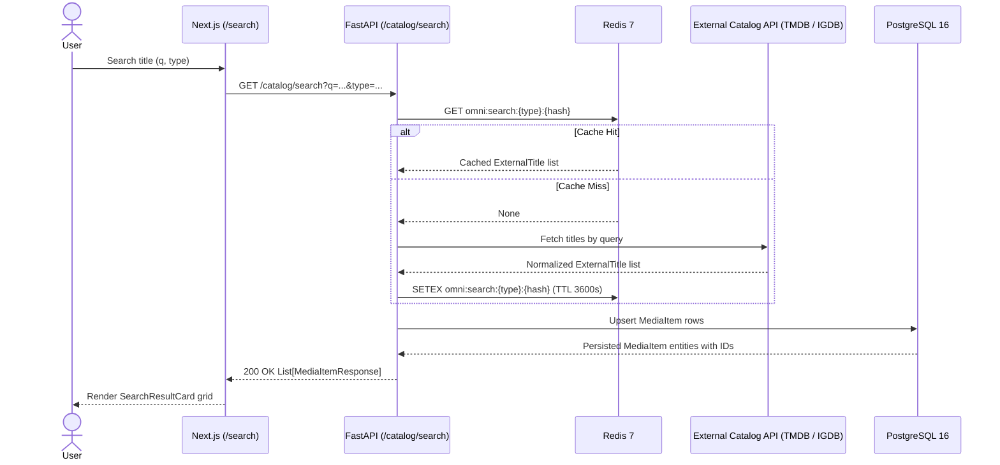
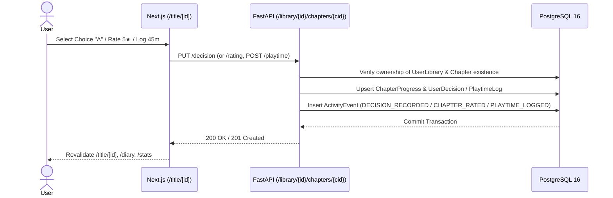
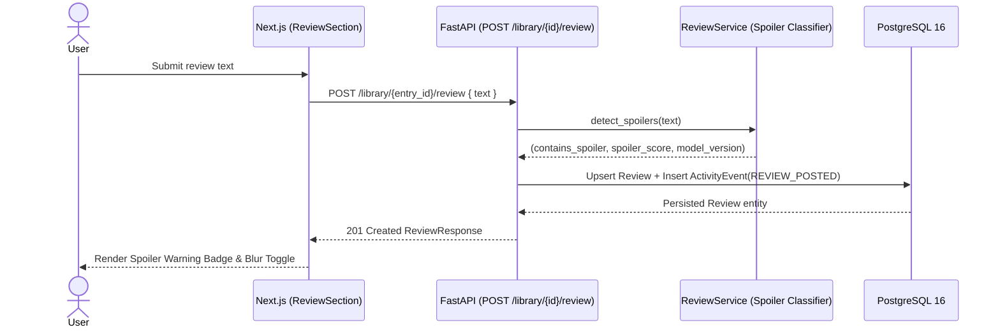

# OmniLog — Runtime Sequence Diagrams

This document defines the runtime interaction sequence diagrams for **OmniLog** across catalog search & caching, granular episodic logging & branching decision recording, and AI cross-media recommendation & NLP spoiler moderation.

## 1. Catalog Search with Read-Through Redis Cache (`US-08`, `US-09`, `NFR-01`)

## 2. Granular Episodic Logging & Branching Decision Recording (`US-10`, `US-11`, `US-12`)

## 3. Review Submission with Automated NLP Spoiler Moderation (`US-14`)

