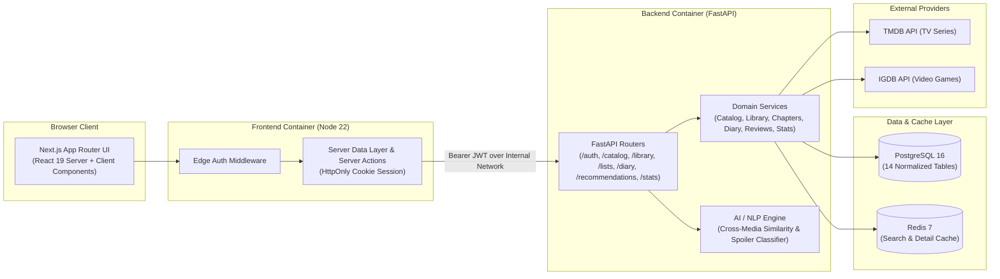
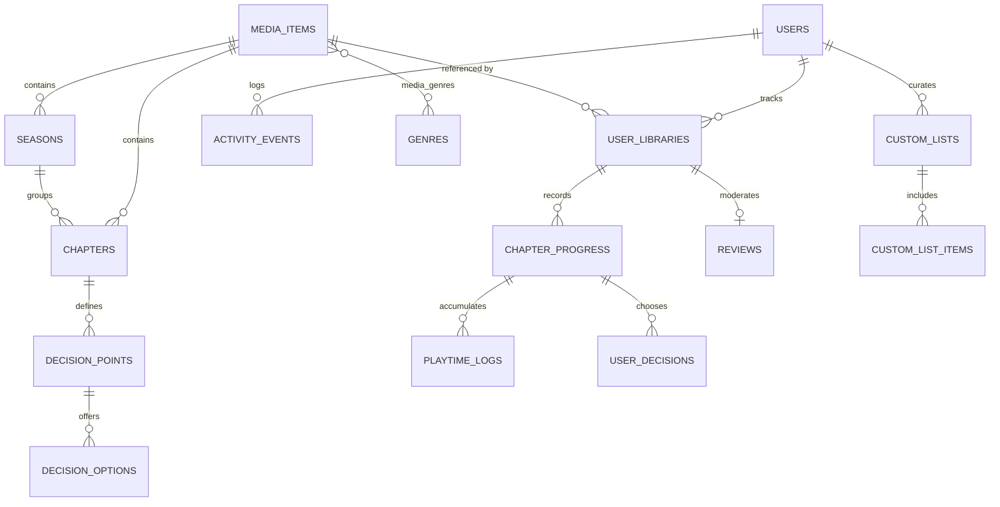
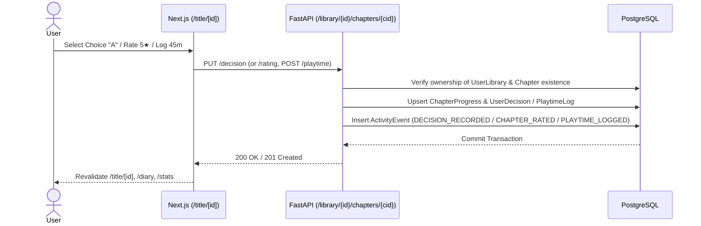
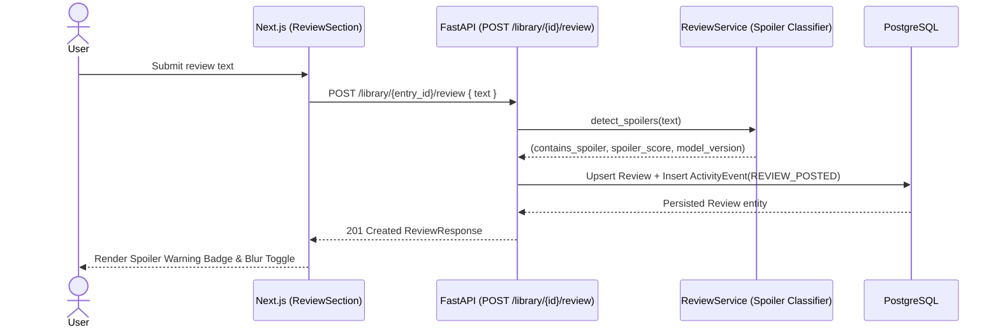

# Software Design Report: OmniLog

- **Project**: OmniLog — Cross-Media Tracking, Episodic Narrative Journaling & AI Recommendation Platform
- **Milestone**: Software Design Report (15.11.2026)
- **Authors**:
  - Mete Özdoğan — Product Owner & Full-Stack Architect (`mete.ozdogan@bilgiedu.net`)
  - Kerem Kenet — Frontend Lead (`kerem.kenet@bilgiedu.net`)
  - Kağan Konuk — Backend Engineer (`kagan.konuk@bilgiedu.net`)
  - Sidar Ürey — ML Engineer (`sidar.urey@bilgiedu.net`)
  - Musab Alperen Başol — API Integration & Backend Engineer (`alperen.basol@bilgiedu.net`)

---

## 1. Architectural Overview

OmniLog follows a layered, containerized 3-tier architecture composed of a **Next.js 16 (React 19, TypeScript) BFF/Frontend**, a **FastAPI (Python 3.12, SQLAlchemy 2.0) REST Backend**, a **PostgreSQL 16 Relational Database**, and a **Redis 7 Caching Layer**.

### Key Architectural Decisions
1. **HttpOnly Cookie Session via Next.js Server Actions**: Access tokens are stored exclusively in `HttpOnly`, `SameSite=Lax` cookies managed by the Next.js server layer (`frontend/src/lib/auth/session.ts`), eliminating XSS token exfiltration (`NFR-03`).
2. **Read-Through Redis Caching for External Catalogs**: `GET /catalog/search` and `GET /catalog/{id}` check Redis first (`NFR-01`), falling back to TMDB/IGDB adapters and persisting normalized metadata into PostgreSQL (`US-08`, `US-09`).
3. **Append-Only Activity Diary**: Every user mutation (`LIBRARY_ADDED`, `STATUS_CHANGED`, `RATED`, `CHAPTER_RATED`, `PLAYTIME_LOGGED`, `DECISION_RECORDED`, `REVIEW_POSTED`, `LIST_CREATED`, `LIST_ITEM_ADDED`) writes a structured event to `activity_events` within the same database transaction (`US-07`).

---

## 2. Subsystem & Component Design

### 2.1 Backend Modules (`backend/app/`)
| Module | Responsibility | Key Files |
|---|---|---|
| **API Layer** | HTTP routing, request validation, status mapping, JWT dependency injection | `api/auth.py`, `api/catalog.py`, `api/library.py`, `api/chapters.py`, `api/lists.py`, `api/diary.py`, `api/recommendations.py`, `api/stats.py`, `api/friends.py` |
| **Domain Services** | Business rules, transactional boundaries, cache orchestration | `services/catalog_service.py`, `services/library_service.py`, `services/chapter_service.py`, `services/review_service.py`, `services/diary_service.py`, `services/stats_service.py` |
| **External Clients** | Resilient HTTP adapters for IGDB and TMDB with timeout and error translation (`502 Bad Gateway` on upstream failure, `NFR-04`) | `clients/igdb.py`, `clients/tmdb.py` |
| **Persistence Models** | SQLAlchemy 2.0 declarative ORM mappings and Alembic migrations (`0001`–`0011`) | `models/entities.py`, `migrations/versions/` |

### 2.2 Frontend Modules (`frontend/src/`)
| Screen ID | Route | Purpose | Primary Components |
|---|---|---|---|
| `S-01` | `/` | Public Landing Page | `Navbar`, `Hero`, `MediaStream` |
| `S-02` / `S-03` | `/login`, `/register` | Authentication & Registration | `LoginForm`, `RegisterForm` |
| `S-04` | `/library` | Personal Media Library | `LibraryEntryCard` |
| `S-05` | `/search` | Unified TMDB & IGDB Catalog Search | `SearchResultCard`, `AddToLibraryButton` |
| `S-06` | `/title/[id]` | Title Details, Episodic Logging, Decisions & Spoiler-Moderated Review | `LibraryControls`, `ChapterProgressCard`, `ReviewSection` |
| `S-07` / `S-08` | `/lists`, `/lists/[id]` | Custom Lists Overview & List Detail | `CreateListForm`, `AddListItemForm` |
| `S-09` | `/diary` | Chronological Activity Diary | `DiaryPage` |
| `S-10` | `/recommendations` | AI Cross-Media Recommendation Engine | `RecommendationsPage` |
| `S-11` | `/stats` | Visual Analytics Dashboard | `StatsPage` |

---

## 3. Physical Database Design

The PostgreSQL schema is managed via 11 sequential Alembic migrations (`0001_initial_schema.py` through `0011_reviews.py`) and enforces referential integrity, domain check constraints, and composite uniqueness.

### Key Constraints & Indexes
- `user_libraries`: `UNIQUE (user_id, media_item_id)`, `CHECK (rating IS NULL OR (rating >= 1 AND rating <= 10))`.
- `chapter_progress`: `UNIQUE (library_entry_id, chapter_id)`, `CHECK (rating IS NULL OR (rating >= 1 AND rating <= 5))`.
- `playtime_logs`: `CHECK (minutes > 0)`.
- `user_decisions`: `UNIQUE (chapter_progress_id, decision_point_id)`.
- `reviews`: `UNIQUE (library_entry_id)` with `contains_spoiler BOOLEAN`, `spoiler_score FLOAT`, and `spoiler_model_version VARCHAR(64)`.

---

## 4. Key Runtime Sequence Diagrams

### 4.1 Granular Episodic Logging & Decision Recording (Epic 4: `US-10`, `US-11`, `US-12`)

### 4.2 Review Submission with Automated NLP Spoiler Moderation (Epic 5: `US-14`)

