# OmniLog - Software Design Report

**Course:** CMPE 331 Software Engineering Concepts, Fall 2026-2027  
**Deliverable:** Software Design Report (pull request deadline 11.11.2026, PDF deadline 15.11.2026)  
**Repository branch:** `design_work`

| Team member | Role |
|---|---|
| Mete Özdoğan | Product Owner, Full-Stack Architect |
| Kerem Kenet | Frontend Lead |
| Kağan Konuk | Backend Engineer |
| Sidar Ürey | ML Engineer |
| Musab Alperen Başol | API Integration and Backend Engineer |
| Mohammad Edris | Backend/QA Engineer |

---

## 1. Introduction

This report describes the software architecture and detailed design of **OmniLog**, a cross-media tracking, episodic narrative journaling, and recommendation platform that brings video games, TV series, and movies into one place. It builds directly on the [Requirement Specification Report](../requirements/requirements-specification.md) and the [Requirement Analysis Report](../analysis/requirement-analysis-report.md), using the same user stories (`US-01` to `US-15`), business rules (`BR-01` to `BR-18`), and non-functional requirements (`NFR-01` to `NFR-05`).

Every diagram and table in this report has been verified against the current repository codebase across all six epics:
- **Epic 1 (Infrastructure):** FastAPI application (`backend/app/main.py`), PostgreSQL 16 + `pgvector` and Redis 7 (`docker-compose.yml`, `docker-compose.prod.yml`), Alembic migrations (`0001` to `0011`), and health check (`GET /health`).
- **Epic 2 (User Management & Social Journal):** Registration, login, JWT authentication, personal library CRUD, custom lists, and append-only activity diary (`backend/app/api/auth.py`, `library.py`, `journal.py`).
- **Epic 3 (Multi-Media Aggregation & Cataloging):** Read-through Redis caching (`backend/app/core/cache.py`), IGDB and TMDB integration clients with keyless public fallbacks (`backend/app/integrations/igdb.py`, `tmdb.py`), genre normalization (`genres.py`), and catalog search/details (`backend/app/api/catalog.py`).
- **Epic 4 (Granular Episodic & Decision Logging):** Per-chapter/episode star ratings (`1..5`), atomic playtime logging, branching narrative decision points/options (`backend/app/api/chapters.py`, `backend/app/services/chapter_service.py`), and deterministic game chapter seeding (`backend/app/seed/`).
- **Epic 5 (Cross-Media Recommendations & Spoiler Moderation):** Genre-weighted cross-media recommendations (`backend/app/api/recommendations.py`) and automated NLP spoiler detection on user reviews (`backend/app/services/review_service.py`, `POST /library/{entry_id}/review`).
- **Epic 6 (Analytics Dashboard):** Personal media split, rating distribution, genre breakdown, and 5-hour playtime histogram (`backend/app/api/stats.py`, `backend/app/services/stats_service.py`).

### 1.1 Design artifacts

All models are stored in `docs/design/` as PlantUML source files (`.puml`) alongside rendered `.png` and `.svg` images and Markdown/Mermaid companions (`.md` / `.mmd`). The PDF version of this report ([software-design-report.pdf](software-design-report.pdf)) embeds the rendered PNG images.

| Artifact | Folder | Files |
|---|---|---|
| Architecture diagrams | `docs/design/arch` | `01-system-architecture`, `02-backend-layers`, `03-frontend-structure` (`architecture-diagram.md`) |
| Class diagrams | `docs/design/class` | `01-domain-model`, `02-service-layer`, `03-catalog-integration`, `04-schemas` (`class-diagram.md`) |
| Sequence diagrams | `docs/design/sequence` | `01-us02-register` to `10-us14-review` (10 diagrams, `sequence-diagrams.md`) |

To regenerate all PNG and SVG diagrams from PlantUML sources: `./docs/design/render.sh`.

### 1.2 Design overview

| Topic | Decision | Implementation in Repo |
|---|---|---|
| Architectural style | Client-server with Next.js Server Components/Actions (BFF) and a layered FastAPI monolith | `frontend/src/`, `backend/app/` |
| Frontend | Next.js 16 (App Router), React 19, TypeScript, Tailwind CSS v4, Recharts | `frontend/package.json`, `frontend/src/app/` |
| Backend | FastAPI, SQLAlchemy 2, Pydantic v2, Alembic | `backend/requirements.txt`, `backend/app/main.py` |
| Persistence & cache | PostgreSQL 16 (`pgvector/pgvector:pg16`), Redis 7 (`redis:7-alpine`) + in-process fallback | `backend/app/core/database.py`, `backend/app/core/cache.py` |
| Authentication | Stateless JWT (`HS256`, 90 min expiry via `PyJWT`), `passlib[bcrypt]` password hashing, `httpOnly` cookie (`omnilog_session`) | `backend/app/core/security.py`, `frontend/src/lib/server/session.ts` |
| External catalog | IGDB (games, Twitch OAuth + Steam Store fallback) and TMDB (series/movies + TVMaze/iTunes fallback) | `backend/app/integrations/igdb.py`, `backend/app/integrations/tmdb.py` |
| Deployment | Docker Compose (`docker-compose.prod.yml`), Caddy 2 reverse proxy (`docker/Caddyfile`) with automatic HTTPS on private network `internal` | `docker-compose.prod.yml`, `backend/Dockerfile`, `frontend/Dockerfile` |

---

## 2. Architecture

### 2.1 System architecture

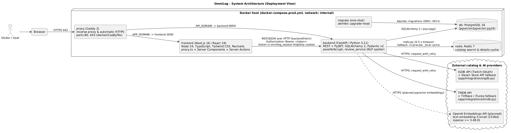

The production stack defined in `docker-compose.prod.yml` runs six containers on a single isolated Docker network (`internal`):
1. **`proxy` (`caddy:2-alpine`, `docker/Caddyfile`):** The only container that publishes host ports (`80` and `443`). Terminates TLS automatically via Let's Encrypt and routes `{$APP_DOMAIN}` to `frontend:3000` and `{$API_DOMAIN}` to `backend:8000`.
2. **`frontend` (`node:24-alpine`, `frontend/Dockerfile`):** Runs the Next.js 16 standalone server on port `3000` as non-root user `10001`. Renders Server Components and executes Server Actions, communicating with the backend over HTTP using Bearer JWT tokens read from the `omnilog_session` `httpOnly` cookie.
3. **`backend` (`python:3.11-slim-bookworm`, `backend/Dockerfile`):** Runs FastAPI under Uvicorn on port `8000` as non-root user `10001:10001`. Waits for `migrate` (`service_completed_successfully`) and `redis` (`service_healthy`) before starting.
4. **`migrate` (`omnilog-backend` image):** A one-shot container (`restart: "no"`) that runs `alembic upgrade head` against PostgreSQL once `db` is healthy.
5. **`db` (`pgvector/pgvector:pg16`):** PostgreSQL 16 relational database with the `pgvector` extension, persisted in volume `pgdata`.
6. **`redis` (`redis:7-alpine`):** Password-protected (`--requirepass`) in-memory cache with append-only persistence (`--appendonly yes`), persisted in volume `redisdata`.

### 2.2 Backend layers

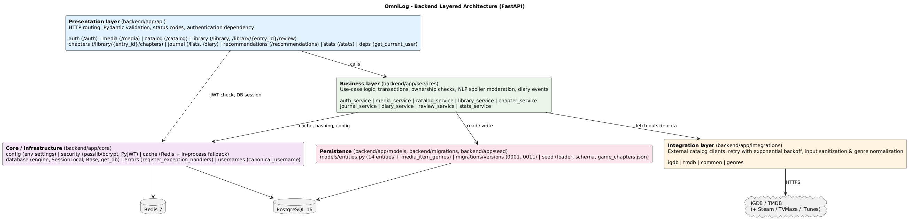

Every module inside `backend/app/` belongs to one of five strict horizontal layers:

| Layer | Package | Files in Repository | Responsibility |
|---|---|---|---|
| **Presentation** | `backend/app/api` | `auth.py`, `media.py`, `catalog.py`, `library.py`, `chapters.py`, `journal.py`, `recommendations.py`, `stats.py`, `deps.py` | HTTP routing, Pydantic request/response serialization, translating domain exceptions to HTTP status codes, and the `get_current_user` dependency |
| **Business** | `backend/app/services` | `auth_service.py`, `media_service.py`, `catalog_service.py`, `library_service.py`, `chapter_service.py`, `journal_service.py`, `diary_service.py`, `review_service.py`, `stats_service.py` | Use-case orchestration, transactional boundaries, ownership verification, NLP spoiler classification (`detect_spoilers`), and append-only diary recording (`record_event`) |
| **Integration** | `backend/app/integrations` | `igdb.py`, `tmdb.py`, `common.py`, `genres.py` | External HTTP adapters for IGDB and TMDB (plus keyless public fallbacks), retry with exponential backoff (`request_with_retry`), input sanitization (`clean_*`), and genre normalization (`normalize_genres`) |
| **Core** | `backend/app/core` | `config.py`, `security.py`, `cache.py`, `database.py`, `errors.py`, `usernames.py` | Fail-fast environment configuration, `passlib[bcrypt]` hashing and `PyJWT` signing, Redis + in-process fallback cache, SQLAlchemy engine/session lifecycle, global `RequestValidationError` sanitization, and Turkish-aware Unicode NFC username canonicalization |
| **Persistence** | `backend/app/models`, `backend/migrations`, `backend/app/seed` | `models/entities.py`, `migrations/versions/0001..0011`, `seed/loader.py`, `seed/schema.py`, `seed/game_chapters.json` | 14 SQLAlchemy ORM entities, `media_item_genres` association table, check/unique/composite FK constraints, 11 Alembic migrations, and idempotent episodic game chapter seeding |

**Dependency rule:** Routers in `app/api` call services in `app/services`. Services never import routers or `HTTPException`; they raise domain exceptions (such as `AccountConflictError`, `LibraryConflictError`, `LibraryEntryNotFoundError`, `CatalogUnavailableError`, `DecisionNotAllowedError`), which the router maps to HTTP status codes (`404`, `409`, `422`, `503`).

### 2.3 Frontend structure

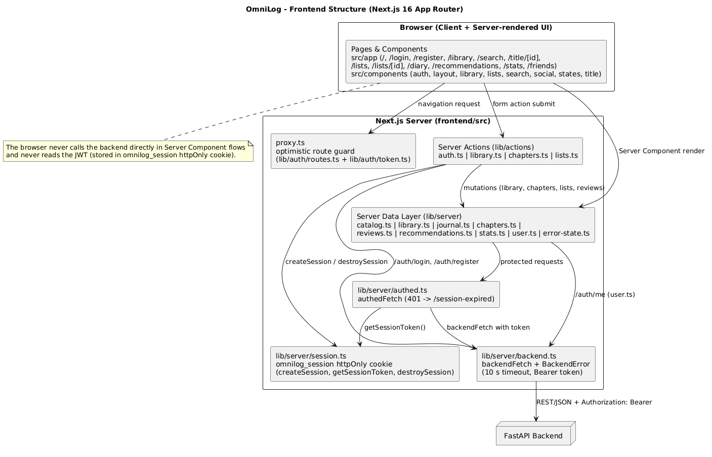

The Next.js 16 frontend (`frontend/src/`) separates client interactivity from server-side backend communication:

| Layer / Directory | Files in Repository | Responsibility |
|---|---|---|
| **App Router Pages (`src/app/`)** | `page.tsx` (`/`), `login/page.tsx`, `register/page.tsx`, `session-expired/route.ts`, `library/page.tsx`, `search/page.tsx`, `title/[id]/page.tsx`, `lists/page.tsx`, `lists/[id]/page.tsx`, `diary/page.tsx`, `recommendations/page.tsx`, `stats/page.tsx`, `friends/page.tsx` | Server-rendered routes (`S-01` to `S-11` plus `/friends`), route-level loading/error boundaries (`loading.tsx`, `error.tsx`, `not-found.tsx`), and cookie cleanup route handler (`/session-expired`) |
| **UI Components (`src/components/`)** | `auth/` (`AuthBanner`, `AuthCard`, `AuthField`, `GoogleSignInButton`, `LoginForm`, `RegisterForm`), `layout/` (`Navbar`, `Footer`, `Logo`, `dashboard/`), `library/` (`LibraryEntryCard`), `lists/` (`CreateListForm`, `AddListItemForm`), `search/` (`SearchResultCard`, `AddToLibraryButton`), `title/` (`LibraryControls`, `ChapterProgressCard`, `ReviewSection`), `social/` (`AddFriendModal`, `FriendActivityFeed`), `states/` (`EmptyState`, `ErrorState`, `LoadingState`, `RetryButton`, `StateCard`) | Reusable presentation and interactive form components |
| **Optimistic Route Guard** | `src/proxy.ts`, `src/lib/auth/routes.ts`, `src/lib/auth/token.ts` | Inspects `omnilog_session` cookie expiration (`hasLiveToken`) on protected prefixes (`/library`, `/search`, `/title`, `/lists`, `/diary`, `/recommendations`, `/stats`, `/profile`) and redirects unauthenticated visitors to `/login` |
| **Server Actions (`src/lib/actions/`)** | `auth.ts` (`loginAction`, `registerAction`, `logoutAction`), `library.ts` (`addToLibraryAction`, `updateLibraryEntryAction`, `removeLibraryEntryAction`, `submitReviewAction`), `chapters.ts` (`rateChapterAction`, `logPlaytimeAction`, `recordDecisionAction`), `lists.ts` (`createListAction`, `deleteListAction`, `addItemToListAction`, `removeItemFromListAction`) | Handle form submissions on the server, mutate backend state, manage session cookies, and trigger `revalidatePath` |
| **Server Data Layer (`src/lib/server/`)** | `backend.ts` (`backendFetch`, `BackendError`), `session.ts` (`createSession`, `getSessionToken`, `destroySession`), `authed.ts` (`authedFetch`), `error-state.ts` (`toErrorState`), `catalog.ts`, `library.ts`, `journal.ts`, `chapters.ts`, `reviews.ts`, `recommendations.ts`, `stats.ts`, `user.ts` | `server-only` modules that attach the Bearer JWT from the `httpOnly` cookie, enforce a 10-second timeout (`AbortSignal.timeout(10_000)`), and redirect `401` responses to `/session-expired` |

---

## 3. Class Design

### 3.1 Domain model (`backend/app/models/entities.py`)

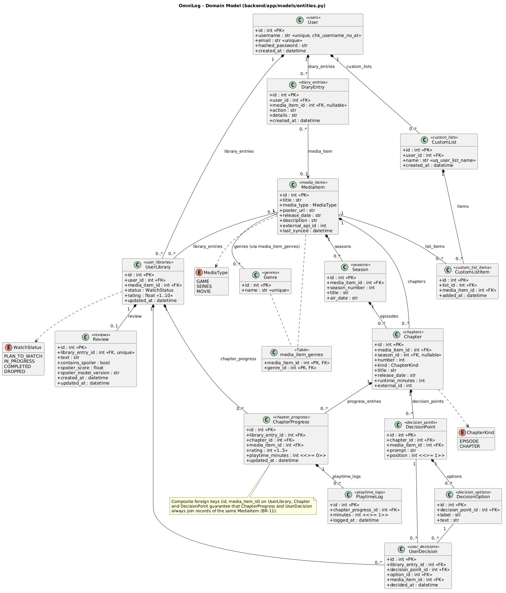

The persistence layer in [entities.py](../../backend/app/models/entities.py) defines **3 enums** (`MediaType`, `WatchStatus`, `ChapterKind`), **1 association table (`media_item_genres`)**, and **14 SQLAlchemy entity classes** managed across 11 Alembic revisions (`0001_create_users_media_items_and_library.py` through `0011_reviews.py`). Key design decisions in the domain model:

- **One `MediaItem` for games, series, and movies:** The `media_type` enum distinguishes them, and `(media_type, external_api_id)` is unique (`uq_media_type_external_id`) because IGDB and TMDB use separate ID spaces.
- **`Chapter` serves both episodes and game chapters:** A TV episode belongs to a `Season` (`kind='episode' AND season_id IS NOT NULL`), whereas a game chapter has no season (`kind='chapter' AND season_id IS NULL`), enforced by `chk_chapter_kind_season` and partial unique index `uq_chapter_game_number`.
- **Personal data separated from shared catalog data:** `UserLibrary`, `Review`, `ChapterProgress`, `PlaytimeLog`, `UserDecision`, `CustomList`, `CustomListItem`, and `DiaryEntry` are user-owned, while `MediaItem`, `Genre`, `Season`, `Chapter`, `DecisionPoint`, and `DecisionOption` are shared catalog tables.
- **Database-enforced same-title guarantee (`BR-11`):** `ChapterProgress`, `DecisionPoint`, and `UserDecision` carry `media_item_id` and use composite foreign keys (`fk_progress_entry_title`, `fk_progress_chapter_title`, `fk_decision_entry_title`, `fk_decision_point_title`, `fk_decision_option_point`), so PostgreSQL itself rejects any rating or decision that pairs a library entry and a chapter from different titles.
- **Append-only diary:** `DiaryEntry` rows are never updated or deleted; removals record new events (`LIBRARY_REMOVED`, `LIST_ITEM_REMOVED`, `LIST_DELETED`).

| Class | Table Name | Columns (Exact Names & Types in `entities.py`) | Key Constraints |
|---|---|---|---|
| `User` | `users` | `id` (PK), `username` (`String(50)`), `email` (`String(100)`), `hashed_password` (`String(255)`), `created_at` (`DateTime`) | `UNIQUE(username)`, `UNIQUE(email)`, `chk_username_no_at` (`position('@' in username) = 0`) |
| `Genre` | `genres` | `id` (PK), `name` (`String(50)`) | `UNIQUE(name)` |
| *(Table)* | `media_item_genres` | `media_item_id` (PK, FK `media_items.id`), `genre_id` (PK, FK `genres.id`) | `ON DELETE CASCADE`, index `ix_media_item_genres_genre_id` |
| `MediaItem` | `media_items` | `id` (PK), `title` (`String(200)`), `media_type` (`Enum(MediaType)`), `poster_url` (`String(500)`), `release_date` (`String(50)`), `description` (`Text`), `external_api_id` (`Integer`), `last_synced` (`DateTime`) | `uq_media_type_external_id` (`media_type`, `external_api_id`) |
| `UserLibrary` | `user_libraries` | `id` (PK), `user_id` (FK `users.id`), `media_item_id` (FK `media_items.id`), `status` (`Enum(WatchStatus)`), `rating` (`Float`), `updated_at` (`DateTime`) | `uq_user_media_entry` (`user_id`, `media_item_id`), `uq_user_library_id_media_item` (`id`, `media_item_id`), `chk_rating_range` (`1..10`) |
| `Review` | `reviews` | `id` (PK), `library_entry_id` (FK `user_libraries.id`), `text` (`Text`), `contains_spoiler` (`Boolean`), `spoiler_score` (`Float`), `spoiler_model_version` (`String(50)`), `created_at` (`DateTime`), `updated_at` (`DateTime`) | `uq_review_library_entry` (`library_entry_id`) |
| `CustomList` | `custom_lists` | `id` (PK), `user_id` (FK `users.id`), `name` (`String(200)`), `created_at` (`DateTime`) | `uq_user_list_name` (`user_id`, `name`) |
| `CustomListItem` | `custom_list_items` | `id` (PK), `list_id` (FK `custom_lists.id`), `media_item_id` (FK `media_items.id`), `added_at` (`DateTime`) | `uq_list_media_item` (`list_id`, `media_item_id`) |
| `DiaryEntry` | `diary_entries` | `id` (PK), `user_id` (FK `users.id`), `media_item_id` (FK `media_items.id`, nullable), `action` (`String(50)`), `details` (`String(255)`), `created_at` (`DateTime`) | Append-only event log (`DiaryAction` constants) |
| `Season` | `seasons` | `id` (PK), `media_item_id` (FK `media_items.id`), `season_number` (`Integer`), `title` (`String(200)`), `air_date` (`String(50)`) | `uq_season_media_number` (`media_item_id`, `season_number`) |
| `Chapter` | `chapters` | `id` (PK), `media_item_id` (FK `media_items.id`), `season_id` (FK `seasons.id`, nullable), `number` (`Integer`), `kind` (`Enum(ChapterKind)`), `title` (`String(200)`), `release_date` (`String(50)`), `runtime_minutes` (`Integer`), `external_id` (`Integer`) | `uq_chapter_season_number`, partial index `uq_chapter_game_number` (`WHERE season_id IS NULL`), `uq_chapter_id_media_item`, `chk_chapter_kind_season` |
| `ChapterProgress` | `chapter_progress` | `id` (PK), `library_entry_id` (`Integer`), `chapter_id` (`Integer`), `media_item_id` (`Integer`), `rating` (`SmallInteger`), `playtime_minutes` (`Integer`), `updated_at` (`DateTime`) | Composite FKs `fk_progress_entry_title` and `fk_progress_chapter_title`, `uq_progress_entry_chapter`, `chk_progress_rating` (`1..5`), `chk_progress_playtime` (`>= 0`) |
| `PlaytimeLog` | `playtime_logs` | `id` (PK), `chapter_progress_id` (FK `chapter_progress.id`), `minutes` (`Integer`), `logged_at` (`DateTime`) | `chk_playtime_minutes` (`minutes >= 1`) |
| `DecisionPoint` | `decision_points` | `id` (PK), `chapter_id` (`Integer`), `media_item_id` (`Integer`), `prompt` (`String(300)`), `position` (`Integer`) | Composite FK `fk_decision_point_chapter_title`, `uq_decision_point_id_media_item`, `chk_decision_point_position` (`>= 1`) |
| `DecisionOption` | `decision_options` | `id` (PK), `decision_point_id` (FK `decision_points.id`), `label` (`String(10)`), `text` (`String(200)`) | `uq_option_point_label` (`decision_point_id`, `label`), `uq_option_point_id` (`decision_point_id`, `id`) |
| `UserDecision` | `user_decisions` | `id` (PK), `library_entry_id` (`Integer`), `decision_point_id` (`Integer`), `option_id` (`Integer`), `media_item_id` (`Integer`), `decided_at` (`DateTime`) | Composite FKs `fk_decision_entry_title`, `fk_decision_point_title`, `fk_decision_option_point`, `uq_user_decision_entry_point` |

### 3.2 Application classes: routers, services, and diary

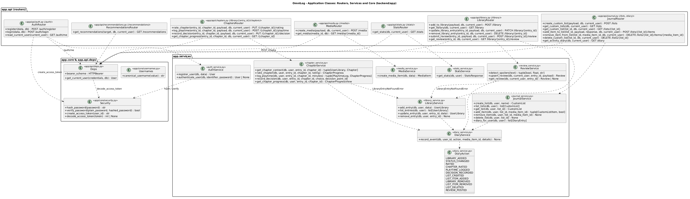

The backend uses function-based modules in `backend/app/api/` and `backend/app/services/`. Every route and function in the diagram matches its source file:

| Router Module (`backend/app/api/`) | Endpoints & Handler Functions | Service Module (`backend/app/services/`) | Service Functions |
|---|---|---|---|
| `auth.py` (`/auth`) | `POST /auth/register` (`register`), `POST /auth/login` (`login`), `GET /auth/me` (`read_current_user`) | `auth_service.py` | `register_user(db, data)`, `authenticate_user(db, identifier, password)` |
| `media.py` (`/media`) | `POST /media` (`create_media`), `GET /media/{media_id}` (`get_media`) | `media_service.py` | `create_media_item(db, data)` |
| `catalog.py` (`/catalog`) | `GET /catalog/search` (`search_catalog`), `GET /catalog/{media_id}` (`get_title_details`) | `catalog_service.py` | `normalize_query(text)`, `search_catalog(db, media_type, text)`, `get_title_details(db, media_id)` |
| `library.py` (`/library`) | `POST /library` (`add_to_library`), `GET /library` (`get_library`), `PATCH /library/{entry_id}` (`update_library_entry`), `DELETE /library/{entry_id}` (`remove_library_entry`), `POST /library/{entry_id}/review` (`submit_review`), `GET /library/{entry_id}/review` (`get_review`) | `library_service.py`, `review_service.py` | `add_entry`, `list_entries`, `update_entry`, `remove_entry`; `detect_spoilers`, `upsert_review`, `get_review` |
| `chapters.py` (`/library/{entry_id}/chapters`) | `PUT /{chapter_id}/rating` (`rate_chapter`), `POST /{chapter_id}/playtime` (`log_playtime`), `PUT /{chapter_id}/decision` (`record_decision`), `GET /{chapter_id}` (`get_chapter_progress`) | `chapter_service.py` | `get_chapter_context`, `rate_chapter`, `log_playtime`, `record_decision`, `get_chapter_progress` |
| `journal.py` (`/lists`, `/diary`) | `POST /lists` (`create_custom_list`), `GET /lists` (`get_custom_lists`), `GET /lists/{list_id}` (`get_custom_list`), `POST /lists/{list_id}/items` (`add_item_to_list`), `DELETE /lists/{list_id}/items/{media_item_id}` (`remove_item_from_list`), `DELETE /lists/{list_id}` (`delete_custom_list`), `GET /diary` (`get_activity_diary`) | `journal_service.py`, `diary_service.py` | `create_list`, `list_lists`, `get_list`, `add_item`, `remove_item`, `delete_list`, `diary_for_user`; `record_event` (`DiaryAction`) |
| `recommendations.py` (`/recommendations`) | `GET /recommendations` (`get_recommendations`) | *(in router)* | Genre-weighted content similarity ranking excluding user's owned `UserLibrary` items |
| `stats.py` (`/stats`) | `GET /stats` (`get_stats`) | `stats_service.py` | `get_stats(db, user)` (`_media_split`, `_rating_distribution`, `_genre_breakdown`, `_playtime_stats`) |

### 3.3 Catalog service and outside APIs

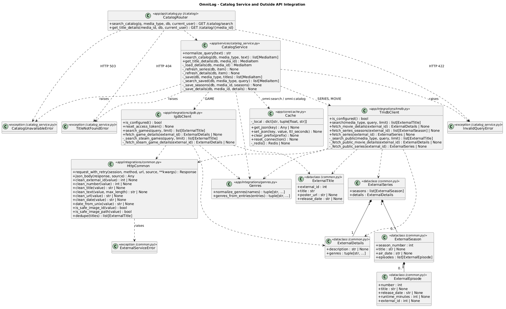

`catalog_service.py` coordinates `cache.py` (`get_json`, `set_json`, `clear_prefix`), `igdb.py` (`search_games`, `fetch_game_details`, plus keyless Steam Store API fallback when `IGDB_CLIENT_ID="public"`), `tmdb.py` (`search`, `fetch_movie_details`, `fetch_series_seasons`, `fetch_series`, plus keyless TVMaze and iTunes Search API fallback when `TMDB_API_KEY="public"`), `genres.py` (`normalize_genres`, `genres_from_entries`), and `common.py` (`request_with_retry`, `json_body`, `clean_*`, `dedupe`). External responses are normalized into frozen dataclasses (`ExternalTitle`, `ExternalDetails`, `ExternalEpisode`, `ExternalSeason`, `ExternalSeries`) before reaching the service layer.

### 3.4 API contracts (`backend/app/schemas/*.py`)

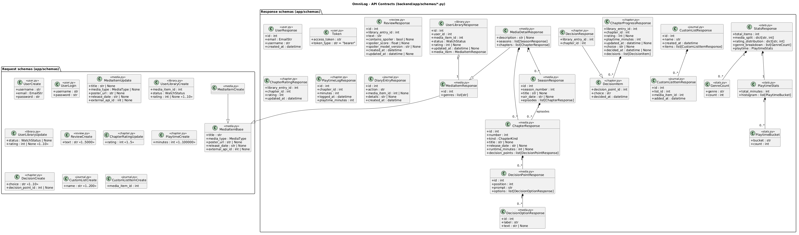

All Pydantic v2 request and response schemas in `backend/app/schemas/` (`user.py`, `media.py`, `library.py`, `chapter.py`, `journal.py`, `review.py`, `stats.py`) enforce strict type and range rules (`strict=True` on ratings and playtime, Turkish-aware username canonicalization, NUL-byte rejection, 72-byte bcrypt password cap) and never expose `hashed_password` in any response model (`UserResponse`, `NFR-03`).

---

## 4. Behavior Design: Sequence Diagrams

Ten of the fifteen user stories are modeled with sequence diagrams (**67% coverage**, exceeding the >= 30% requirement), showing both the main success path and alternative/error flows (`401`, `404`, `409`, `422`, `503`).

| Diagram | User Story | Priority | Endpoint & Service | Key Flows Shown |
|---|---|---|---|---|
| `01` | `US-02` Register an account | Must | `POST /auth/register` -> `auth_service.register_user` | Pydantic validation (`422`), duplicate check (`409`), bcrypt hashing, unique index race handling, auto-login |
| `02` | `US-03` Log in | Must | `POST /auth/login` -> `auth_service.authenticate_user` | Username or email lookup, `DUMMY_HASH` timing-attack mitigation, `PyJWT` signing, `omnilog_session` `httpOnly` cookie |
| `03` | `US-04` Add to library (`US-07` diary) | Must | `POST /library` -> `library_service.add_entry` | `get_current_user` (`401`), missing media (`404`), duplicate (`409`), transactional `LIBRARY_ADDED` + `RATED` diary events |
| `04` | `US-08` Search the catalog | Must | `GET /catalog/search` -> `catalog_service.search_catalog` | Query normalization, Redis cache hit (`NFR-01`), external call with retry/backoff, PostgreSQL fallback, `503` (`NFR-04`) |
| `05` | `US-09` View title details | Must | `GET /catalog/{media_id}` -> `catalog_service.get_title_details` | 24h detail cache, TMDB series season/episode sync, saved fallback on failure, fixed 8-query `selectinload` |
| `06` | `US-10` Rate a chapter or episode | Must | `PUT /library/{entry_id}/chapters/{chapter_id}/rating` -> `chapter_service.rate_chapter` | Ownership check, same-title check (`BR-11`), savepoint race-safe upsert, idempotent unchanged rating |
| `07` | `US-11` Log playtime | Should | `POST /library/{entry_id}/chapters/{chapter_id}/playtime` -> `chapter_service.log_playtime` | Upper bound check, `PlaytimeLog` insert, atomic SQL `playtime_minutes = playtime_minutes + minutes`, `PLAYTIME_LOGGED` event |
| `08` | `US-12` Record a branching decision | Should | `PUT /library/{entry_id}/chapters/{chapter_id}/decision` -> `chapter_service.record_decision` | Decision point resolution, option validation (`422`), PostgreSQL `ON CONFLICT DO UPDATE`, `DECISION_RECORDED` event |
| `09` | `US-15` View personal statistics | Should | `GET /stats` -> `stats_service.get_stats` | Three aggregation queries, largest-remainder media split (`sums to 100`), rating distribution, 5h playtime histogram |
| `10` | `US-14` Submit review with spoiler moderation | Could | `POST /library/{entry_id}/review` -> `review_service.upsert_review` | Ownership check, `detect_spoilers` NLP classifier (`omnilog-nlp-spoiler-v1`), `Review` upsert, `REVIEW_POSTED` diary event |

### 4.1 US-02 Register an account

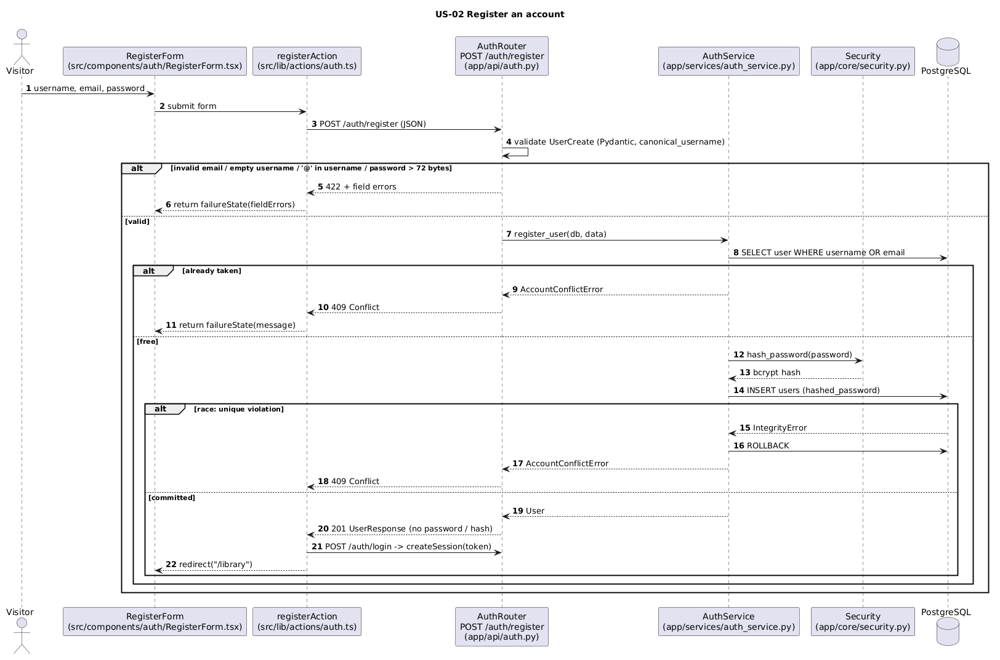

`registerAction` (`frontend/src/lib/actions/auth.ts`) calls `registerUser` (`frontend/src/lib/server/user.ts`) -> `POST /auth/register` (`backend/app/api/auth.py`) -> `auth_service.register_user` (`backend/app/services/auth_service.py`). After Pydantic validates `UserCreate` (`422` on invalid email, `@` in username, or password > 72 UTF-8 bytes) and `register_user` verifies uniqueness (`409` on duplicate username/email or `IntegrityError`), the password is hashed with `hash_password` (`passlib[bcrypt]`), the `User` row is committed, and `registerAction` automatically calls `logIn` to create the `omnilog_session` cookie and redirect to `/library`.

### 4.2 US-03 Log in

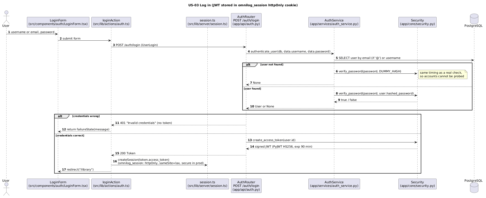

`loginAction` (`frontend/src/lib/actions/auth.ts`) posts `{ username, password }` to `POST /auth/login` (`backend/app/api/auth.py`). `auth_service.authenticate_user` canonicalizes usernames without `@`, queries `User` by username or case-insensitive email, always executes `verify_password` (using `DUMMY_HASH` when no user row exists to prevent timing enumeration), and signs an `HS256` JWT via `create_access_token` (`PyJWT`, 90-minute expiry), which `createSession` (`frontend/src/lib/server/session.ts`) stores in the `httpOnly` cookie `omnilog_session`.

### 4.3 US-04 Add a title to the library

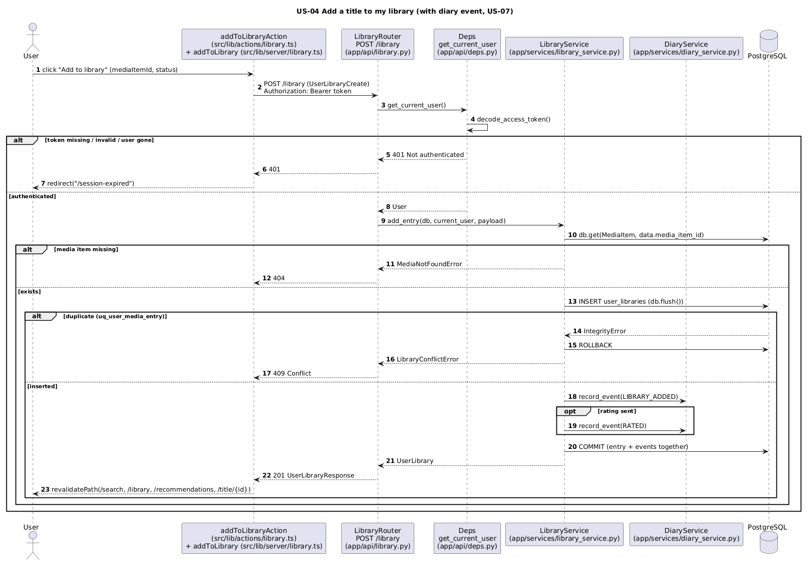

`addToLibraryAction` (`frontend/src/lib/actions/library.ts`) sends `POST /library` through `authedFetch` (`frontend/src/lib/server/authed.ts`). After `get_current_user` (`backend/app/api/deps.py`) verifies the Bearer token (`401`), `library_service.add_entry` (`backend/app/services/library_service.py`) verifies the `MediaItem` exists (`404`), checks for an existing `(user_id, media_item_id)` pair (`409`), inserts `UserLibrary`, and records `DiaryAction.LIBRARY_ADDED` (plus `DiaryAction.RATED` if an initial rating is given) via `diary_service.record_event` in the same database commit.

### 4.4 US-08 Search the catalog

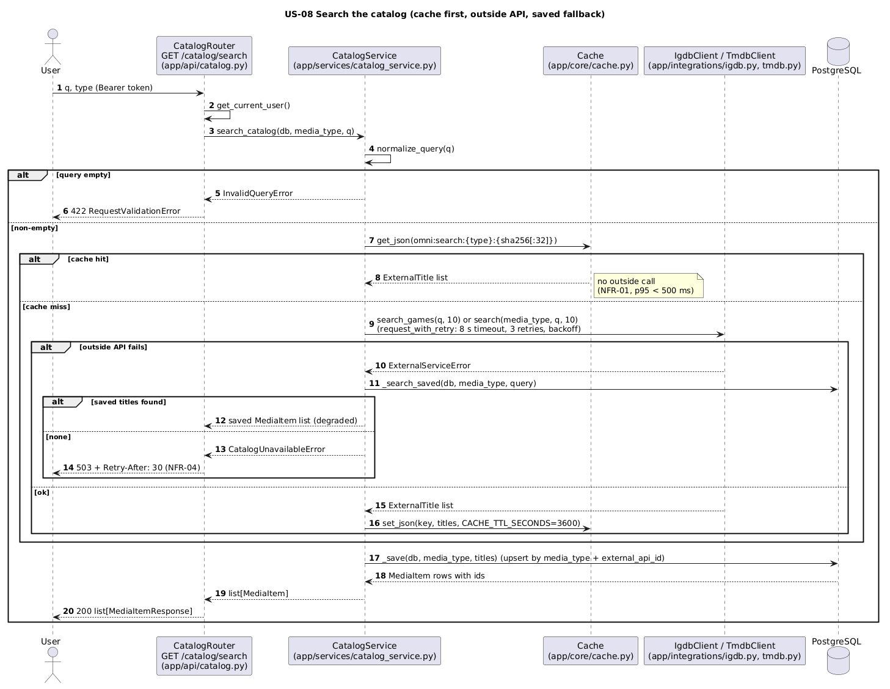

`searchCatalog` (`frontend/src/lib/server/catalog.ts`) calls `GET /catalog/search` (`backend/app/api/catalog.py`) -> `catalog_service.search_catalog`. The service normalizes the query (`normalize_query`), checks Redis (`cache.get_json("omni:search:{type}:{sha256[:32]}")`, `NFR-01`), calls `igdb.search_games` or `tmdb.search` with `request_with_retry` on cache miss, falls back to PostgreSQL `_search_saved` or HTTP `503` (`Retry-After: 30`) on `ExternalServiceError` (`NFR-04`), upserts `MediaItem` and `Genre` rows, and seeds episodic game chapters from `game_chapters.json`.

### 4.5 US-09 View title details

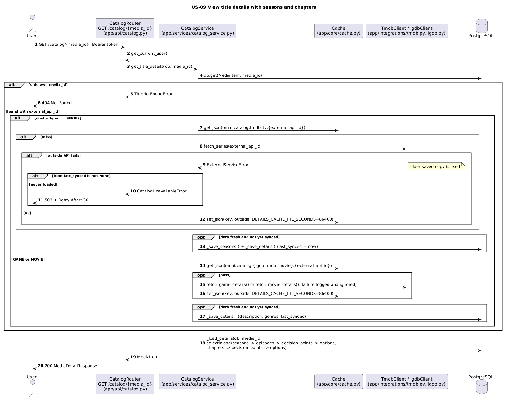

`getTitleDetails` (`frontend/src/lib/server/catalog.ts`) calls `GET /catalog/{media_id}` -> `catalog_service.get_title_details`. For TV series with `external_api_id`, `_refresh_series` reads or populates the 24-hour cache (`omni:catalog:tmdb_tv:{ext_id}`), syncs `Season` and `Chapter` (`kind=EPISODE`) rows, or serves previously synced rows if TMDB fails and `last_synced` is set; `_load_details` then loads the complete hierarchy (`seasons`, `episodes`, `chapters`, `decision_points`, `options`) in a fixed 8 SQL queries via `selectinload`.

### 4.6 US-10 Rate a chapter or episode

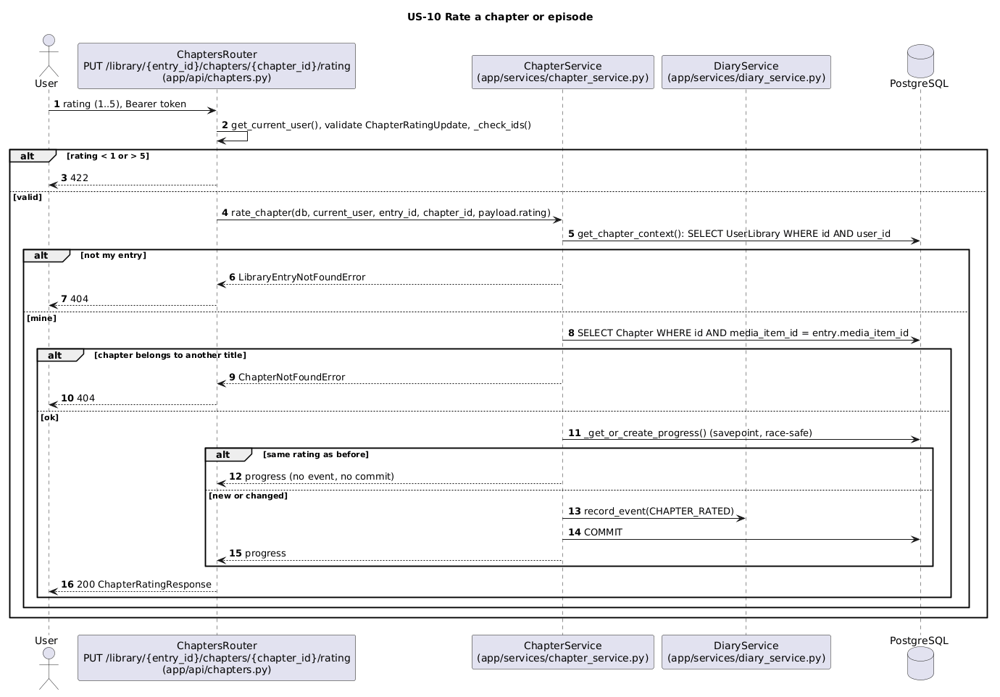

`rateChapterAction` (`frontend/src/lib/actions/chapters.ts`) calls `PUT /library/{entry_id}/chapters/{chapter_id}/rating` (`backend/app/api/chapters.py`) -> `chapter_service.rate_chapter`. `get_chapter_context` verifies library entry ownership (`404`) and enforces the same-title rule (`chapter.media_item_id == entry.media_item_id`, `BR-11`), `_get_or_create_progress` creates or fetches `ChapterProgress` inside a savepoint (`db.begin_nested()`), and `diary_service.record_event(CHAPTER_RATED)` is called only when `previous_rating != rating`.

### 4.7 US-11 Log playtime

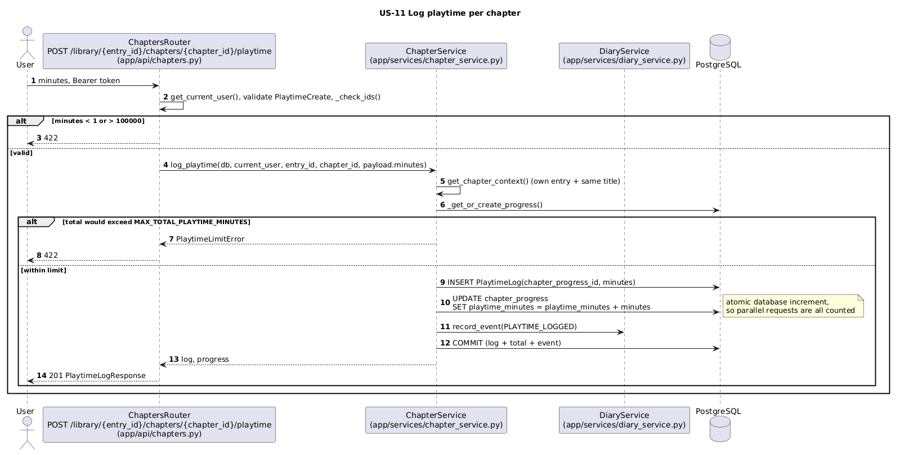

`logPlaytimeAction` (`frontend/src/lib/actions/chapters.ts`) calls `POST /library/{entry_id}/chapters/{chapter_id}/playtime` -> `chapter_service.log_playtime`. After verifying `minutes >= 1` (`PlaytimeCreate`) and checking `_MAX_TOTAL_PLAYTIME_MINUTES = 1_000_000`, the service inserts a `PlaytimeLog` row, increments `ChapterProgress.playtime_minutes` atomically in SQL (`SET playtime_minutes = playtime_minutes + :minutes`), and commits `DiaryAction.PLAYTIME_LOGGED` in the same transaction.

### 4.8 US-12 Record a branching decision

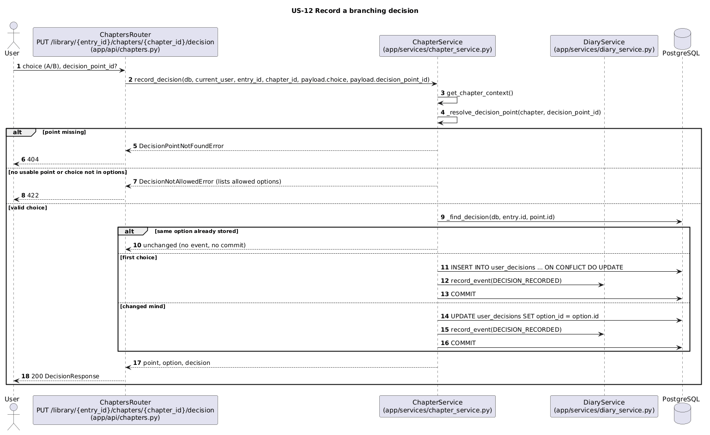

`recordDecisionAction` (`frontend/src/lib/actions/chapters.ts`) calls `PUT /library/{entry_id}/chapters/{chapter_id}/decision` -> `chapter_service.record_decision`. `_resolve_decision_point` selects the target `DecisionPoint` (`404` if none, `422` if `decision_point_id` is omitted when multiple points exist), matches `choice_label` against `DecisionOption.label` (`422` `DecisionNotAllowedError` if invalid), executes PostgreSQL `INSERT INTO user_decisions ... ON CONFLICT (library_entry_id, decision_point_id) DO UPDATE`, and logs `DiaryAction.DECISION_RECORDED` (`-> label` when changed).

### 4.9 US-15 View personal statistics

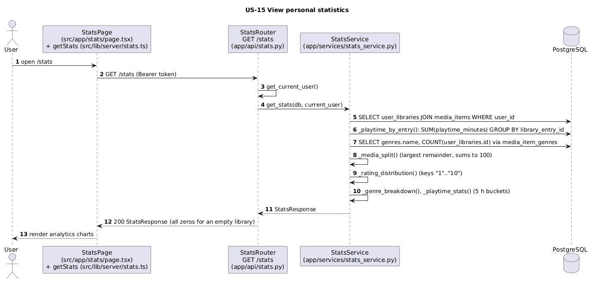

`getUserStats` (`frontend/src/lib/server/stats.ts`) calls `GET /stats` (`backend/app/api/stats.py`) -> `stats_service.get_stats` (`backend/app/services/stats_service.py`). The service executes three targeted queries (library entries with `MediaItem.media_type`, genre counts via `media_item_genres`, and total `ChapterProgress.playtime_minutes`), computes integer media-split percentages summing to `100%` via the largest-remainder method (`_media_split`), builds the `1..10` rating distribution and 5-hour playtime histogram (`_playtime_stats`), and renders them with Recharts on `/stats`.

### 4.10 US-14 Submit review with automated NLP spoiler moderation

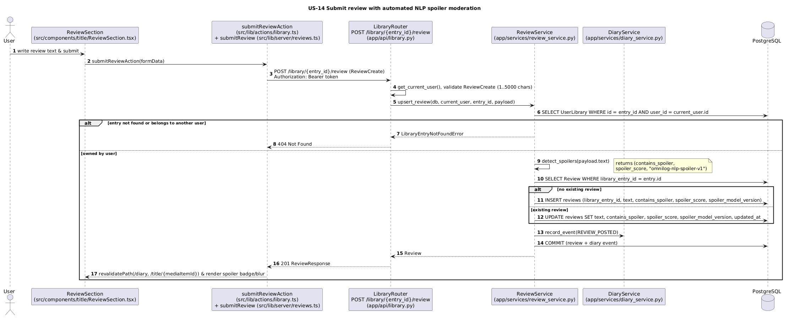

`submitReviewAction` (`frontend/src/lib/actions/library.ts`) calls `POST /library/{entry_id}/review` (`backend/app/api/library.py`) -> `review_service.upsert_review` (`backend/app/services/review_service.py`). After verifying entry ownership (`UserLibrary.id == entry_id AND user_id == current_user.id`), `detect_spoilers(payload.text)` evaluates spoiler pattern weights (`_SPOILER_PATTERNS`) and structural markers (`>! ... !<`, `[spoiler]`) to produce `(contains_spoiler, spoiler_score, "omnilog-nlp-spoiler-v1")`, upserts the `Review` row (`reviews` table), and records `DiaryAction.REVIEW_POSTED` in the same transaction.

---

## 5. Design Decisions for Non-Functional Requirements

This section explains how every non-functional requirement (`NFR-01` to `NFR-05`) and supporting quality attribute (security, data integrity, deployability) is handled in OmniLog, mapping each requirement to its **design decision**, the **tool or library** used, and **where it lives in the repository**.

### 5.1 Master Mapping: NFRs -> Design Decision -> Tool -> Repository Location

| NFR / Attribute | Requirement | Design Decision | Tool / Technology | Where in the Repository |
|---|---|---|---|---|
| **NFR-01** (Performance) | Cached catalog searches respond with `p95 < 500 ms` over 100 repeated requests | **Cache-aside search & details caching** with normalized SHA-256 keys (`omni:search:{type}:{hash}`, 1h TTL; `omni:catalog:{source}:{id}`, 24h TTL) and 0.5s fail-fast Redis socket timeouts | **Redis 7** (`redis-py` `>=5.0.0`), Python `hashlib` & `unicodedata` | `backend/app/core/cache.py` (`get_json`, `set_json`, `_redis`), `backend/app/services/catalog_service.py` (`normalize_query`, `_cache_key`, `search_catalog`, `_refresh_series`, `_refresh_details`), `backend/app/core/config.py` (`CACHE_TTL_SECONDS`, `DETAILS_CACHE_TTL_SECONDS`) |
| **NFR-01** (Performance) | Avoid N+1 database queries on library lists and nested title details | **Eager loading** (`joinedload` for library items; 4-level `selectinload` for seasons, episodes, chapters, decision points, and options in a fixed 8 queries) + **database indexing** on lookup/join columns | **SQLAlchemy 2.x** (`joinedload`, `selectinload`), **PostgreSQL 16** B-tree indexes | `backend/app/services/library_service.py` (`list_entries`), `backend/app/services/catalog_service.py` (`_load_details`), `backend/app/models/entities.py` (`ix_media_item_genres_genre_id`, `index=True` on `title`, `external_api_id`, `season_id`, `chapter_id`), `tests/requirements/test_nfr.py` |
| **NFR-02** (Security: AuthZ) | Protected endpoints (`/library`, `/lists`, `/diary`, `/stats`, `/catalog`, `/recommendations`) return `401` without a valid token | **Single authentication dependency** (`get_current_user`) using `HTTPBearer(auto_error=False)` to return explicit `401 Unauthorized` + **query-level ownership filtering** (`id AND user_id`) | **FastAPI** (`Depends`, `HTTPBearer`), **PyJWT** (`>=2.15.1`, `HS256`, 90-min `exp`) | `backend/app/api/deps.py` (`get_current_user`, `bearer_scheme`), `backend/app/core/security.py` (`create_access_token`, `decode_access_token`), `backend/app/core/config.py` (`_require("SECRET_KEY")`, `>= 32` chars, `ACCESS_TOKEN_EXPIRE_MINUTES`), `tests/requirements/test_nfr.py` |
| **NFR-02** (Security: Session) | Prevent client-side XSS token theft and unauthenticated page flashes | **Server-side `httpOnly` cookie session** (`omnilog_session`, `sameSite="lax"`, `secure` in prod) read only by `server-only` modules + optimistic route guard | **Next.js 16** (`next/headers` `cookies()`, `server-only`), Node `Buffer` base64url JWT `exp` check | `frontend/src/lib/server/session.ts` (`createSession`, `getSessionToken`, `destroySession`), `frontend/src/lib/server/authed.ts` (`authedFetch`), `frontend/src/proxy.ts` (`proxy`), `frontend/src/lib/auth/routes.ts`, `frontend/src/lib/auth/token.ts`, `frontend/src/app/session-expired/route.ts` |
| **NFR-03** (Security: Passwords) | Passwords are never stored or returned in plain text | **Bcrypt password hashing** with 72-byte limit validation, **constant-time dummy hash verification** (`DUMMY_HASH`) for unknown users, and **response schema omission** (`UserResponse` has no password/hash field) | **passlib[bcrypt]** (`>=1.7.4`), **bcrypt** (`>=4.0.1,<5.0.0`), **Pydantic v2** (`UserCreate`, `UserResponse`) | `backend/app/core/security.py` (`hash_password`, `verify_password`, `DUMMY_HASH`, `BCRYPT_MAX_BYTES`), `backend/app/services/auth_service.py` (`register_user`, `authenticate_user`), `backend/app/schemas/user.py` (`UserCreate`, `UserResponse`), `tests/requirements/test_nfr.py` |
| **NFR-03** (Security: SAST & Deps) | Automated detection of hardcoded secrets, insecure JWT/SQL patterns, and vulnerable packages | **Static Application Security Testing (SAST)** on every push/PR with custom rules + **automated dependency auditing** | **Semgrep** (`1.181.0`, `.semgrep.yml`), **Dependabot**, `npm audit --omit=dev --audit-level=high` | `.semgrep.yml` (19 rules covering SQLi, JWT, secrets, CORS, XSS, `localStorage`), `.github/workflows/semgrep.yml`, `.github/dependabot.yml`, `.github/workflows/ci.yml` |
| **NFR-04** (Reliability) | Catalog endpoints survive external API or Redis failures (returning cached/saved data or `503`, never unhandled `500`) | **4-stage resilience chain:** (1) Redis cache with 30s circuit-breaker fallback to in-process `_local` cache, (2) HTTP retry with exponential backoff (8s timeout, 3 retries, `Retry-After` support), (3) PostgreSQL saved-copy fallback (`_search_saved` / `last_synced`), (4) clean `503 Service Unavailable` with `Retry-After: 30` | **requests** (`Session`, `Timeout`, `ConnectionError`), **redis-py**, custom retry & sanitizer helpers, **FastAPI** exception handlers | `backend/app/integrations/common.py` (`request_with_retry`, `_delay_seconds`, `clean_*`), `backend/app/core/cache.py` (`_mark_redis_down`, `_local`), `backend/app/services/catalog_service.py` (`search_catalog`, `_search_saved`, `_refresh_series`), `backend/app/api/catalog.py`, `backend/app/core/errors.py` (`validation_exception_handler`), `tests/requirements/test_nfr.py` |
| **NFR-04** (Reliability: Data) | Prevent race conditions and cross-title corruption under concurrent requests | **Database-enforced composite foreign keys** (`BR-11`), nested **savepoints** (`db.begin_nested()`), **atomic SQL increments** (`playtime_minutes + minutes`), and PostgreSQL **`ON CONFLICT DO UPDATE`** | **PostgreSQL 16** constraints, **SQLAlchemy 2.x** (`ForeignKeyConstraint`, `pg_insert`, `begin_nested`), **Alembic** (`alembic check`) | `backend/app/models/entities.py` (`ChapterProgress`, `DecisionPoint`, `UserDecision`), `backend/app/services/chapter_service.py` (`_get_or_create_progress`, `log_playtime`, `record_decision`), `backend/migrations/versions/0001..0011` |
| **NFR-05** (Maintainability) | Backend line coverage of at least **70%** enforced automatically | **Strict layered architecture** + **deterministic fake external APIs** (`fake_external_apis.py`) + **CI coverage gate** (`--cov-fail-under=70`) and frontend unit/component test suite | **pytest** (`>=7.4.0`), **pytest-cov** (`>=4.1.0`), **FastAPI `TestClient`**, **Vitest + MSW + Testing Library**, **GitHub Actions** | `.github/workflows/ci.yml` (`pytest --cov=backend/app --cov-fail-under=70`), `tests/requirements/` (`test_epic1..6`, `test_nfr.py`, `fake_external_apis.py`), `tests/test_security_checks.py`, `tests/test_security_tokens.py`, `frontend/vitest.config.mts`, `frontend/tests/` |
| **Deployability & Isolation** | Reproducible production deployment with least privilege and network isolation | **Multi-stage / non-root Docker images** (`uid 10001`), health-checked startup order, and a single public entrypoint (`caddy:2-alpine`) | **Docker Compose**, **Caddy 2**, **Hadolint** | `docker-compose.prod.yml`, `docker/Caddyfile`, `backend/Dockerfile`, `frontend/Dockerfile`, `.github/workflows/docker-build.yml`, `docs/deployment.md` |

---

### 5.2 Performance (`NFR-01`)

*Requirement: the 95th percentile response time of cached catalog searches is under 500 ms over 100 repeated requests.*

1. **Read-through / cache-aside in Redis (`backend/app/core/cache.py`, `backend/app/services/catalog_service.py`):**
   - `catalog_service.search_catalog` normalizes the query via `normalize_query` (Unicode `NFC`, control-character stripping, whitespace collapsing) and hashes `query.casefold()` with SHA-256 to build the key `omni:search:{type}:{sha256[:32]}`.
   - Search results are cached for `CACHE_TTL_SECONDS` (`3600` seconds = 1 hour). Title details, seasons, and episodes are cached under `omni:catalog:{tmdb_tv|tmdb_movie|igdb}:{external_id}` for `DETAILS_CACHE_TTL_SECONDS` (`86400` seconds = 24 hours).
   - The cache stores normalized external payloads (`ExternalTitle`, `ExternalSeason`, `ExternalDetails`) rather than database primary keys, preventing stale foreign-key references.
2. **Fail-fast cache client (`backend/app/core/cache.py`):**
   - `redis.Redis.from_url` is configured with `socket_connect_timeout=0.5` and `socket_timeout=0.5`. If Redis raises `redis.RedisError`, `_mark_redis_down` trips a 30-second circuit breaker (`_REDIS_RETRY_AFTER_SECONDS = 30`) and falls back to the thread-safe in-process dictionary `_local` (capped at `_LOCAL_MAX_ENTRIES = 1000`), ensuring an unreachable Redis server never adds latency to catalog requests.
3. **Elimination of N+1 queries (`backend/app/services/library_service.py`, `backend/app/services/catalog_service.py`):**
   - `library_service.list_entries` uses `joinedload(UserLibrary.media_item)` to fetch the user's library and associated `MediaItem` rows in a single SQL query (`MediaItem.genres` uses `lazy="selectin"`).
   - `catalog_service._load_details` chains `selectinload(MediaItem.seasons).selectinload(Season.episodes).selectinload(Chapter.decision_points).selectinload(DecisionPoint.options)` and `selectinload(MediaItem.chapters)...`, loading an entire series or episodic game in a fixed **8 queries** regardless of season or episode count.

### 5.3 Security (`NFR-02` and `NFR-03`)

*Requirements: protected endpoints return `401` without a valid token (`NFR-02`); passwords are never stored or returned in plain text (`NFR-03`).*

1. **Centralized JWT authentication (`backend/app/api/deps.py`, `backend/app/core/security.py`):**
   - `get_current_user` in `backend/app/api/deps.py` uses `HTTPBearer(auto_error=False)` so missing, malformed, or expired tokens consistently return HTTP `401 Unauthorized` with `WWW-Authenticate: Bearer` (rather than FastAPI's default `403`).
   - Tokens are signed and verified with **PyJWT** (`jwt.encode` / `jwt.decode` in `backend/app/core/security.py`) using `HS256` and expire after `ACCESS_TOKEN_EXPIRE_MINUTES` (`90` minutes).
   - `backend/app/core/config.py` enforces `_require("SECRET_KEY")` and raises `RuntimeError` at startup if `len(SECRET_KEY) < 32`.
2. **Query-level ownership enforcement (`backend/app/services/library_service.py`, `chapter_service.py`, `journal_service.py`, `review_service.py`):**
   - Every personal resource lookup filters by both primary key and `user_id` (e.g., `UserLibrary.id == entry_id, UserLibrary.user_id == user.id`). Accessing another user's entry raises the same `LibraryEntryNotFoundError` (`404`) as a non-existent ID, preventing ID enumeration.
3. **Password hashing and timing-attack mitigation (`backend/app/core/security.py`, `backend/app/services/auth_service.py`, `backend/app/schemas/user.py`):**
   - Passwords are hashed with `passlib.context.CryptContext(schemes=["bcrypt"])`.
   - `UserCreate` (`backend/app/schemas/user.py`) rejects NUL bytes (`\x00`) and passwords exceeding `BCRYPT_MAX_BYTES = 72` UTF-8 bytes (`422`), preventing bcrypt truncation collisions.
   - In `auth_service.authenticate_user`, when a username or email is not found, `verify_password(password, DUMMY_HASH)` still executes a full bcrypt check against a precomputed dummy hash so response latency does not leak account existence.
   - `UserResponse` (`backend/app/schemas/user.py`) includes only `id`, `email`, `username`, and `created_at`, guaranteeing that `hashed_password` is never serialized (`NFR-03`).
4. **HttpOnly cookie session & SAST enforcement (`frontend/src/lib/server/session.ts`, `.semgrep.yml`):**
   - The JWT is stored in the `omnilog_session` cookie with `httpOnly: true`, `sameSite: "lax"`, and `secure: process.env.NODE_ENV === "production"`.
   - Custom Semgrep rules in `.semgrep.yml` (executed by `.github/workflows/semgrep.yml`) block `localStorage`/`sessionStorage` token storage (`javascript-token-in-local-storage`), `NEXT_PUBLIC_` secret leakage (`nextjs-public-env-secret`), SQL f-strings (`python-sql-text-fstring`), `jwt.decode` without `algorithms=` (`python-jwt-decode-no-algorithms`), hardcoded `SECRET_KEY` (`python-hardcoded-secret-key`), and wildcard CORS (`python-cors-wildcard-origin`).

### 5.4 Reliability and Data Integrity (`NFR-04`)

*Requirement: when IGDB or TMDB is unavailable, catalog endpoints return cached/saved data or `503`, never an unhandled `500`.*

1. **Multi-tier external API resilience (`backend/app/integrations/common.py`, `backend/app/services/catalog_service.py`, `backend/app/api/catalog.py`):**
   - `request_with_retry` in `backend/app/integrations/common.py` uses a `(3.05s connect, 8.0s read)` timeout and retries timeouts, connection errors, HTTP `429`, and `5xx` responses up to `EXTERNAL_API_MAX_RETRIES = 3` times with exponential backoff (`0.5 * 2^attempt`, respecting upstream `Retry-After` headers up to `_MAX_DELAY_SECONDS = 5.0`).
   - When all retries fail, `request_with_retry` raises `ExternalServiceError`. `catalog_service.search_catalog` catches `ExternalServiceError` and queries PostgreSQL via `_search_saved` (`ILIKE` match on `media_items.title`). If saved titles exist, they are returned (`200 OK`); otherwise `CatalogUnavailableError` is raised and `backend/app/api/catalog.py` returns HTTP `503 Service Unavailable` with `Retry-After: 30`.
   - Similarly, `_refresh_series` returns the previously synced PostgreSQL seasons/episodes whenever `item.last_synced is not None`, raising `CatalogUnavailableError` (`503`) only if the series was never synced before.
2. **Input sanitization and non-finite JSON handling (`backend/app/integrations/common.py`, `backend/app/core/errors.py`):**
   - Every external field passes through `clean_external_id`, `clean_number`, `clean_title`, `clean_text`, `clean_url`, `clean_date`, `is_safe_image_id`, and `is_safe_image_path` before caching or database persistence.
   - `validation_exception_handler` in `backend/app/core/errors.py` sanitizes `NaN` and `Infinity` floats in rejected request bodies before rendering FastAPI's `422` response, preventing `ValueError: Out of range float values are not JSON compliant` (`500`).
3. **Database-level same-title integrity and concurrency safety (`backend/app/models/entities.py`, `backend/app/services/chapter_service.py`):**
   - Composite foreign keys (`fk_progress_entry_title`, `fk_progress_chapter_title`, `fk_decision_entry_title`, `fk_decision_point_title`, `fk_decision_option_point`) enforce `BR-11` and `BR-13` inside PostgreSQL.
   - `_get_or_create_progress` uses a savepoint (`with db.begin_nested():`) to handle concurrent first-time progress creation without aborting the outer transaction.
   - `log_playtime` increments `ChapterProgress.playtime_minutes` atomically in SQL (`ChapterProgress.playtime_minutes + minutes`), and `record_decision` uses PostgreSQL `pg_insert(UserDecision)...on_conflict_do_update(constraint="uq_user_decision_entry_point")`.

### 5.5 Data integrity and consistency

These decisions support all functional and non-functional requirements and are enforced inside PostgreSQL (`backend/app/models/entities.py` and `backend/migrations/versions/0001..0011`) so no application code path can bypass them:

1. **Schema-level check and uniqueness constraints (`backend/app/models/entities.py`):**
   - Rating ranges (`chk_rating_range`: `1..10` on `user_libraries`; `chk_progress_rating`: `1..5` on `chapter_progress`), minimum playtime (`chk_playtime_minutes`: `minutes >= 1` on `playtime_logs`; `chk_progress_playtime`: `playtime_minutes >= 0`), positive decision position (`chk_decision_point_position`: `position >= 1`), unique `(user_id, media_item_id)` library entries (`uq_user_media_entry`), unique `(user_id, name)` custom lists (`uq_user_list_name`), and `ON DELETE CASCADE` on all user-owned child tables.
2. **Composite foreign keys for the same-title invariant (`BR-11`, `0010_add_same_title_composite_fks.py`):**
   - `ChapterProgress`, `DecisionPoint`, and `UserDecision` include `media_item_id` and composite foreign keys (`fk_progress_entry_title`, `fk_progress_chapter_title`, `fk_decision_entry_title`, `fk_decision_point_title`, `fk_decision_option_point`) referencing `(id, media_item_id)` on `user_libraries` and `chapters`, and `(decision_point_id, id)` on `decision_options`.
3. **Atomic counters & race-safe upserts (`backend/app/services/chapter_service.py`):**
   - `_get_or_create_progress` runs inside a nested savepoint (`with db.begin_nested():`), `log_playtime` increments `ChapterProgress.playtime_minutes` atomically in SQL (`ChapterProgress.playtime_minutes + minutes`), and `record_decision` uses PostgreSQL `pg_insert(UserDecision)...on_conflict_do_update(constraint="uq_user_decision_entry_point")`.
4. **One transaction per use case (`backend/app/services/diary_service.py`):**
   - `diary_service.record_event` adds the `DiaryEntry` to the active SQLAlchemy session without committing; the calling service (`library_service`, `chapter_service`, `journal_service`, `review_service`) commits the domain state mutation and its diary event together in a single transaction.

### 5.6 Maintainability (`NFR-05`)

*Requirement: backend line coverage of at least 70% with `pytest-cov`.*

1. **Automated coverage gate in CI (`.github/workflows/ci.yml`):**
   - Every push and pull request runs `python -m pytest tests/requirements -v --cov=backend/app --cov-report=term-missing --cov-report=xml --cov-fail-under=70` against real PostgreSQL 16 (`pgvector/pgvector:pg16`) and Redis 7 service containers.
2. **Migration drift check (`backend/migrations/`):**
   - CI runs `alembic upgrade head` followed by `alembic check` in both the `backend` job and the `docker-compose` smoke test job, failing the build if `backend/app/models/entities.py` diverges from the Alembic revision history (`0001` to `0011`).
3. **Deterministic test doubles (`tests/requirements/fake_external_apis.py`):**
   - External IGDB and TMDB calls are replaced in functional and NFR tests by `fake_external_apis.py`, making the test suite fast, offline, and repeatable, while `test_epic3_catalog_live.py` runs against live APIs on manual `workflow_dispatch`.
4. **Frontend quality gates (`.github/workflows/ci.yml`, `frontend/tests/`):**
   - The `frontend` CI job enforces `npm audit --omit=dev --audit-level=high`, `npm run lint` (ESLint), `npx tsc --noEmit` (TypeScript typecheck), `npm run test` (Vitest + MSW + Testing Library across 22 test files in `frontend/tests/`), and `npm run build`.
5. **Team & repository governance (`.github/`):**
   - `.github/CODEOWNERS`, `.github/pull_request_template.md`, `.github/ISSUE_TEMPLATE/`, and `.github/dependabot.yml` enforce code review ownership and automated dependency updates across `pip`, `npm`, `docker`, and `github-actions`.

### 5.7 Deployability and portability

1. **Twelve-factor configuration (`backend/app/core/config.py`, `backend/.env.example`, `env.prod.example`):**
   - All secrets and environment settings (`DATABASE_URL`, `REDIS_URL`, `SECRET_KEY`, `CORS_ORIGINS`, `IGDB_CLIENT_ID`, `IGDB_CLIENT_SECRET`, `TMDB_API_KEY`) are read from environment variables; no secrets are stored in the repository.
2. **Health-checked startup orchestration (`docker-compose.prod.yml`, `docker/Caddyfile`):**
   - `docker-compose.prod.yml` starts `db` (`pg_isready` health check) and `redis` (`redis-cli ping` health check), runs the one-shot `migrate` container (`alembic upgrade head`), starts `backend` (waiting for `migrate: service_completed_successfully` and `redis: service_healthy`) and `frontend`, and exposes only `proxy` (`caddy:2-alpine` on ports `80`/`443`) on the isolated bridge network `internal`.
3. **Hardened multi-stage images (`backend/Dockerfile`, `frontend/Dockerfile`, `.github/workflows/docker-build.yml`):**
   - Both Dockerfiles install dependencies before copying source layers for fast rebuilds, run as non-root UID `10001`, and are linted in CI with Hadolint (`hadolint/hadolint-action`).

### 5.8 Current status, known limits, and planned work

| Topic | Implemented in `main` Today | Planned Next Step |
|---|---|---|
| **Spoiler detection (`US-14`)** | Implemented in `backend/app/services/review_service.py` (`detect_spoilers`, `upsert_review`, `get_review`), `Review` entity (`0011_reviews.py`), `POST/GET /library/{entry_id}/review`, and `frontend/src/components/title/ReviewSection.tsx` (warning badge + blur toggle) | Upgrade from weighted NLP pattern/structural classifier (`omnilog-nlp-spoiler-v1`) to a fine-tuned transformer model if higher recall on subtle plot spoilers is needed |
| **Recommendations (`US-13`)** | Implemented in `backend/app/api/recommendations.py` (`GET /recommendations`) using genre-preference weights derived from the user's rated library entries, excluding owned titles | Persist `VECTOR(1536)` embeddings in `media_embeddings` and `user_taste_vectors` (`pgvector/pgvector:pg16`) using OpenAI `text-embedding-3-small` (`openai>=3.48.0` in `backend/requirements.txt`, selected in PR #186) |
| **Statistics (`US-15`)** | Computed on each `GET /stats` call (`backend/app/services/stats_service.py`) via three SQL queries over the user's library, genres, and chapter progress | Optional Redis caching (`omni:stats:{user_id}`) with invalidation hooks on library/chapter mutations if user libraries grow large |
| **Horizontal scalability** | Stateless `PyJWT` authentication and shared Redis cache (`backend/app/core/cache.py`) allow multiple `backend` and `frontend` replicas behind Caddy | Add replica scaling and PgBouncer connection pooling when concurrent load requires it |

---

## 6. Traceability

| Requirement | Architecture Artifact | Class Diagram | Sequence Diagram | Repository Implementation |
|---|---|---|---|---|
| `US-01` (Health check) | `01-system-architecture`, `02-backend-layers` | - | - | `backend/app/main.py` (`GET /health`) |
| `US-02`, `US-03` (Register, Login) | `02-backend-layers`, `03-frontend-structure` | `01-domain-model`, `02-service-layer`, `04-schemas` | `01-us02-register`, `02-us03-login` | `backend/app/api/auth.py`, `backend/app/services/auth_service.py`, `frontend/src/lib/actions/auth.ts` |
| `US-04`, `US-05` (Library CRUD & rating) | `02-backend-layers`, `03-frontend-structure` | `01-domain-model`, `02-service-layer`, `04-schemas` | `03-us04-add-to-library` | `backend/app/api/library.py`, `backend/app/services/library_service.py`, `frontend/src/lib/actions/library.ts` |
| `US-06`, `US-07` (Custom lists & diary) | `02-backend-layers`, `03-frontend-structure` | `01-domain-model`, `02-service-layer`, `04-schemas` | `03-us04-add-to-library` (diary event) | `backend/app/api/journal.py`, `backend/app/services/journal_service.py`, `backend/app/services/diary_service.py` |
| `US-08`, `US-09` (Catalog search & details) | `01-system-architecture`, `02-backend-layers` | `01-domain-model`, `03-catalog-integration`, `04-schemas` | `04-us08-catalog-search`, `05-us09-title-details` | `backend/app/api/catalog.py`, `backend/app/services/catalog_service.py`, `backend/app/integrations/` |
| `US-10`, `US-11`, `US-12` (Episodic logging) | `02-backend-layers`, `03-frontend-structure` | `01-domain-model`, `02-service-layer`, `04-schemas` | `06-us10-rate-chapter`, `07-us11-log-playtime`, `08-us12-record-decision` | `backend/app/api/chapters.py`, `backend/app/services/chapter_service.py`, `frontend/src/lib/actions/chapters.ts` |
| `US-13` (Recommendations) | `02-backend-layers`, `03-frontend-structure` | `01-domain-model`, `02-service-layer` | - | `backend/app/api/recommendations.py`, `frontend/src/app/recommendations/page.tsx` |
| `US-14` (Review spoiler moderation) | `02-backend-layers`, `03-frontend-structure` | `01-domain-model`, `02-service-layer`, `04-schemas` | `10-us14-review` | `backend/app/api/library.py`, `backend/app/services/review_service.py`, `frontend/src/components/title/ReviewSection.tsx` |
| `US-15` (Personal statistics) | `02-backend-layers`, `03-frontend-structure` | `01-domain-model`, `02-service-layer`, `04-schemas` | `09-us15-stats` | `backend/app/api/stats.py`, `backend/app/services/stats_service.py`, `frontend/src/app/stats/page.tsx` |
| `NFR-01` (Search latency < 500 ms) | `01-system-architecture` (Redis) | `03-catalog-integration` (`Cache`) | `04-us08-catalog-search`, `05-us09-title-details` | `backend/app/core/cache.py`, `backend/app/services/catalog_service.py`, `tests/requirements/test_nfr.py` |
| `NFR-02`, `NFR-03` (AuthZ & password security) | `02-backend-layers`, `03-frontend-structure` | `02-service-layer` (`Deps`, `Security`), `04-schemas` (`UserResponse`) | `01-us02-register`, `02-us03-login`, `03-us04-add-to-library` | `backend/app/api/deps.py`, `backend/app/core/security.py`, `frontend/src/lib/server/session.ts`, `.semgrep.yml` |
| `NFR-04` (External API fault tolerance) | `01-system-architecture` | `03-catalog-integration` (`HttpCommon`, `Cache`) | `04-us08-catalog-search`, `05-us09-title-details` | `backend/app/integrations/common.py`, `backend/app/services/catalog_service.py`, `tests/requirements/test_nfr.py` |
| `NFR-05` (>= 70% test coverage) | `02-backend-layers` | `02-service-layer` | - | `.github/workflows/ci.yml`, `tests/requirements/` |
