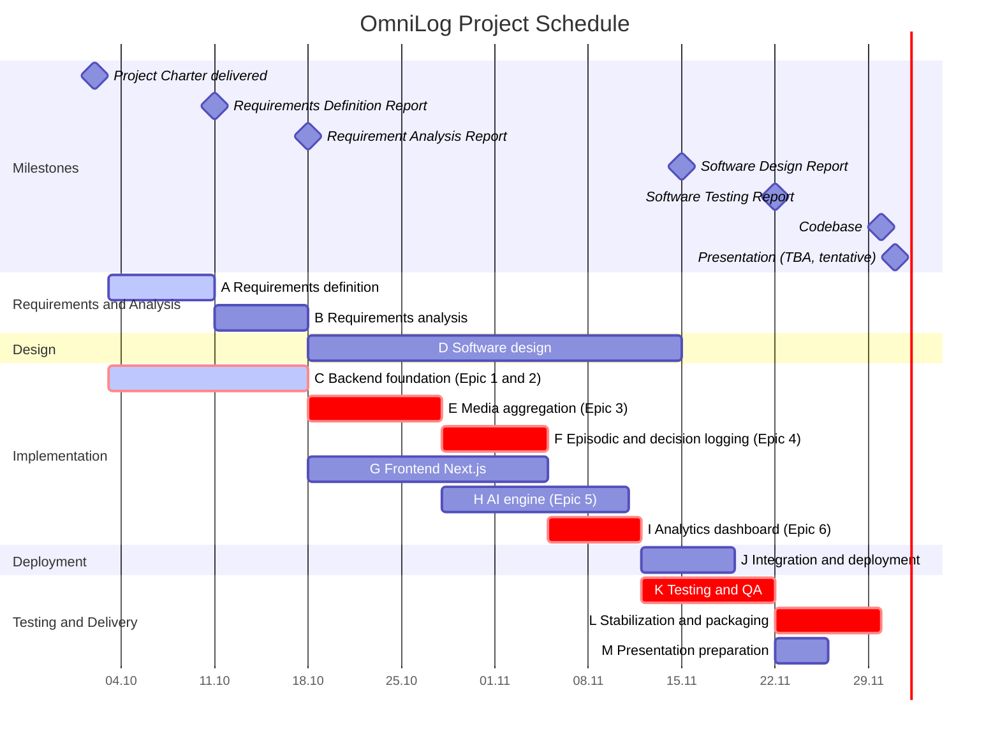

# OmniLog - Gantt Chart

Task dates come from the PERT analysis in [pert.md](pert.md), rounded to whole days. Red bars are on the critical path. Milestones follow the Project Charter. The presentation date is not announced yet (TBA), so it is shown tentatively at the start of December.

