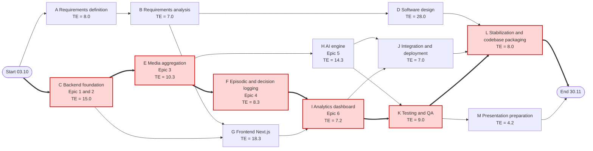

# OmniLog - PERT Analysis

Time unit: days. **Day 0 = 03.10.2026** (the day after the Project Charter was delivered). The target end is the Codebase deadline, 30.11.2026 (day 58).

Expected time: `TE = (O + 4M + P) / 6`, where O = optimistic, M = most likely, P = pessimistic. Thick arrows mark the critical path.

## Network diagram

## Activity table

| ID | Activity | Predecessors | O | M | P | TE | ES | EF | Slack | Suggested owner |
|---|---|---|---|---|---|---|---|---|---|---|
| A | Requirements definition (user stories, tests, spec report) | - | 6 | 8 | 10 | 8.0 | 0.0 | 8.0 | 0.3 | All |
| B | Requirements analysis (domain model, ER, BPD/DFD, report) | A | 5 | 7 | 9 | 7.0 | 8.0 | 15.0 | 0.3 | All |
| C | Backend foundation (DB, schemas, CRUD, auth) | - | 12 | 15 | 18 | 15.0 | 0.0 | 15.0 | **0** | Backend Engineer, API Integration and Backend Engineer |
| D | Software design (architecture, class and sequence diagrams, report) | B | 24 | 28 | 32 | 28.0 | 15.0 | 43.0 | 6.8 | Full-Stack Architect |
| E | Media aggregation: IGDB / TMDB ingestion and Redis cache | C | 8 | 10 | 14 | 10.3 | 15.0 | 25.3 | **0** | API Integration and Backend Engineer |
| F | Episodic and decision logging | E | 6 | 8 | 12 | 8.3 | 25.3 | 33.7 | **0** | Backend Engineer |
| G | Frontend (Next.js UI) | B, C | 14 | 18 | 24 | 18.3 | 15.0 | 33.3 | 0.3 | Frontend Lead |
| H | AI engine: recommendation and spoiler detection | E | 10 | 14 | 20 | 14.3 | 25.3 | 39.7 | 1.2 | ML Engineer |
| I | Analytics dashboard | F, G | 5 | 7 | 10 | 7.2 | 33.7 | 40.8 | **0** | Frontend Lead, Full-Stack Architect |
| J | Integration, Docker, CI/CD and cloud deployment | H, I | 5 | 7 | 9 | 7.0 | 40.8 | 47.8 | 2.0 | Full-Stack Architect |
| K | Testing and QA (unit, performance, security, SonarQube, report) | H, I | 7 | 9 | 11 | 9.0 | 40.8 | 49.8 | **0** | All |
| L | Stabilization and codebase packaging | D, J, K | 6 | 8 | 10 | 8.0 | 49.8 | 57.8 | **0** | All |
| M | Presentation preparation | K | 3 | 4 | 6 | 4.2 | 49.8 | 54.0 | 3.8 | All |

Slack is measured relative to the computed project end (day 57.8). Activities with slack below 0.5 day (A, B, G) are near-critical.

## Critical path

**C -> E -> F -> I -> K -> L**

`15.0 + 10.3 + 8.3 + 7.2 + 9.0 + 8.0 = 57.8 days`, which ends on about 30.11.2026.

## Schedule risk

Sum of the critical-path variances, with `variance = ((P - O) / 6)^2`:

`1.00 + 1.00 + 1.00 + 0.69 + 0.44 + 0.44 = 4.58`, so `sigma = 2.14 days`.

The deadline is day 58 and the expected duration is day 57.8, so `Z = (58 - 57.8) / 2.14 = 0.08`. The probability of finishing by 30.11.2026 is about **53%**. The plan has almost no buffer, so the mitigations are:

- Start the AI engine (H) and the frontend (G) early, because they run in parallel with the critical path.
- Keep the Epic 3 integration (E) minimal at first: one IGDB endpoint and one TMDB endpoint, then expand.
- Freeze scope at the end of Epic 4 for the backend. Anything not finished moves to "nice to have".

## Milestone alignment

| Milestone | Deadline | Related activity | Planned finish |
|---|---|---|---|
| Requirements Definition Report | 11.10.2026 | A | 11.10 (day 8) |
| Requirement Analysis Report | 18.10.2026 | B | 18.10 (day 15) |
| Software Design Report | 15.11.2026 | D | 15.11 (day 43) |
| Software Testing Report | 22.11.2026 | K | 22.11 (day 50) |
| Codebase | 30.11.2026 | L | 30.11 (day 58) |
| Presentation | TBA | M | about 26.11 (preparation) |
