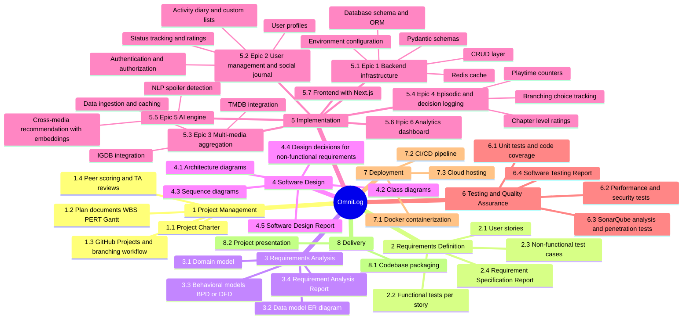

# OmniLog - Work Breakdown Structure (WBS)

The WBS decomposes the project into deliverable-oriented work packages. Phases 2-4 and 6 map directly to the course deliverables, and phase 5 maps to the six epics defined in the Project Charter.

## Mapping of WBS phases to course milestones

| WBS phase | Deliverable | Deadline |
|---|---|---|
| 1.1 | Project Charter | 02.10.2026 23:59 |
| 2 | Requirements Definition Report | 11.10.2026 23:59 |
| 3 | Requirement Analysis Report | 18.10.2026 23:59 |
| 4 | Software Design Report | 15.11.2026 23:59 |
| 6 | Software Testing Report | 22.11.2026 23:59 |
| 5, 7, 8.1 | Codebase | 30.11.2026 23:59 |
| 8.2 | Presentation | TBA |
