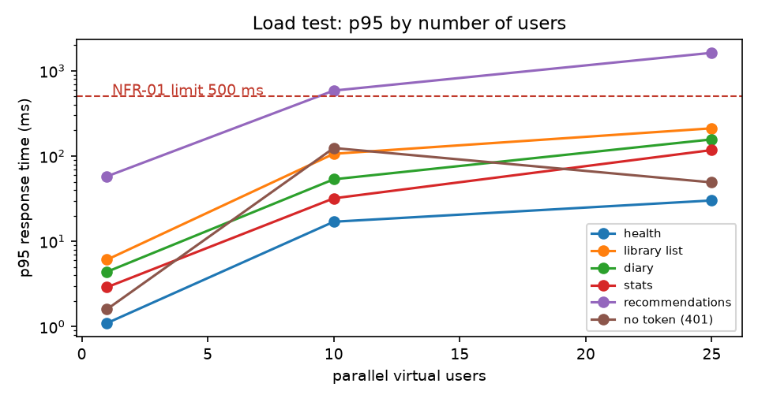

# Non-Functional Tests

**Branch:** `test_work` | **Run date:** 19.11.2026

This folder explains which kinds of non-functional tests were carried out for OmniLog, how they were run, and what the results mean. Raw results are in [`results/`](results/).

**Test environment.** One virtual machine with 1 CPU core and 4 GB RAM, Ubuntu 24.04, Python 3.12, PostgreSQL 16.2, Redis 6.2, Uvicorn with one worker. The load generator ran on the same machine as the server, so the two compete for the single core. The numbers are therefore **pessimistic** compared with a deployment on separate machines. They are meant for comparing endpoints and finding limits, not as a promise for production.

| # | Kind of test | Requirement | Tool | Result |
|---|---|---|---|---|
| 1 | Performance of cached endpoints | NFR-01 | pytest (`test_nfr.py`) | Passed: p95 6.2 ms and 4.2 ms |
| 2 | Load test over real HTTP | NFR-01 | `tests/nonfunctional/run_load_test.py` | 0 errors in 4 500 requests. One endpoint is above 500 ms (finding N-01) |
| 3 | Security: authentication and authorisation | NFR-02 | pytest | Passed: 22 of 22 endpoints refuse a request without a token. Other users' data is answered with 404 |
| 4 | Security: token attacks | NFR-02 | pytest (`test_security_tokens.py`) | Passed: expired, wrongly signed, `alg: none`, other algorithm and missing `sub` tokens are refused |
| 5 | Security: password handling | NFR-03 | pytest (`test_nfr03_*`) | Passed: hash differs from the password, nothing is returned |
| 6 | Security: static code checks | NFR-02, NFR-03 | pytest AST checks (`test_security_static.py`), Ruff `S` rules, Bandit | Passed: 0 findings |
| 7 | Security: dependency audit | NFR-02 | `pip-audit`, `npm audit` | 0 known vulnerabilities in backend and frontend packages (frontend: production and development) |
| 8 | Security: CORS policy | NFR-02 | pytest (`test_security_checks.py`) | Passed: no wildcard origin |
| 9 | Reliability: outside services fail | NFR-04 | pytest with fakes (`test_nfr04_*`, edge-case files) | Passed: timeouts, refused keys, odd answers and outages end in cached data or 503, never in an unhandled 500 |
| 10 | Reliability: Redis or database down | NFR-04 | pytest (`test_health.py`) | Passed: Redis down is not fatal (in-process cache). `/health` answers even if the database is down, `/health/ready` reports it |
| 11 | Reliability: database migrations | NFR-04 | `alembic upgrade head`, `alembic check` | Passed: 11 migrations apply to an empty database and the models match the schema |
| 12 | Robustness of input | NFR-02 | pytest edge cases | Passed: NUL bytes, 72-byte bcrypt limit, Unicode case rules, over-long and blank text are refused with 422 |
| 13 | Maintainability | NFR-05 | pytest-cov, Radon, ESLint, `tsc` | 91.3 % line coverage. Average cyclomatic complexity A (3.05). ESLint 0 errors, `tsc` 0 errors |

## 1. Performance (NFR-01)

**Requirement:** the 95th percentile (p95) of cached catalog searches is under 500 ms over 100 repeated requests.

**Method.** `test_nfr01_cached_search_p95_under_500ms` warms the cache with one request, sends 100 identical `GET /catalog/search` requests and computes the p95. The same is done for `GET /stats`. IGDB and TMDB are replaced by fakes, so the test measures only OmniLog (routing, JWT check, cache read, JSON).

**Result** (`results/nfr01-pytest-output.txt`):

```
[NFR-01] GET /catalog/search: p95=6.2 ms over 100 requests
[NFR-01] GET /stats: p95=4.2 ms over 100 requests
```

**Interpretation.** Both are about 80 times faster than the limit. The p95 means that 95 of 100 requests were at least this fast, so it describes the slow tail and not the average. The test runs in-process (no network), so it shows the application cost only. The load test below adds a real network connection, the database and parallel users.

## 2. Load test over real HTTP

**Method.** `tests/nonfunctional/run_load_test.py` registers a user with 40 library entries and then sends requests over real HTTP to a running Uvicorn. Each scenario is run with 1, 10 and 25 parallel virtual users, each sending 20 requests one after the other (login: 5). After one warm-up request, the script records requests per second, p50, p95, p99 and the number of responses with an unexpected status. How to repeat it is in the header of the script.

**Results** (`results/load-test-results.json`):



| Scenario | Users | Requests | Errors | Req/s | p50 (ms) | p95 (ms) | p99 (ms) | p95 < 500 ms |
|---|---:|---:|---:|---:|---:|---:|---:|---|
| health | 1 | 20 | 0 | 684.5 | 0.8 | 1.1 | 1.5 | yes |
| health | 10 | 200 | 0 | 672.2 | 4.7 | 17.0 | 20.8 | yes |
| health | 25 | 500 | 0 | 581.0 | 8.1 | 30.2 | 51.7 | yes |
| library list | 1 | 20 | 0 | 113.9 | 4.9 | 6.1 | 65.1 | yes |
| library list | 10 | 200 | 0 | 147.1 | 53.4 | 106.5 | 123.7 | yes |
| library list | 25 | 500 | 0 | 153.0 | 122.9 | 211.9 | 234.5 | yes |
| diary | 1 | 20 | 0 | 242.5 | 3.3 | 4.4 | 4.5 | yes |
| diary | 10 | 200 | 0 | 211.7 | 36.7 | 53.5 | 100.8 | yes |
| diary | 25 | 500 | 0 | 201.4 | 83.8 | 157.1 | 205.8 | yes |
| stats | 1 | 20 | 0 | 316.1 | 2.4 | 2.9 | 3.5 | yes |
| stats | 10 | 200 | 0 | 316.9 | 23.0 | 32.0 | 40.8 | yes |
| stats | 25 | 500 | 0 | 287.0 | 50.4 | 117.8 | 131.1 | yes |
| recommendations | 1 | 20 | 0 | 23.7 | 35.8 | 57.9 | 68.6 | yes |
| recommendations | 10 | 200 | 0 | 21.2 | 447.0 | 587.2 | 647.3 | **no** |
| recommendations | 25 | 500 | 0 | 21.6 | 1132.6 | 1628.1 | 1733.3 | **no** |
| login (bcrypt) | 1 | 5 | 0 | 4.0 | 255.3 | 278.6 | 278.6 | n/a (bcrypt) |
| login (bcrypt) | 10 | 50 | 0 | 4.0 | 2522.0 | 2679.5 | 2706.5 | n/a (bcrypt) |
| login (bcrypt) | 25 | 125 | 0 | 4.0 | 6736.3 | 7783.7 | 11412.4 | n/a (bcrypt) |
| no token (401) | 1 | 20 | 0 | 495.8 | 1.1 | 1.6 | 3.1 | yes |
| no token (401) | 10 | 200 | 0 | 307.7 | 11.3 | 124.5 | 185.0 | yes |
| no token (401) | 25 | 500 | 0 | 524.9 | 15.1 | 49.2 | 79.4 | yes |

**Interpretation.**

- **Reliability under load: 0 errors.** Not one of the 4 500 requests failed or timed out, also at 25 parallel users on one core. The service degrades by getting slower, not by failing.
- **Reading endpoints scale as expected.** With more users the response time grows in proportion, because the single core is the bottleneck: `/health` stays under 31 ms at p95, `/stats` (cached) under 118 ms, `/diary` under 157 ms and `/library` under 212 ms at 25 users. All are under the 500 ms limit.
- **Finding N-01: `GET /recommendations` is the slowest endpoint.** It manages only about 21 requests per second whatever the number of users, and its p95 passes 500 ms from 10 users (587 ms) and reaches 1.6 s at 25 users. The endpoint loads every title of the catalog, ranks them in Python and has no limit, no pagination and no cache. This grows with the size of the catalog. See the [mitigation plan](../quality/mitigation-plan.md), finding Q-02. NFR-01 only names the catalog search, so the requirement is still met, but this is the first place that would hurt in production.
- **Finding N-02: login costs 250 ms of CPU by design.** Passwords are hashed with bcrypt at cost 12 (NFR-03), so one core can verify only about 4 logins per second, and 25 simultaneous logins wait up to 7.8 s. This is the price of safe password storage. It also means that a flood of login requests is a cheap way to keep the server busy. A rate limit is proposed (Q-03).
- **Requests without a token (401)** are refused fast (p95 49 ms at 25 users), so unauthenticated traffic does not reach the database.

## 3. Security tests (NFR-02, NFR-03)

| Check | What is tested | Test |
|---|---|---|
| Authentication on every protected endpoint | 22 endpoint and method combinations (library, review, chapters, lists, diary, catalog, recommendations, stats, media) answer 401 without a token | `test_nfr02_protected_endpoints_require_token` |
| Token verification | Valid token accepted. Expired, wrong signature, `alg: none`, other algorithm (HS384) and token without `sub` are refused | `tests/test_security_tokens.py` |
| Token lifetime | The token expires after the configured time | `test_epic2_token_lifetime.py` |
| Ownership (broken object-level authorisation) | The library entry, list, chapter data and review of another user cannot be read or changed. The answer is 404, so the existence of an object is not revealed | `test_epic2_users.py`, `test_epic2_removal.py`, `test_epic3_library_edge_cases.py`, `test_epic5_review_and_recommendation_edge_cases.py` |
| Password storage | Stored hash differs from the password and is longer. Neither the password nor `hashed_password` appears in any answer | `test_nfr03_password_is_hashed_and_never_returned` |
| Login enumeration | An unknown user and a wrong password get the same answer | `test_us03_unknown_user_gets_same_response_as_wrong_password` |
| Input robustness | NUL byte, 72-byte limit of bcrypt (no silent truncation), Unicode case rules for user names | `test_epic2_auth_edge_cases.py`, `test_epic2_login_identifier_edge_cases.py` |
| CORS | A foreign origin does not get `*` | `tests/test_security_checks.py` |
| Static checks | JWT decoding with a fixed algorithm list and signature check on, no CORS wildcard, no debug mode, no secrets in log lines, no SQL built from formatted strings. Each check is itself tested on unsafe sample code | `tests/test_security_static.py` (64 cases) |
| Static analysis | Ruff `S` (flake8-bandit) rules and Bandit over 4 254 lines: **0 findings** | `raw` outputs in [`../quality/raw`](../quality/raw/) |
| Dependencies | `pip-audit` (backend) and `npm audit` (frontend, production and development): **0 vulnerabilities** | [`../quality/raw`](../quality/raw/) |

**Interpretation.** No security test failed, and no static or dependency tool reported a finding. This does not prove the absence of vulnerabilities. What is *not* covered: penetration testing of the running deployment, rate limiting (does not exist, Q-03) and the Docker images. The CI pipeline additionally runs gitleaks, Trivy, Semgrep and zizmor (`.github/workflows/security.yml`).

## 4. Reliability tests (NFR-04)

The tests replace IGDB, TMDB and OpenAI with fakes that fail in every way that has been seen in practice: connection error, timeout with retries, refused API key, unusable or empty JSON, missing credentials.

| Situation | Expected behaviour | Result |
|---|---|---|
| IGDB or TMDB down, saved titles exist | Answer from the database or cache | Passed |
| IGDB or TMDB down, nothing saved | `503` with a clear message | Passed |
| Series never loaded and TMDB down | `503` (US-09) | Passed |
| A failed load | Is not cached, so the next request tries again | Passed |
| OpenAI down | Recommendations still answer. A review is saved, flagged with the local spoiler patterns | Passed |
| Redis down | In-process cache takes over. The service stays ready | Passed |
| Database down | `/health` stays 200 (process is alive). `/health/ready` reports 503 | Passed |
| Missing `DATABASE_URL` or short `SECRET_KEY` | The application refuses to start with a clear error | Passed |
| Concurrent writes (two requests pass the "exists?" check at the same time) | The unique constraint is the fallback and the answer is 409, not 500 | Passed (`HiddenPreCheck` tests) |

## 5. Maintainability (NFR-05)

- Line coverage 91.3 %, branch coverage 78.3 % (see [coverage report](../coverage/coverage-report.md)).
- **Cyclomatic complexity (Radon):** 278 functions, average 3.05 (grade A). Six functions are grade C (complexity 11 to 14): `openai_client.embed_texts` (14), `seed.__main__.main` (13), `recommendations.get_recommendations` (13), `openai_client.classify_spoiler` (13), `tmdb.fetch_series` (12), `igdb._get_access_token` (11). None is above 14. Three files with a byte-order mark could not be parsed by Radon (Q-05).
- ESLint: 0 errors, 5 warnings (`` instead of `next/image`). TypeScript: 0 errors.

## 6. What was not done

- **Stress and soak tests** (finding the breaking point, running for hours) were not done. The load test stops at 25 users because of the single-core environment.
- **Usability and accessibility tests** are outside the scope of the requirements.
- **Penetration test of the deployed system** was not done. WBS item 6.3 mentions it; it needs a deployed environment.
