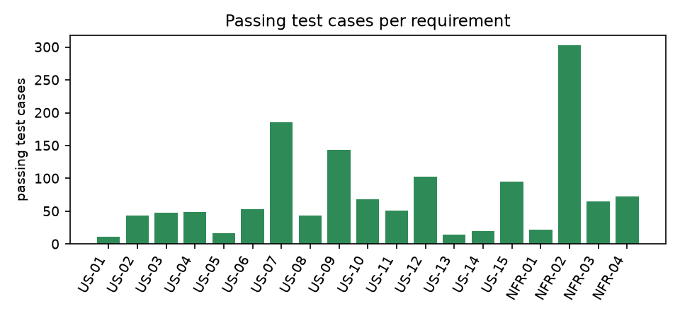
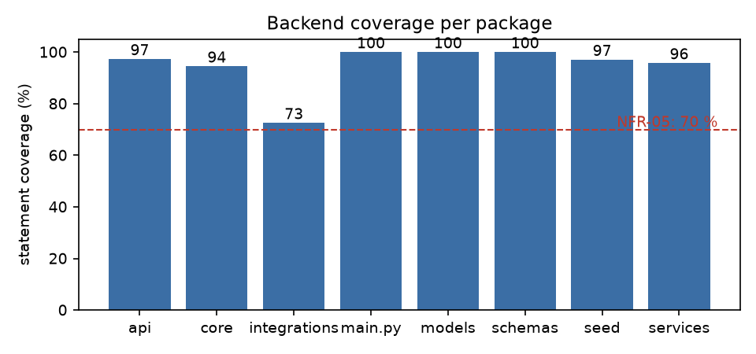
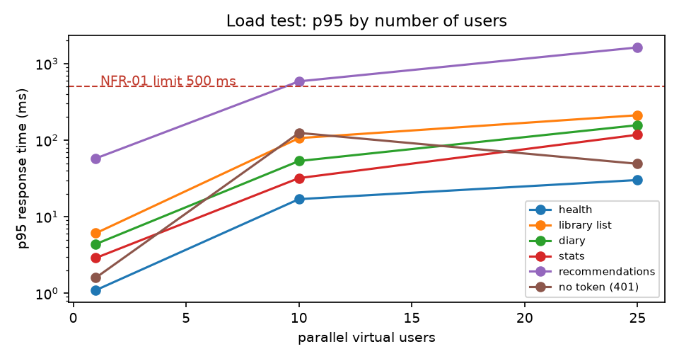

# OmniLog - Software Testing Report

**Course:** CMPE 331 Software Engineering Concepts, Fall 2026-2027  
**Deliverable:** Software Testing Report (pull request deadline 25.11.2026, PDF deadline 29.11.2026)  
**Repository branch:** `test_work`  
**Test run:** 19.11.2026, commit base `main`

| Team member | Role |
|---|---|
| Mete Özdoğan | Product Owner, Full-Stack Architect |
| Kerem Kenet | Frontend Lead |
| Kağan Konuk | Backend Engineer |
| Sidar Ürey | ML Engineer |
| Musab Alperen Başol | API Integration and Backend Engineer |
| Mohammad Edris | Backend/QA Engineer |

---

## 1. Introduction

This report presents the tests of OmniLog, the results of the latest run, and how to interpret them. The detail is in dedicated folders of the repository, and this report links to them.

| Part of the assignment | Where |
|---|---|
| Traceability matrix (tests to requirements, requirement and code coverage) | [`coverage/traceability-matrix.md`](coverage/traceability-matrix.md), [`coverage/coverage-report.md`](coverage/coverage-report.md) |
| Non-functional tests and their results | [`non-func-tests/README.md`](non-func-tests/README.md), [`non-func-tests/results/`](non-func-tests/results/) |
| SonarQube, static analysis, mitigation of high-severity issues | [`quality/README.md`](quality/README.md), [`quality/mitigation-plan.md`](quality/mitigation-plan.md) |
| This report | `software-testing-report.md` |

### 1.1 Result at a glance

| Question | Answer |
|---|---|
| Do the tests pass? | **Yes.** Backend: 753 passed, 0 failed, 3 skipped (live tests that need real API keys). Frontend: 251 passed, 0 failed |
| Are the requirements covered? | **Yes.** 20 of 20 requirements (15 user stories, 5 NFRs) and 40 of 40 acceptance criteria have a passing test |
| How much code is covered? | Backend **91.3 %** of statements, **78.3 %** of branches (target 70 %). Frontend 32.8 % of lines (no target) |
| Non-functional requirements met? | Yes. NFR-01 p95 6.2 ms (limit 500 ms). 0 errors in 4 500 load-test requests |
| Vulnerabilities? | None found by Ruff, Bandit, `pip-audit` and `npm audit` |
| What is open? | Two High findings (dead duplicate code, unbounded recommendations endpoint), the SonarQube scan, and frontend coverage. See section 6 |

## 2. Test strategy

The tests are **black-box tests of the public behaviour**: they send HTTP requests to the FastAPI application and check the status code, the body, the database rows and the diary events. They do not test private functions.

| Level | What | Tools | Count |
|---|---|---|---:|
| Requirement tests | One or more tests for every acceptance criterion of a user story, in files named after the epic (`test_epic2_users.py`) | pytest, FastAPI `TestClient`, PostgreSQL 16, Redis | about 40 core tests |
| Edge-case tests | Boundaries, invalid input, other users' data, failures of outside services, concurrency | pytest (many parametrized) | 700 + |
| Non-functional tests | Performance, security, reliability (section 3.3) | pytest, a load-test script, static analysers | see section 3.3 |
| Frontend tests | Components, forms, route protection, API layer | Vitest, Testing Library, MSW | 251 |
| Static checks | Lint, types, security rules | Ruff, Bandit, ESLint, `tsc` | CI on every pull request |

Design decisions that make the tests reliable:

- **A real database.** Tests run on PostgreSQL 16, the same engine as production. The schema is dropped and created again at the start of every session, and every test registers its own new user with random credentials, so tests do not see each other's data.
- **Outside services are faked.** IGDB, TMDB and OpenAI are replaced by fakes that can also fail on purpose. No test needs the internet, so the results are the same on every machine and in CI.
- **Tests state the requirement.** The name or docstring of a test names its user story (`test_us05_rating_out_of_range_rejected`), which is what makes the generated traceability matrix possible.
- **CI gate.** The workflow `ci.yml` runs all tests and fails below 70 % coverage.

## 3. Important tests and how to interpret them

### 3.1 Traceability and coverage



**What the numbers say.** Every requirement has passing tests, including the Could-have US-14. US-04 to US-07 and US-10 to US-12 have 17 to 186 test cases each. These stories are about the user's own data, where the main risks are wrong values, other users' data and data loss. US-01 has few core tests because its behaviour is one answer, but the health checks also have their own tests of a failing database and Redis.

**How to interpret.** The count of test cases per story is a measure of how many different situations are tried, not of how important the story is. A low count (US-13: 14) is not a gap by itself, but US-13 is the place where the first coverage run showed untested behaviour (ranking), which is why tests were added (section 5).



**Coverage.** 91.3 % of backend statements and 78.3 % of branches are executed. The packages with the highest risk (`api` 97 %, `services` 96 %, `core` 95 %, `schemas` and `models` 100 %) are at 95 to 100 %. The `integrations` package, which talks to outside services, is lower (72.5 %), because the fallback providers have few tests. Coverage shows what was **not** tested. It cannot show that what was tested is correct, so it is read together with the requirement and acceptance-criteria matrix, where the answer is "40 of 40 criteria are checked by a test that asserts the result".

### 3.2 Important functional tests

| Test (file) | Requirement | Why it matters | Result |
|---|---|---|---|
| `test_us05_cannot_update_other_users_entry` (`test_epic2_users.py`) | US-05, NFR-02 | A user must never change another user's data. The answer is 404, so the existence of the entry is not revealed | Pass |
| `test_the_review_of_another_users_entry_cannot_be_read` (`test_epic5_review_and_recommendation_edge_cases.py`, new) | US-14, NFR-02 | The same rule for reviews. The review text must not leak | Pass |
| `test_us11_log_playtime` and `test_entries_add_up_and_every_answer_shows_the_running_total` | US-11 | 90 + 30 minutes must give 120. Sums are easy to get wrong | Pass |
| `test_us12_decision_can_be_changed` | US-12 | Only the last choice may be kept, so statistics and diary do not double count | Pass |
| `test_us15_personal_statistics` | US-15 | 3 games and 1 series must give 75 % and 25 %, and the ratings 8, 8, 6 the right distribution | Pass |
| `test_the_percents_are_whole_numbers_that_add_up_to_100` (`test_epic6_stats_edge_cases.py`) | US-15 | Rounding must not give 99 % or 101 % in the dashboard | Pass |
| `test_a_second_request_does_not_call_tmdb` | US-09, NFR-01 | Proves that the cache works and that outside quotas are saved | Pass |
| `test_duplicate_list_name_returns_409` and the concurrency tests | US-06 | Two simultaneous requests must not create a duplicate or a 500. The database constraint is the last line of defence | Pass |
| `test_us03_unknown_user_gets_same_response_as_wrong_password` | US-03, NFR-02 | An attacker cannot learn which user names exist | Pass |

**How to interpret.** The common point of these tests is that they check a *bad* case (other user, duplicate, rounding), where the code is most likely to be wrong. The tests that pass on the "happy path" alone would give a high coverage but say little about quality.

### 3.3 Non-functional tests

Details and method: [`non-func-tests/README.md`](non-func-tests/README.md).

**Performance (NFR-01).** The cached search needs a p95 of 6.2 ms and the cached statistics 4.2 ms over 100 requests, against a limit of 500 ms. The p95 is the time that 95 % of requests stay under, so it shows the slow tail that users notice and not only the average.



**Load test.** 4 500 requests over real HTTP with 1, 10 and 25 parallel users: **0 errors, 0 timeouts**. Reading endpoints stay below 212 ms at p95 with 25 users (`/health` 30 ms, `/stats` 118 ms, `/diary` 157 ms, `/library` 212 ms). **Two results need attention:**

1. `GET /recommendations` reaches only about 21 requests per second and p95 587 ms with 10 users (1.6 s with 25). The line in the chart that crosses the red limit is this endpoint. The reason is in the code (no limit, no cache, all titles are loaded) and is described in finding Q-02.
2. Login takes about 250 ms per request on purpose, because of bcrypt (NFR-03). One core manages 4 logins per second. This is a trade-off between NFR-03 and availability, and a rate limit is proposed (Q-03).

*How to interpret:* the test machine had one CPU core that was shared by the server and the load generator, so absolute numbers are worse than on a production host. The *shape* is what counts: linear growth of the response time with the number of users is normal for one core, and an endpoint that is much slower than the others (recommendations) is the first one to fix.

**Security (NFR-02, NFR-03).** 22 of 22 protected endpoints refuse a request without a token. Five kinds of forged token (expired, wrong signature, `alg: none`, wrong algorithm, no subject) are refused. Passwords are never returned and are stored as bcrypt hashes. 64 static checks, Ruff, Bandit, `pip-audit` and `npm audit` report no finding. *Interpretation:* a clean result means that the known classes of problems that these tools look for are absent. It does not replace a penetration test.

**Reliability (NFR-04).** When IGDB, TMDB, OpenAI or Redis fail, OmniLog answers from saved data or with a clear 503, and never with an unhandled 500. A failed load is not cached. If the database is down, `/health` still answers (the process is alive) and `/health/ready` returns 503, so a hosting platform can tell the two apart.

### 3.4 Code quality

Details: [`quality/README.md`](quality/README.md), [`quality/static-analysis-results.md`](quality/static-analysis-results.md).

Average cyclomatic complexity is 3.05 (grade A). Six functions are grade C (11 to 14); none is higher. ESLint reports 0 errors, TypeScript 0 errors. The SonarQube scan still has to be run (see the status note in `quality/README.md`) and its results added to `quality/sonarqube-results.md`.

## 4. Findings

Full list with mitigation: [`quality/mitigation-plan.md`](quality/mitigation-plan.md).

| Id | Severity | Finding | Mitigation |
|---|---|---|---|
| Q-01 | High | `api/lists.py` and `services/list_service.py` are dead copies of code that exists in `journal.py`. The router is shadowed. The copy forgets to clear the stats cache | Delete both files and the three lines in `main.py` |
| Q-02 | High | `GET /recommendations` loads all titles, ranks them in Python, has no limit or cache. p95 587 ms at 10 users | Limit, eager loading of genres, per-user cache, move the ranking to a service |
| Q-03 | Medium | No rate limit on login | Rate limit at the proxy, several workers |
| Q-04 | Medium | Silent switch to SQLite when a `localhost` PostgreSQL is not running | Only with an explicit variable |
| Q-05 to Q-10 | Medium, Low | BOM in 7 files, six complex functions, `utcnow()`, frontend coverage, `` warnings, fallback tests | See plan |

**How to read the severity.** *High* means that the finding can cause wrong behaviour or an outage under realistic conditions if it is not fixed; *Medium* means a risk that needs a trigger (a misconfiguration, an attacker); *Low* is hygiene. No finding is a Blocker, and the test suite found no functional defect in the requirements.

## 5. Changes made during the test phase

1. **14 new test cases** (`tests/requirements/test_epic5_review_and_recommendation_edge_cases.py`) for the untested "not found" and ownership paths of reviews and the ranking of recommendations (US-13, US-14). All pass.
2. **Load-test script** `tests/nonfunctional/run_load_test.py` (not collected by pytest, needs a running server).
3. **Documentation** in `docs/tests/` and the SonarQube configuration `sonar-project.properties`.
4. No production code was changed. The fixes in section 4 are proposed for separate pull requests.

## 6. Limits and open work

- **SonarQube** has not been run (no server in the test environment). The procedure and the template are ready. This is the main open item of the assignment (step 4).
- **Frontend coverage** is 32.8 %, and has no target in the requirements (Q-08).
- **3 live tests are skipped** in normal runs because they need real IGDB and TMDB keys; they run on demand in CI.
- **Load test** was done on one shared CPU core and with up to 25 users. No stress or endurance test and no penetration test of a deployed system were done.
- The tests prove that the *specified* behaviour works. They cannot find a requirement that was never written.

## 7. How to reproduce

```bash
git checkout test_work
docker compose up -d                     # PostgreSQL 16 and Redis
python -m venv .venv && . .venv/bin/activate
pip install -r backend/requirements.txt -r tests/requirements-test.txt
python -m pytest tests -v --cov=backend/app --cov-branch --cov-report=term-missing
cd frontend && npm ci && npx vitest run
# load test (second terminal: cd backend && uvicorn app.main:app)
python tests/nonfunctional/run_load_test.py --out docs/tests/non-func-tests/results
```
