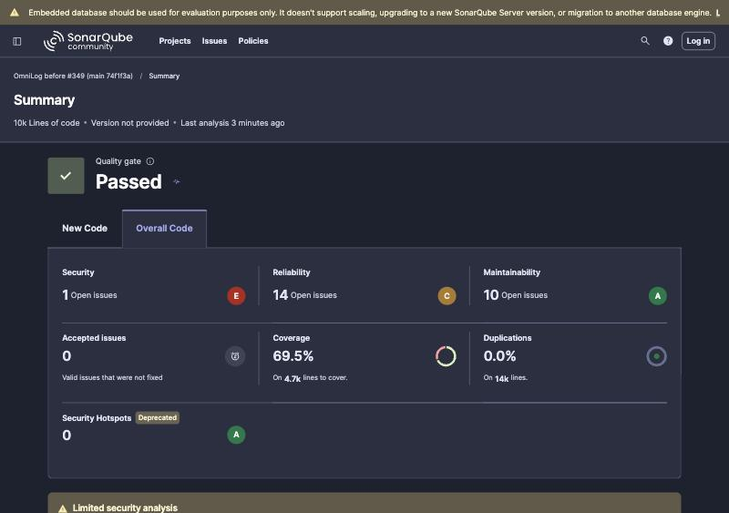
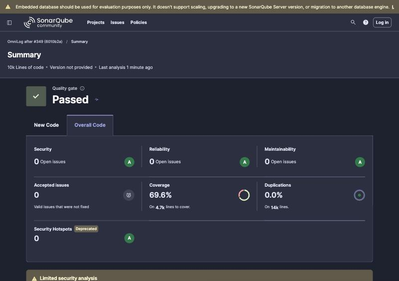
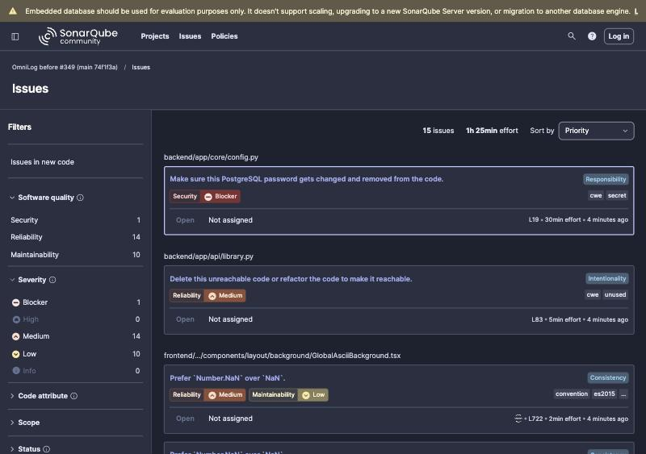
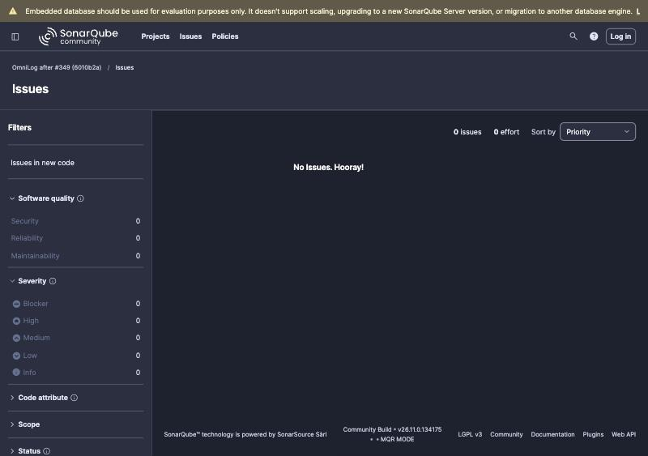

# SonarQube analysis

Issue #299. This feeds the Software Testing Report (#296). The scan was run on 2026-11-25 with SonarQube Community Build 26.11 in Docker on a developer machine, because the CI job cannot run yet (section 5).

## 1. Result

| Measure | First scan (`main` at `74f1f3a`) | After the fixes of this pull request |
|---|---|---|
| Quality gate ("Sonar way") | Passed | **Passed** |
| Bugs | 2 | **0** |
| Vulnerabilities | 1 (Blocker) | **0** |
| Security hotspots | 0 | **0** |
| Code smells | 12 | **0** |
| Duplicated lines | 0.0% | **0.0%** |
| Reliability / security / maintainability rating | C / E / A | **A / A / A** |
| Technical debt | 45 min | **0 min** |
| Lines of code | 10 395 | 10 397 |
| Coverage, whole project | 69.5% | 69.6% |
| Coverage, `backend/app` (4 645 lines) | 95.0% | **95.0%** |
| Coverage, `frontend/src` (5 752 lines) | 41.6% | **41.6%** |

The backend coverage in SonarQube (95.0%) matches `pytest --cov` (94.99%, [coverage](coverage.md)), so the paths in `coverage.xml` are read correctly. SonarQube counts lines and conditions together, so its frontend number (41.6%) is not the same as the line number of Vitest (about 33%).

### Screenshots

Both versions were scanned again on 26.11.2026 into two projects of the same local server, with the same numbers as above. The pages were opened without a login. The project name of the "after" scan says `6010b2a`: that commit has the same code as `6ee1f8d`, which only adds the `Assisted-by` trailer to its message.

| Before (`main` at `74f1f3a`) | After (#349) |
|---|---|
|  |  |
|  |  |

The dashboard of this SonarQube version counts by software quality: 1 security, 14 reliability and 10 maintainability issues before the fixes. These are the same 15 issues as in the table, because one issue can count for two qualities (for example the `Number.NaN` smells count for reliability and maintainability).

## 2. Every finding and what was done

| Rule | Type, severity | Where | Decision |
|---|---|---|---|
| `secrets:S6698` | Vulnerability, Blocker | `backend/app/core/config.py:19` | Real, but only the development password of `docker-compose.yml` in an example comment. The comment now shows `<user>:<password>` |
| `python:S1763` | Bug | `backend/app/api/library.py:83` | Real: a second `raise` after the `except` block could never run. Removed |
| `python:S5863` | Bug | `tests/requirements/test_password_hashing.py:69` | False positive: the test compares two bcrypt hashes of the same password, which differ because of the salt. Rewritten with two named hashes, and both are verified |
| `typescript:S8786` | Code smell | `frontend/src/lib/server/backend.ts:74` | Real but low risk: `/\/+$/` can backtrack on a long run of slashes, and `BACKEND_URL` comes only from the server settings. Replaced by a loop, with a test of 100 000 slashes |
| `typescript:S6853` | Code smell | `frontend/src/components/title/ChapterProgressCard.tsx:116` | Real (accessibility): the playtime label was not linked to its field. `htmlFor` and `id` added, with a test that finds the field by its label. The test failed first |
| `typescript:S7773` (10 times) | Code smell | `frontend/src/components/layout/background/GlobalAsciiBackground.tsx` | Style: `Number.NaN` instead of `NaN` |

No finding was marked as "won't fix" or hidden with an exclusion.

## 3. What the scan covers

`sonar-project.properties` scans `backend/app` and `frontend/src` as code, and `tests` and `frontend/tests` as tests. Migrations, `node_modules`, `.next`, the HTML coverage reports and `__pycache__` are excluded. Coverage comes from `coverage.xml` (pytest-cov) and, since this pull request, from `frontend/coverage/lcov-root.info` (Vitest with the `lcov` reporter, paths moved to the repository root).

## 4. How to repeat it on your machine

1. Start SonarQube (it needs about 2 GB of memory):

   ```bash
   docker run -d --name omnilog-sonarqube -p 127.0.0.1:9000:9000 sonarqube:community
   ```

2. Open `http://localhost:9000`, sign in, change the first password, and create a **global analysis token** (My Account > Security).
3. Make the coverage files from the repository root (PostgreSQL and Redis running):

   ```bash
   python -m pytest tests --cov=backend/app --cov-report=xml
   (cd frontend && npx vitest run --coverage --coverage.reporter=lcov)
   sed 's#^SF:src/#SF:frontend/src/#' frontend/coverage/lcov.info > frontend/coverage/lcov-root.info
   ```

4. Run the scanner from the repository root (`host.docker.internal` reaches the SonarQube of step 1 on Docker Desktop; on Linux add `--add-host host.docker.internal:host-gateway`). Add `-Dsonar.scm.disabled=true` only when the scanner cannot read the git history:

   ```bash
   docker run --rm -v "$PWD":/usr/src -e SONAR_HOST_URL=http://host.docker.internal:9000 -e SONAR_TOKEN=<token> sonarsource/sonar-scanner-cli -Dsonar.projectKey=omnilog -Dsonar.qualitygate.wait=true
   ```

## 5. The CI job

The job "SonarQube" in `.github/workflows/ci.yml` is ready since #322. It needs the backend and the frontend jobs, downloads both coverage reports, scans and waits for the quality gate. It is skipped with a notice while the secret `SONAR_TOKEN` is not set, and that is the state now.

To turn it on, a repository admin must choose one of these, because SonarCloud is free only for **public** repositories and this one is private:

- make the repository public and import it on SonarCloud (free), or
- use a paid SonarCloud plan, or
- run a SonarQube server that GitHub Actions can reach.

Then set the secret `SONAR_TOKEN` and the variables `SONAR_PROJECT_KEY` and `SONAR_ORGANIZATION`, and turn off "Automatic Analysis" on SonarCloud so that only CI scans.
